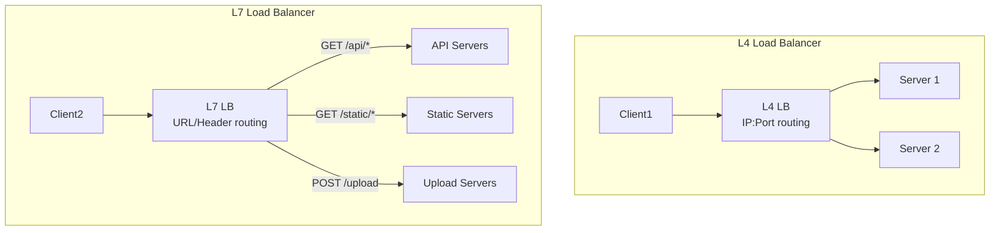
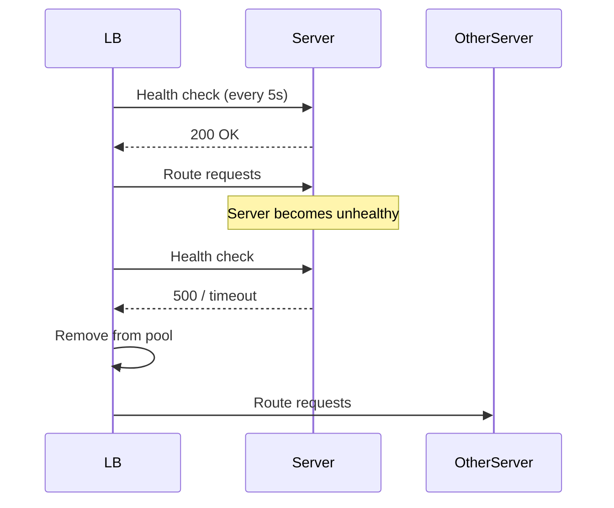
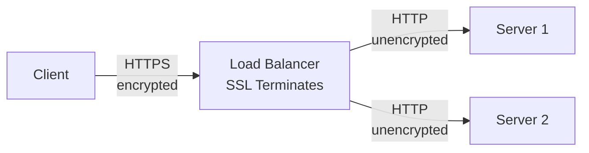
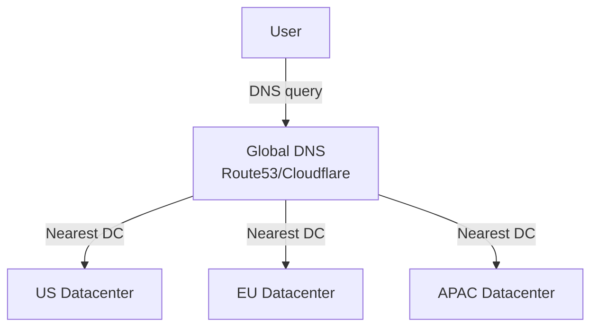
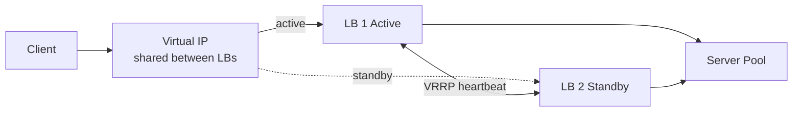

# 06 — Load Balancers

> [!important] Core Idea
> A load balancer distributes incoming traffic across multiple servers to maximize throughput, minimize latency, and avoid overloading any single server. It's the entry point for all horizontal scaling.

---

## L4 vs L7 Load Balancers

| Feature | L4 (Transport Layer) | L7 (Application Layer) |
|---------|---------------------|----------------------|
| Works at | TCP/UDP | HTTP, gRPC, WebSocket |
| Sees | IP, port, connection | URL, headers, cookies, body |
| Speed | Faster (less processing) | Slower (parses packets) |
| Routing intelligence | Low | High (URL-based, header-based) |
| SSL termination | No (pass-through) | Yes |
| Sticky sessions | IP hash | Cookie-based |
| Examples | AWS NLB, HAProxy (TCP) | AWS ALB, Nginx, Envoy |



> [!tip] When to Use L7
> Use L7 when you need URL-based routing, A/B testing, authentication at the edge, SSL termination, or routing different services through the same port. Use L4 when you need raw performance or are load balancing non-HTTP traffic.

---

## Load Balancing Algorithms

### 1. Round Robin
Requests distributed evenly in rotation: S1 → S2 → S3 → S1...

- **Best for:** Homogeneous servers with similar request weights
- **Problem:** Doesn't account for server load or request complexity

### 2. Weighted Round Robin
Servers get requests proportional to weight: S1(weight=3) gets 3x requests of S2(weight=1)

- **Best for:** Heterogeneous servers (different CPU/RAM)
- **Use case:** Gradually shifting traffic during deployments (canary)

### 3. Least Connections
New request goes to server with fewest active connections.

- **Best for:** Long-lived connections (WebSocket, file uploads)
- **Problem:** Doesn't account for connection complexity

### 4. Least Response Time
Route to server with lowest average response time.

- **Best for:** Latency-sensitive services
- **Problem:** Requires response time monitoring

### 5. IP Hash (Sticky by IP)
Hash client IP to determine server. Same IP always goes to same server.

- **Best for:** Stateful applications that need session affinity
- **Problem:** Uneven distribution if many clients behind NAT; breaks if server dies

### 6. Consistent Hashing
Uses a hash ring to distribute connections (see [[14 - Consistent Hashing]])

- **Best for:** Cache clusters, service meshes
- **Advantage:** Minimal redistribution when servers are added/removed

### 7. Random
Randomly select a server.
- Simple, no overhead, surprisingly effective for homogeneous loads

---

## Health Checks

### Active Health Checks (LB polls servers)
```
LB → GET /health → Server
  → 200 OK: server is healthy, include in pool
  → Non-200 or timeout: remove from pool (passive failover)
```

### Passive Health Checks (based on real traffic)
- Monitor error rates and response times from real requests
- If server returns 5xx above threshold, remove from pool



---

## Session Persistence (Sticky Sessions)

### Cookie-based (L7 only)
LB sets a cookie (e.g., `SERVERID=s1`) on first request. Subsequent requests with this cookie go to the same server.

### IP hash (L4 and L7)
Hash client IP → server index. Problem: many users behind corporate NAT share one IP.

> [!warning] Sticky Session Pitfall
> If the sticky server dies, all its sessions are lost and need to re-establish. For stateful data, prefer an external store (Redis) over sticky sessions.

---

## SSL Termination at LB



**Benefits:**
- Servers don't need SSL certs or CPU overhead of SSL
- LB can inspect/route based on headers (impossible with encrypted traffic)
- Centralized certificate management

**With SSL Pass-through (L4):**
- Traffic remains encrypted end-to-end
- LB cannot inspect content
- Required for client certificate authentication (mTLS)

---

## Global Load Balancing (DNS-based)



**Methods:**
- **GeoDNS**: Route based on user's location
- **Latency-based**: Route to region with lowest RTT
- **Failover**: Route to secondary if primary fails
- **Weighted**: Traffic split between regions

**TTL consideration:** Lower TTL = faster failover but more DNS queries

---

## Load Balancer Redundancy



**VRRP/HSRP**: Protocol for virtual IP failover between LBs. If active LB dies, standby takes the VIP.

---

## Common LB Products

| Product | Layer | Notes |
|---------|-------|-------|
| AWS ALB | L7 | Managed, feature-rich, HTTP/gRPC |
| AWS NLB | L4 | Ultra-low latency, preserves source IP |
| Nginx | L4/L7 | Most common self-hosted, also API gateway |
| HAProxy | L4/L7 | High performance, extensive config |
| Envoy | L7 | Service mesh sidecar, Istio default |
| Traefik | L7 | K8s-native, auto service discovery |

---

## Interview Checklist

- [ ] Know L4 vs L7 differences and when to use each
- [ ] Know 3+ load balancing algorithms and their trade-offs
- [ ] Explain sticky sessions and why external session store is better
- [ ] Describe health checks (active vs passive)
- [ ] Know SSL termination and its trade-offs
- [ ] Mention LB redundancy (active-passive with VIP)
- [ ] Know DNS-based global load balancing

---

## Related Notes

- [[01 - Scalability]] — LB is the entry point for horizontal scaling
- [[04 - Availability & Reliability]] — LB provides failover
- [[14 - Consistent Hashing]] — used in LB algorithms for cache clusters
- [[18 - Rate Limiting]] — often implemented at LB layer
