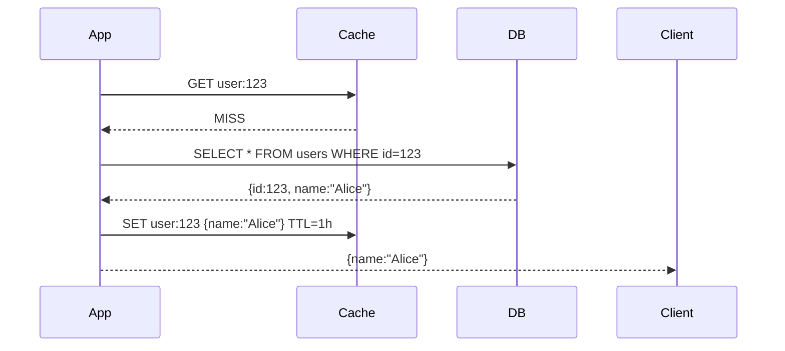
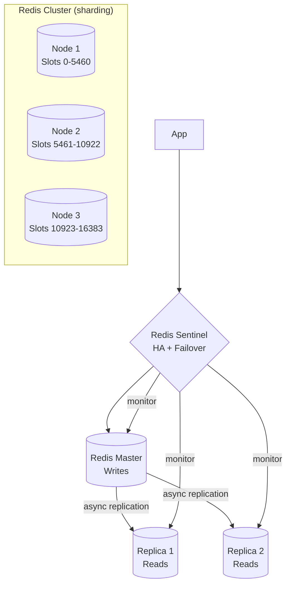

# 07 — Caching

> [!important] Core Idea
> Caching stores frequently accessed data in fast storage (memory) to reduce latency and load on slower systems (databases). It is **the single highest-impact lever** for performance optimization. Cache > DB, always prefer serving from cache.

---

## Cache Strategies

### 1. Cache-Aside (Lazy Loading) — Most Common
Application checks cache first. On miss, loads from DB, writes to cache.



**Pros:** Only caches what's actually used; cache failure doesn't break app  
**Cons:** First request is slow (cold cache); potential for stale data  
**Used for:** Read-heavy workloads, user profile data, product catalogs

### 2. Write-Through
On every write, update DB AND cache simultaneously.

```
Write → Cache → DB  (both updated together)
Read  → Cache (always warm after first write)
```

**Pros:** Cache always has fresh data; no stale reads  
**Cons:** Write latency (2 writes); caches data that may never be read  
**Used for:** When reads follow writes closely (e.g., user settings)

### 3. Write-Behind (Write-Back)
Write to cache, then asynchronously write to DB.

```
Write → Cache (immediate, fast)
       ↓ (async, batched)
       DB
```

**Pros:** Very fast writes  
**Cons:** Risk of data loss if cache crashes before DB write; complex  
**Used for:** High-write-volume systems where slight data loss is acceptable (metrics, analytics counters)

### 4. Read-Through
Cache sits in front of DB. App only talks to cache; cache fetches from DB on miss.

```
App → Cache → DB (on miss, cache fetches and stores)
```

**Pros:** App doesn't need cache logic  
**Cons:** Cold cache penalty; cache becomes single point of failure  
**Used for:** CDN (pull mode), Memcached in some setups

### 5. Refresh-Ahead (Predictive)
Cache proactively refreshes entries before they expire.

```
TTL = 1 hour. At 50min, background job refreshes the cache entry.
```

**Pros:** Eliminates cold cache on popular keys  
**Cons:** May refresh data that won't be read; wasted resources  
**Used for:** Trending content, popular items

---

## Cache Eviction Policies

| Policy | Description | Use Case |
|--------|-------------|----------|
| **LRU** (Least Recently Used) | Evict item not accessed longest | General purpose; most common |
| **LFU** (Least Frequently Used) | Evict item accessed least often | Skewed access patterns |
| **FIFO** | Evict oldest inserted item | Simple queues |
| **TTL** | Evict after time-to-live expires | All cases; often combined with LRU |
| **Random** | Evict random item | Simple, surprisingly effective |
| **MRU** | Evict most recently used | Scanning large datasets |

> [!tip] LRU vs LFU
> - **LRU** is better when recent access predicts future access (most cases)
> - **LFU** is better for content with long-term stable popularity (e.g., home page, popular products) but has high overhead and doesn't adapt to changing patterns
> - Redis uses an **approximated LRU** (samples 5 random keys, evicts least recently used among them) — cheaper than true LRU

---

## Cache Problems and Solutions

### Cache Stampede / Thundering Herd
**Problem:** A cache key expires. Thousands of requests hit DB simultaneously.

```
t=0: Cache key expires
t=0: 10,000 requests query cache → MISS
t=0: 10,000 requests hit DB simultaneously → DB overload
```

**Solutions:**
1. **Mutex/Lock**: First request acquires lock, fetches from DB, populates cache. Others wait.
2. **Probabilistic early expiration**: Expire cache entry slightly before TTL with some probability (prevents synchronized expiry)
3. **Promise/Future**: Return stale data immediately, refresh in background
4. **Leases**: Cache returns a "lease token" on miss; only lease holder can populate cache

### Cache Penetration
**Problem:** Requests for keys that don't exist in DB bypass cache and hit DB every time.

```
Request for user:999999 (doesn't exist)
→ Cache MISS → DB query → Not found
→ Cache MISS → DB query → Not found  (repeated every time)
```

**Solutions:**
1. **Cache null values**: Cache "NOT_FOUND" with short TTL
2. **Bloom filter**: Check if key possibly exists before querying DB → [[19 - Bloom Filters]]

### Cache Avalanche
**Problem:** Many cache keys expire simultaneously (e.g., all set with same TTL). Massive DB load spike.

**Solutions:**
1. **Jitter on TTL**: `TTL = base_TTL + random(0, base_TTL * 0.1)` — stagger expiry
2. **Layered caching**: L1 (local) + L2 (Redis) — L2 expiry doesn't immediately hit DB
3. **Pre-warming**: Populate cache before it goes cold

### Cache Breakdown (Big Key Invalidation)
**Problem:** A very popular ("hot") cache key expires. Simultaneous thundering herd on that one key.

**Solutions:**
1. Never expire hot keys (or use very long TTL)
2. Mutex pattern on cache miss
3. Background refresh before expiry

---

## Redis vs Memcached

| Feature | Redis | Memcached |
|---------|-------|-----------|
| Data structures | Strings, Lists, Sets, ZSets, Hashes, Streams, HyperLogLog | Strings only |
| Persistence | RDB snapshots + AOF log | None |
| Replication | Master-replica + Redis Sentinel/Cluster | External (client-side hashing) |
| Cluster | Redis Cluster (auto-sharding) | Client-side sharding |
| Lua scripting | Yes | No |
| Pub/Sub | Yes | No |
| Transactions | Yes (MULTI/EXEC) | No |
| Memory efficiency | Good (but overhead per key) | Better for pure string caching |
| Performance | ~100K-1M ops/sec | ~100K-1M ops/sec |

> [!tip] When to Choose
> **Redis**: Almost always. Rich data structures (leaderboard = ZSet, session = Hash, pub/sub = Streams). Persistence for warm restart.  
> **Memcached**: Pure string caching at massive scale; multi-threaded better for CPU-bound scenarios; simpler horizontal scaling

---

## Redis Architecture for Scale



**Redis Cluster:**
- 16,384 hash slots partitioned across nodes
- `hash_slot = CRC16(key) % 16384`
- Each node has a primary + replica
- Automatic failover if primary goes down

---

## Cache Hit Rate and Sizing

```
Hit rate = Cache Hits / (Cache Hits + Misses)

A good hit rate is ≥ 90-95% for most systems.

To estimate cache size needed:
  If top 20% of items get 80% of reads (Pareto):
    Cache the top 20% of data
  
  Example:
    Total data: 100GB
    Cache 20%: 20GB
    Expected hit rate: ~80%+
```

> [!question] Interview Q: How much cache do you need?
> Estimate the "working set" — the data accessed in a given time window. For most applications, 20% of data gets 80% of reads. Cache that 20%. For a 1TB dataset, a 200GB Redis cluster gets you ~80% hit rate.

---

## Distributed Caching

For large-scale:
1. **Client-side sharding**: Client decides which cache node based on key hash
2. **Consistent hashing**: Minimal key movement when nodes added/removed → [[14 - Consistent Hashing]]
3. **Redis Cluster**: Built-in sharding with gossip protocol for node discovery

---

## Caching at Different Layers

```
Browser cache        ← HTTP Cache-Control headers
CDN cache            ← Edge caching (CloudFront, Cloudflare) → [[09 - CDN]]
API Gateway cache    ← Cache response for identical requests
Application cache    ← In-process cache (Guava, Caffeine)
Distributed cache    ← Redis, Memcached
Database cache       ← Query cache, buffer pool (MySQL InnoDB)
```

---

## Interview Checklist

- [ ] Know all 5 cache strategies and when to use each
- [ ] Know LRU, LFU, TTL eviction and trade-offs
- [ ] Explain cache stampede with solution (mutex, jitter)
- [ ] Explain cache penetration with solution (null caching, bloom filter)
- [ ] Explain cache avalanche with solution (TTL jitter)
- [ ] Know Redis vs Memcached trade-offs
- [ ] Know Redis Sentinel vs Cluster
- [ ] Estimate hit rate and cache sizing

---

## Related Notes

- [[09 - CDN]] — CDN is a type of cache at the network edge
- [[07 - Caching]] → [[14 - Consistent Hashing]] for distributed cache sharding
- [[19 - Bloom Filters]] — used to prevent cache penetration
- [[SD01 - URL Shortener]] — cache for redirect lookups
