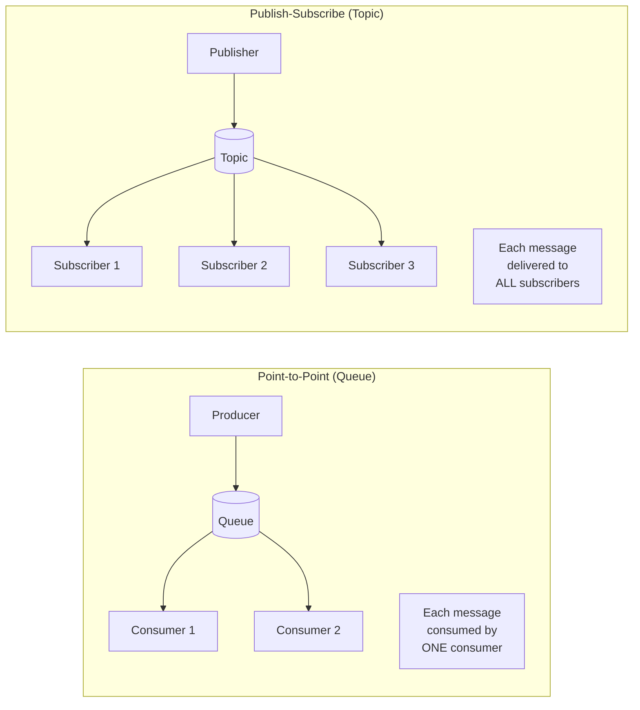
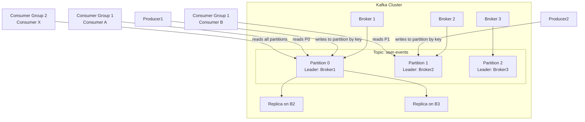
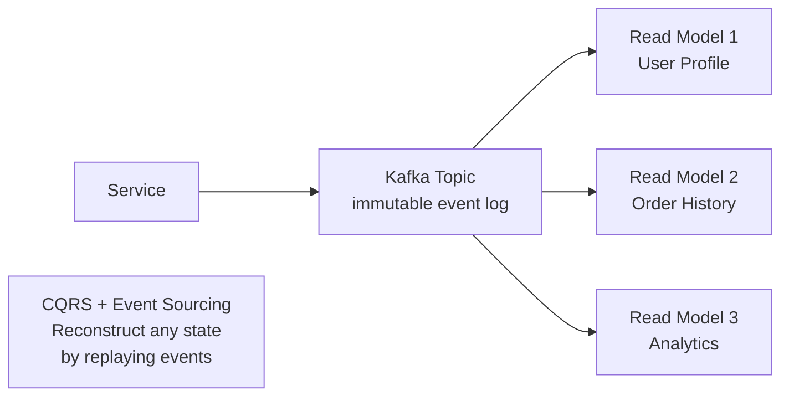

# 08 — Message Queues

> [!important] Core Idea
> Message queues **decouple producers from consumers**, enabling async processing. Producer sends a message and continues. Consumer processes at its own pace. This is the primary tool for handling bursty traffic, enabling retries, and building resilient systems.

---

## Why Message Queues?

```
Without MQ (synchronous):
  API → [heavy processing] → Response
  → User waits for processing
  → If processing fails, request fails
  → Can't scale producer and consumer independently

With MQ (asynchronous):
  API → Queue → [workers] → Done
  → User gets immediate acknowledgment
  → Failures are retried automatically
  → Scale workers independently
```

**Use cases:**
- Email/notification sending (don't block API on email SMTP)
- Image/video processing (transcoding after upload)
- Order processing (decouple checkout from inventory/payment)
- Log ingestion (buffer writes to slow storage)
- Event sourcing (Kafka as immutable event log)

---

## Point-to-Point vs Pub-Sub



| Feature | Point-to-Point | Pub-Sub |
|---------|---------------|---------|
| Message delivered to | One consumer | All subscribers |
| Consumer groups | Single consumer pulls | Multiple independent subscribers |
| Use case | Task queue, work distribution | Event broadcasting, fan-out |
| Examples | SQS, RabbitMQ (queue) | Kafka, SNS, Google Pub/Sub |

---

## Kafka Architecture (Deep Dive)

Kafka is the industry standard for high-throughput event streaming at FAANG.



### Key Kafka Concepts

**Topic**: A named stream of records. Append-only log.

**Partition**: A topic is split into N ordered partitions. Parallelism = number of partitions.

**Offset**: Position of a record within a partition. Consumer tracks offset to know where it left off.

**Consumer Group**: A group of consumers that collectively consume a topic.
- Each partition is consumed by exactly ONE consumer in a group
- Multiple groups can independently consume the same topic
- Scale consumers = scale partitions (max consumers = partitions)

**Broker**: A Kafka server. Topic partitions are distributed across brokers.

**Replication Factor**: How many copies of each partition exist. `replication_factor=3` means 3 brokers have a copy.

**ISR (In-Sync Replicas)**: Set of replicas fully caught up with the leader.

```
Write flow:
  Producer → Leader partition
  Leader writes to local log
  Followers pull from leader
  Leader acknowledges producer after ISR replicated

acks=0: Fire and forget (may lose messages)
acks=1: Leader acknowledged (may lose if leader fails before follower replication)
acks=all: All ISR replicated (strongest durability guarantee)
```

### Kafka Retention
- Kafka is a **log**, not a queue. Messages are NOT deleted after consumption.
- Retention by time (default 7 days) or size
- Consumers can replay from any offset (great for event sourcing, debugging)

---

## Message Delivery Semantics

| Semantic | Description | How | Use Case |
|----------|-------------|-----|---------|
| **At-most-once** | May lose messages, never duplicates | Don't retry; auto-commit offset before processing | Metrics, non-critical |
| **At-least-once** | Never loses, may duplicate | Retry on failure; commit offset AFTER processing | Most cases; idempotent consumers |
| **Exactly-once** | No loss, no duplicates | Kafka transactions + idempotent producer | Financial transactions |

> [!warning] Exactly-Once is Hard
> True exactly-once requires distributed transactions across producer, broker, and consumer. Kafka supports it since 0.11 with idempotent producers + transactions, but it has performance overhead. Most systems use at-least-once with idempotent consumers.

**Making at-least-once safe:** Design consumer operations to be **idempotent** — applying the same message twice has the same effect as applying it once.

```python
# Non-idempotent (dangerous with at-least-once):
balance += 100  # If processed twice, balance increases by 200

# Idempotent (safe with at-least-once):
payment_table.insert_or_ignore(payment_id=xyz, amount=100)
# Second insert with same payment_id is ignored
```

---

## Dead Letter Queue (DLQ)

Messages that fail processing N times are moved to a DLQ for investigation.

```
Queue → Consumer (fails 3 times) → DLQ
                                    ↓
                              Alert/Investigation
                              Manual replay or discard
```

**Essential for production.** Without DLQ, poison pill messages block the queue forever.

---

## Ordering Guarantees

| Level | Guarantee | How |
|-------|-----------|-----|
| Partition-level | Ordered within a partition | All messages with same key → same partition |
| Topic-level | No global order | N/A (unless 1 partition, but loses parallelism) |

```
Order-sensitive data (user events for user 123):
  → Always publish with key = user_id
  → All messages from user 123 go to same partition
  → Consumed in order by one consumer

Order-insensitive (log events):
  → Round-robin partitioning for maximum parallelism
```

---

## Kafka vs Other Systems

| System | Type | Throughput | Retention | Ordering | Delivery |
|--------|------|-----------|-----------|----------|---------|
| **Kafka** | Distributed log | Very High | Days-forever | Partition-level | At-least-once, exactly-once |
| **RabbitMQ** | Message broker | High | Until consumed | Queue-level | At-most/least/exactly-once |
| **AWS SQS** | Managed queue | High | 14 days | Best-effort | At-least-once |
| **AWS SQS FIFO** | Managed queue | Lower | 14 days | Strict FIFO | Exactly-once |
| **AWS SNS** | Pub-Sub | High | None (push) | No | At-least-once |
| **AWS Kinesis** | Managed streaming | High | 1-365 days | Shard-level | At-least-once |
| **Google Pub/Sub** | Managed pub-sub | High | 7 days | No global | At-least-once |

---

## Consumer Lag Monitoring

Critical production metric:
```
Consumer Lag = Latest Offset - Consumer Current Offset
            = Messages waiting to be processed

High lag → consumers can't keep up → may need more consumers
           (but limited by number of partitions!)
```

---

## Kafka for Event Sourcing



Kafka as the "source of truth" for event-driven architectures (CQRS pattern).

---

## Interview Checklist

- [ ] Explain point-to-point vs pub-sub with use cases
- [ ] Deep dive: Kafka partitions, consumer groups, offsets
- [ ] Know at-most/at-least/exactly-once semantics
- [ ] Explain why at-least-once + idempotent consumer = safe
- [ ] Know DLQ and why it's essential
- [ ] Know ordering: partition-level with key-based routing
- [ ] Compare Kafka vs SQS vs RabbitMQ for a given scenario
- [ ] Know consumer lag and scaling consumers with partitions

---

## Related Notes

- [[04 - Availability & Reliability]] — MQ improves reliability via decoupling and retry
- [[SD02 - Chat System (WhatsApp)]] — message queue for offline message delivery
- [[SD04 - YouTube]] — queue for video transcoding jobs
- [[SD09 - Notification System]] — queue for notification delivery
