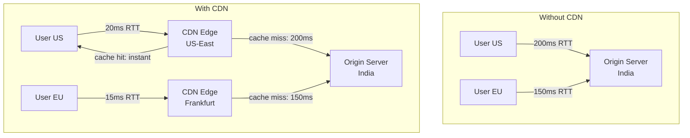
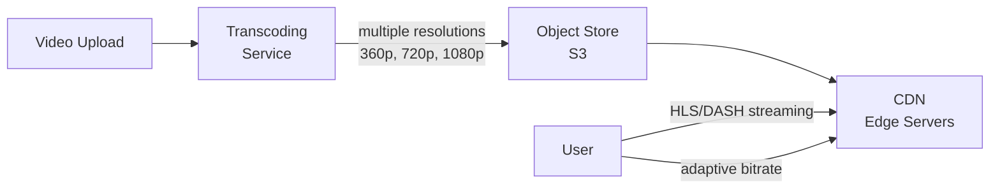

# 09 — Content Delivery Network (CDN)

> [!important] Core Idea
> A CDN is a geographically distributed network of edge servers that cache content close to users. Instead of every user hitting your origin servers, they hit a nearby edge server — reducing latency and origin load.

---

## How CDN Works



**Anycast routing**: User's DNS request resolves to the nearest CDN edge server IP.

---

## Push CDN vs Pull CDN

### Pull CDN (Most Common)
Content pulled from origin on first request. Edge caches it for subsequent requests.

```
First request:
  User → CDN Edge → Origin (cache MISS) → CDN caches response
  
Subsequent requests (until TTL expires):
  User → CDN Edge (cache HIT, no origin call)
```

**Pros:** Simple to configure; origin controls caching via Cache-Control headers  
**Cons:** First user gets higher latency (cold cache); "first user problem"  
**Used for:** Dynamic websites, APIs with infrequent updates

### Push CDN
Content pre-populated to CDN before any user requests it.

```
You push content to CDN:
  Origin → upload content to CDN → CDN distributes to all edge nodes

User requests:
  User → CDN Edge (always HIT after push)
```

**Pros:** No cache misses; good for known-popular content  
**Cons:** Must manage content lifecycle; CDN storage costs; not for dynamic content  
**Used for:** Software downloads, large media files, games

---

## What to Cache at CDN

| Content Type | Cache? | TTL | Notes |
|-------------|--------|-----|-------|
| Static assets (CSS, JS, images) | ✅ Always | Days-years | Use content-hashed URLs for invalidation |
| Video content | ✅ Always | Days | Large files; CDN is essential |
| API responses (public, same for all) | ✅ Sometimes | Minutes | e.g., trending items list |
| User-specific API responses | ❌ No | — | Cache-Control: private |
| HTML pages (static) | ✅ Yes | Hours-days | |
| HTML pages (dynamic, personalized) | ⚠️ Edge cases | Seconds | ESI (Edge Side Includes) |

---

## Cache-Control Headers

```http
Cache-Control: max-age=86400, public          # Cache for 1 day, shareable
Cache-Control: max-age=3600, private           # Cache for 1hr, browser only (not CDN)
Cache-Control: no-cache                        # Must revalidate before serving
Cache-Control: no-store                        # Never cache
Cache-Control: s-maxage=86400                  # CDN cache duration (overrides max-age for CDN)
Cache-Control: stale-while-revalidate=60       # Serve stale for 60s while refreshing
```

---

## Cache Invalidation at CDN

The hardest problem in CDN usage:

### 1. TTL-based Expiry
Set short TTL for frequently changing content. Simple but means stale content until TTL.

### 2. Immutable URLs (Best Practice)
```
bad: /styles/main.css (invalidation needed on each update)
good: /styles/main.abc123.css (hash of content in filename)
```
When content changes, URL changes. Browser/CDN caches old URL indefinitely. Users get new URL from HTML.

### 3. API Invalidation
CDN providers offer invalidation APIs:
```bash
aws cloudfront create-invalidation --distribution-id ABCDEF --paths "/api/trending/*"
```
- Use sparingly — invalidation costs money and takes ~30 seconds to propagate
- Better: design around short TTLs

### 4. Cache Tagging (Surrogate-Control)
Tag responses with related keys. Invalidate all tagged responses at once.
```http
Surrogate-Key: product-123 category-shoes brand-nike
```
Invalidating `product-123` tag removes all responses tagged with it.

---

## CDN for Video Streaming



**Adaptive Bitrate Streaming:**
- Video split into small segments (2-6 seconds each)
- Multiple quality levels pre-encoded
- Player monitors bandwidth, switches quality in real-time
- CDN serves segments from edge (low latency per segment)

---

## Netflix's Open Connect (Custom CDN)

Netflix built their own CDN:
- **Open Connect Appliances (OCAs)**: Custom servers placed inside ISP networks
- Each OCA stores a subset of Netflix's catalog (most popular in that region)
- ISPs get free hardware, Netflix gets lower CDN costs (no bandwidth fees to transit)
- **Proactive caching**: Netflix pushes that evening's popular content to OCAs before peak hours

> [!tip] This is an advanced point that impresses interviewers when designing Netflix

---

## CDN Security Features

| Feature | Use |
|---------|-----|
| DDoS protection | Absorbs attack at edge (Cloudflare absorbs Tbps attacks) |
| WAF (Web App Firewall) | Block SQL injection, XSS at edge |
| Bot protection | Rate limit bots, CAPTCHAs |
| Geo-blocking | Restrict access by country |
| Signed URLs | Time-limited access to protected content |
| SSL/TLS termination | Handle HTTPS at edge |

---

## CDN Providers Comparison

| Provider | Strengths | Notes |
|---------|-----------|-------|
| Cloudflare | DDoS protection, global coverage, free tier | Largest network |
| AWS CloudFront | AWS ecosystem integration | Easy with S3, Lambda@Edge |
| Akamai | Enterprise, oldest CDN | Largest by PoP count |
| Fastly | Real-time purging, VCL customization | Popular for API caching |
| Google Cloud CDN | GCP integration, fast globally | Good with Cloud Storage |

---

## Interview Checklist

- [ ] Explain pull vs push CDN with use cases
- [ ] Know Cache-Control headers and what each does
- [ ] Explain cache invalidation strategies (TTL, immutable URLs, API purge)
- [ ] Know what SHOULD and SHOULD NOT be cached at CDN
- [ ] Explain CDN for video streaming (adaptive bitrate, HLS/DASH)
- [ ] Mention CDN security (DDoS, WAF, signed URLs)
- [ ] Know Netflix Open Connect for extra credit on Netflix design

---

## Related Notes

- [[07 - Caching]] — CDN is caching at network edge
- [[SD04 - YouTube]] — CDN is core to video streaming design
- [[SD12 - Netflix]] — Open Connect CDN design
- [[SD03 - Instagram]] — CDN for image/photo delivery
