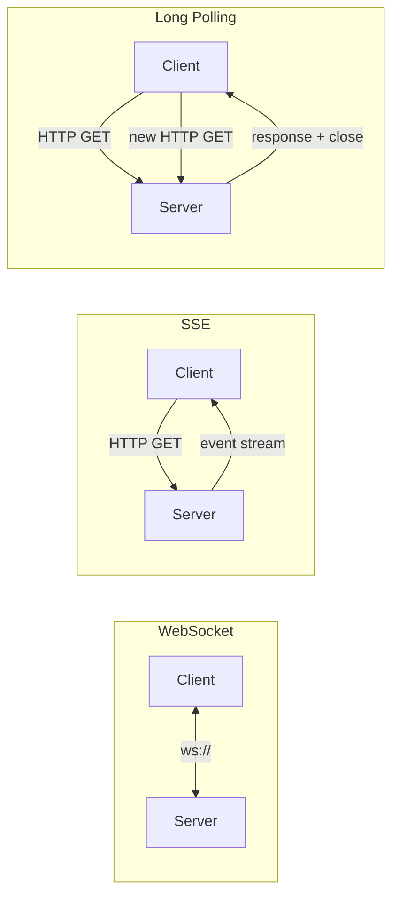
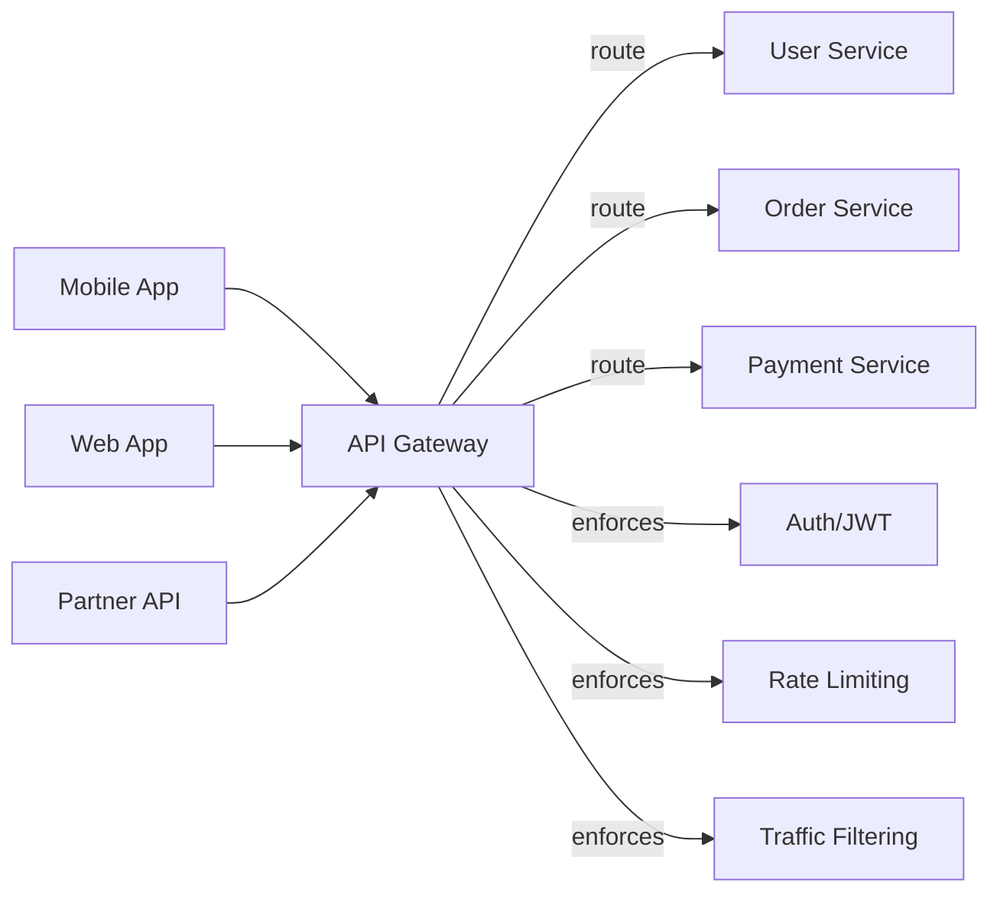

# 10 — API Design

> [!important] Core Idea
> API design determines how clients communicate with your system. REST is the default, gRPC for microservice-to-microservice, GraphQL for flexible client queries, and WebSockets for real-time bidirectional communication.

---

## REST API Design Principles

### HTTP Methods
| Method | Operation | Idempotent? | Safe? |
|--------|-----------|------------|-------|
| GET | Read | ✅ Yes | ✅ Yes |
| POST | Create | ❌ No | ❌ No |
| PUT | Replace (full update) | ✅ Yes | ❌ No |
| PATCH | Partial update | ❌ No | ❌ No |
| DELETE | Delete | ✅ Yes | ❌ No |

**Idempotent**: Same request multiple times = same result  
**Safe**: Request doesn't change server state

### HTTP Status Codes
```
2xx Success:
  200 OK             → GET, PUT, PATCH success
  201 Created        → POST creates resource
  202 Accepted       → Async operation started
  204 No Content     → DELETE success, no body

3xx Redirect:
  301 Moved Permanently → Resource moved
  304 Not Modified      → Conditional GET (use cache)

4xx Client Error:
  400 Bad Request    → Invalid request syntax
  401 Unauthorized   → Not authenticated (login required)
  403 Forbidden      → Authenticated but not authorized
  404 Not Found      → Resource doesn't exist
  409 Conflict       → State conflict (duplicate, version mismatch)
  422 Unprocessable  → Validation failed
  429 Too Many Req   → Rate limited

5xx Server Error:
  500 Internal Error → Server bug
  502 Bad Gateway    → Upstream error
  503 Service Unavail→ Overloaded or down
  504 Gateway Timeout→ Upstream timeout
```

---

## REST API Best Practices

### URL Design
```
# Good: noun-based, hierarchical
GET  /api/v1/users/123
GET  /api/v1/users/123/posts
POST /api/v1/users/123/posts
GET  /api/v1/users/123/posts/456

# Bad: verbs in URL
GET /api/getUser?id=123
POST /api/createPost
GET /api/deletePost?id=456
```

### Versioning Strategies
| Strategy | Example | Pros | Cons |
|----------|---------|------|------|
| URL path | `/api/v1/users` | Simple, explicit | URL changes with version |
| Header | `API-Version: 1` | Clean URLs | Less visible, harder to test |
| Query param | `/api/users?version=1` | Simple | Pollutes query string |
| Content negotiation | `Accept: application/vnd.api+json;version=1` | HTTP-native | Complex |

> [!tip] Recommendation
> Use URL versioning (`/api/v1/`) for external APIs. Header versioning for internal APIs where clean URLs matter.

### Pagination
```
# Offset-based (simple but has problems)
GET /api/posts?page=3&page_size=20
→ Problem: items can shift between pages if new items inserted

# Cursor-based (recommended for feeds)
GET /api/posts?cursor=eyJpZCI6MTIzfQ&limit=20
→ cursor = base64 encoded last seen item
→ Stable even with insertions/deletions
→ Used by: Twitter, Instagram, Facebook feeds

# Keyset pagination (for ordered data)
GET /api/posts?after_id=123&limit=20
→ SELECT * FROM posts WHERE id > 123 LIMIT 20
→ Very fast with B-tree index on id
```

### Idempotency Keys
For non-idempotent operations (POST), add idempotency key to enable safe retries:
```
POST /api/v1/payments
Idempotency-Key: uuid-from-client

# If same key sent again (retry):
→ Return the same response as the original request
→ Don't charge the user twice
```
Stripe, Braintree use this pattern.

---

## gRPC

gRPC is a high-performance RPC framework using HTTP/2 and Protocol Buffers.

```protobuf
// Define service in .proto file
service UserService {
  rpc GetUser(GetUserRequest) returns (User);
  rpc ListUsers(ListUsersRequest) returns (stream User);  // server streaming
  rpc Chat(stream ChatMessage) returns (stream ChatMessage);  // bidirectional
}

message User {
  int64 id = 1;
  string name = 2;
  string email = 3;
}
```

| Feature | REST | gRPC |
|---------|------|------|
| Protocol | HTTP/1.1 | HTTP/2 |
| Data format | JSON (text) | Protocol Buffers (binary) |
| Schema | OpenAPI (optional) | .proto (required) |
| Code generation | Manual/Swagger | Automatic |
| Streaming | No | Yes (client, server, bidirectional) |
| Browser support | Native | Needs grpc-web proxy |
| Performance | Good | ~5-10x better than JSON REST |
| Human readable | Yes | No (binary) |

> [!tip] When to Use gRPC
> - **Microservice-to-microservice** communication (internal, high throughput)
> - **Streaming** needs (bidirectional, e.g., chat, telemetry)
> - **Polyglot** microservices (auto-generates client code in any language)
> - **NOT recommended** for public APIs (browser support is limited)

---

## GraphQL

Client specifies exactly what data it needs. Avoids over-fetching and under-fetching.

```graphql
# Client requests exactly what it needs
query {
  user(id: "123") {
    name
    email
    posts(last: 5) {
      title
      createdAt
    }
  }
}
```

### GraphQL Problems

**N+1 Problem:** Fetching a list of users with their posts:
```
1 query: Get 100 users
100 queries: Get posts for each user (N+1!)
```
**Solution:** DataLoader (batch and deduplicate queries)

**Overfetching in resolvers:** Resolvers may fetch from DB even if client didn't request that field  
**Solution:** DataLoader, field-level authorization, persisted queries

**Schema evolution:** Adding required fields can break existing clients  
**Solution:** Non-null fields sparingly; deprecation over deletion

> [!tip] When to Use GraphQL
> - Multiple clients with different data needs (mobile vs web)
> - Rapidly evolving frontend requirements
> - BFF (Backend for Frontend) pattern
> - NOT good for: simple CRUD, real-time (use subscriptions carefully), file upload

---

## WebSockets vs SSE vs Long Polling

### Long Polling
```
Client: GET /events (holds connection open)
Server: [waits until event available]
Server: Returns event data
Client: Immediately opens new GET /events
```
- Works with HTTP/1.1, simple
- Server needs to hold many connections
- One direction (server → client)

### Server-Sent Events (SSE)
```
Client: GET /stream  (persistent HTTP connection)
Server: data: {"event": "message", "id": 123}\n\n
Server: data: {"event": "typing"}\n\n
```
- Built on HTTP, simpler than WebSocket
- One direction only: server → client
- Auto-reconnect built into browser
- Good for: notifications, live feeds

### WebSocket
```
Client: HTTP Upgrade request
Server: 101 Switching Protocols
Both: Bidirectional message exchange over TCP connection
```
- True bidirectional
- Lower overhead per message than HTTP
- Good for: chat, collaborative editing, gaming, live auctions



| Method | Direction | Protocol | Browser Support | Use Case |
|--------|-----------|---------|----------------|---------|
| Long Polling | Server→Client | HTTP | All | Legacy, simple |
| SSE | Server→Client | HTTP | Modern browsers | Notifications, feeds |
| WebSocket | Bidirectional | WS | All modern | Chat, gaming, collab |
| gRPC streaming | Bidirectional | HTTP/2 | grpc-web proxy | Microservices |

---

## API Gateway

A single entry point for all clients:



**API Gateway responsibilities:**
- Authentication & Authorization (JWT verification)
- Rate limiting → [[18 - Rate Limiting]]
- SSL termination
- Request routing
- Request/response transformation
- Logging and monitoring
- API versioning

**Products:** AWS API Gateway, Kong, Nginx, Envoy, Traefik

---

## Rate Limiting in APIs

```http
# Response headers from rate-limited API
X-RateLimit-Limit: 1000
X-RateLimit-Remaining: 950
X-RateLimit-Reset: 1640000000   # Unix timestamp when limit resets
Retry-After: 60                  # Seconds to wait (on 429 response)
```

→ See [[18 - Rate Limiting]] for algorithm details

---

## Interview Checklist

- [ ] Know REST HTTP methods, status codes, URL design
- [ ] Know 3 pagination strategies and when to use cursor-based
- [ ] Know idempotency keys and why they matter
- [ ] Compare REST vs gRPC vs GraphQL with use cases
- [ ] Know WebSocket vs SSE vs Long Polling with use cases
- [ ] Know API Gateway pattern and what it handles
- [ ] GraphQL N+1 problem and DataLoader solution

---

## Related Notes

- [[18 - Rate Limiting]] — rate limiting at API gateway
- [[06 - Load Balancers]] — L7 LB often acts as API gateway
- [[SD02 - Chat System (WhatsApp)]] — WebSocket usage
- [[04 - Availability & Reliability]] — retry with idempotency
