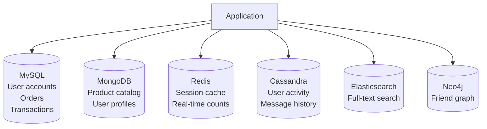

# 11 — SQL vs NoSQL

> [!important] Core Idea
> SQL databases guarantee ACID properties and are best for structured, relational data with complex queries. NoSQL databases sacrifice some guarantees for horizontal scalability, flexible schemas, and specific access patterns.

---

## ACID (SQL) vs BASE (NoSQL)

### ACID Properties (Relational DBs)
| Property | Meaning |
|----------|---------|
| **A**tomicity | Transaction is all-or-nothing |
| **C**onsistency | DB transitions from one valid state to another |
| **I**solation | Concurrent transactions don't interfere |
| **D**urability | Committed transactions survive crashes |

### BASE Properties (NoSQL)
| Property | Meaning |
|----------|---------|
| **B**asically Available | System is available (may return stale data) |
| **S**oft State | State may change over time without input |
| **E**ventually Consistent | Will become consistent given time |

---

## When to Use SQL

- **Structured data** with a defined schema
- **Relationships** between entities (JOINs)
- **Complex queries** and reporting
- **Transactions** spanning multiple records (financial, inventory)
- **Data integrity** is critical (foreign keys, constraints)

**Examples:** PostgreSQL, MySQL, Amazon Aurora, Google Cloud Spanner

```sql
-- SQL shines here: complex relational query
SELECT u.name, COUNT(o.id) as order_count, SUM(o.total) as revenue
FROM users u
JOIN orders o ON u.id = o.user_id
WHERE o.created_at > '2024-01-01'
GROUP BY u.id
HAVING COUNT(o.id) > 5
ORDER BY revenue DESC;
```

---

## NoSQL Types

### 1. Key-Value Store
Simplest NoSQL. Value is opaque blob. Ultra-fast O(1) lookups.

```
key: "user:123:session"
value: "{token: 'abc', expires: 1234567890}"
```

| Database | Use Case |
|----------|---------|
| **Redis** | Session store, cache, real-time leaderboards |
| **DynamoDB** | Any key-value at AWS scale |
| **Memcached** | Pure caching |

**Best for:** Sessions, caching, shopping carts, user preferences, distributed locks

---

### 2. Document Store
Stores JSON/BSON documents. Rich query support within documents.

```json
{
  "_id": "user123",
  "name": "Alice",
  "email": "alice@example.com",
  "addresses": [
    {"type": "home", "city": "NYC"},
    {"type": "work", "city": "Boston"}
  ],
  "preferences": {"theme": "dark"}
}
```

| Database | Use Case |
|----------|---------|
| **MongoDB** | Product catalogs, user profiles, content |
| **CouchDB** | Offline-first, sync |
| **Firestore** | Firebase mobile apps |

**Best for:** Product catalogs, user profiles, content management, semi-structured data

**Limitations:** No JOINs (application-side joins); complex transactions require MongoDB 4.0+ multi-document transactions

---

### 3. Column-Family Store (Wide Column)
Data organized in column families. Optimized for writes and time-series data.

```
Row key: user123
Column family: profile: {name: "Alice", email: "..."}
Column family: activity: {login_time: ..., page_views: ...}
```

| Database | Use Case |
|----------|---------|
| **Cassandra** | Time-series, IoT, messaging, social media |
| **HBase** | Hadoop ecosystem, large-scale analytics |
| **Bigtable** | Google's infrastructure (Gmail, YouTube) |

**Best for:** Time-series data, IoT sensor data, user activity logs, messaging at scale

**Key design:** **Denormalize for your queries**. Cassandra query pattern must match table design.

```cassandra
-- Design table around query: "Get messages for user X in room Y"
CREATE TABLE messages (
  room_id UUID,
  user_id UUID,
  message_id TIMEUUID,
  content TEXT,
  PRIMARY KEY ((room_id), message_id)  -- partition by room, cluster by time
) WITH CLUSTERING ORDER BY (message_id DESC);
```

---

### 4. Graph Database
Optimized for relationship traversal. Vertices (nodes) and edges (relationships).

```
(Alice)-[:FOLLOWS]->(Bob)-[:FOLLOWS]->(Charlie)
(Alice)-[:LIKES]->(Post123)
```

| Database | Use Case |
|----------|---------|
| **Neo4j** | Social networks, fraud detection |
| **Amazon Neptune** | Managed graph DB |
| **ArangoDB** | Multi-model |

**Best for:** Social networks (friend-of-friend), recommendation engines, fraud detection, knowledge graphs

**Limitation:** Hard to distribute/shard (relationships cross nodes)

---

## Choosing SQL vs NoSQL: Decision Framework

```
Step 1: Does the data have complex relationships requiring JOINs?
  → Yes: SQL

Step 2: Do you need ACID transactions across multiple rows/tables?
  → Yes: SQL (or MongoDB 4+, but SQL is simpler)

Step 3: Is the schema constantly changing / semi-structured?
  → Yes: Document (MongoDB) or Key-Value

Step 4: Is write throughput the primary concern (millions of writes/sec)?
  → Yes: Cassandra (wide column) or DynamoDB

Step 5: Is it time-series data (IoT, logs, metrics)?
  → Yes: Cassandra, InfluxDB, TimescaleDB

Step 6: Is it a graph structure (relationships)?
  → Yes: Neo4j, Neptune

Step 7: Is it primarily caching or session storage?
  → Yes: Redis
```

---

## Polyglot Persistence

Using multiple database types in one system based on use case:



> [!warning] Polyglot Complexity
> Each database is another system to operate, monitor, back up, and scale. Start simple (often PostgreSQL can handle more than you think) and add specialized DBs when you have a clear need.

---

## SQL Scaling Strategies

When SQL doesn't scale enough:
1. **Read replicas**: Route reads to replicas → [[12 - Database Replication]]
2. **Caching**: Redis in front of DB → [[07 - Caching]]
3. **Vertical scaling**: Bigger instance
4. **Partitioning (sharding)**: Horizontal split → [[13 - Database Sharding]]
5. **Denormalization**: Reduce JOINs for performance
6. **Move to NoSQL**: For the specific access pattern

---

## Interview Checklist

- [ ] Know ACID vs BASE properties
- [ ] Know 4 NoSQL types with examples and use cases
- [ ] Decision framework: when to use SQL vs which NoSQL
- [ ] Know Cassandra's data model principle (design for queries)
- [ ] Know polyglot persistence and its trade-offs
- [ ] Know SQL scaling strategies before recommending NoSQL

---

## Related Notes

- [[12 - Database Replication]] — scaling reads
- [[13 - Database Sharding]] — scaling writes
- [[14 - Consistent Hashing]] — distributing NoSQL data
- [[02 - CAP Theorem]] — SQL=CP (mostly), NoSQL varies
