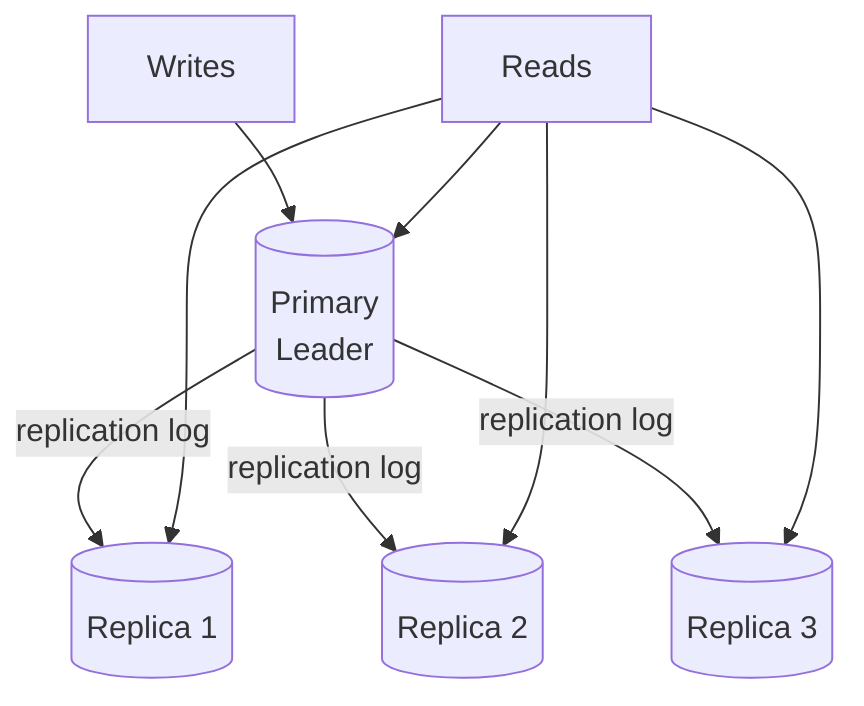
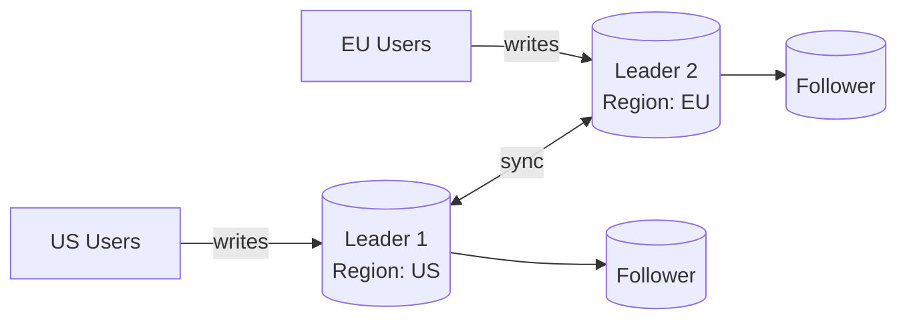
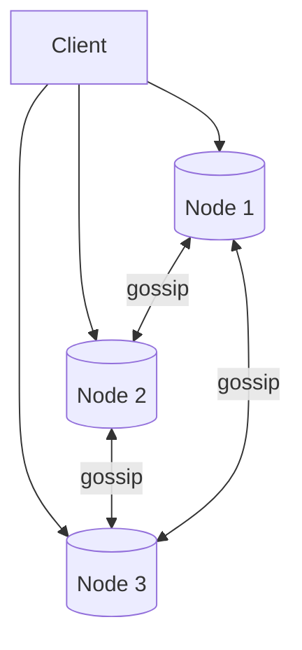

# 12 — Database Replication

> [!important] Core Idea
> Replication copies data to multiple nodes for **availability, fault tolerance, and read scaling**. The challenge: keeping replicas in sync creates consistency trade-offs.

---

## Why Replicate?

1. **High availability**: If primary dies, replica takes over
2. **Read scaling**: Route reads to replicas (primary handles writes)
3. **Geographic distribution**: Put replicas near users to reduce latency
4. **Disaster recovery**: Replicas in different AZ/region

---

## Leader-Follower (Master-Slave)

One primary (leader) accepts writes. Multiple replicas (followers) replicate from primary and accept reads.



### Replication Log Methods

| Method | How | Pros | Cons |
|--------|-----|------|------|
| **Statement-based** | Replicate SQL statements | Small log size | Non-deterministic functions (NOW(), RAND()) |
| **Row-based (WAL)** | Replicate actual row changes | Deterministic | Larger log size |
| **Logical log** | Higher-level change log | DB-version independent | Medium complexity |

**Most DBs use row-based (WAL - Write-Ahead Log).**

### Sync vs Async Replication

**Synchronous:**
```
Primary writes → waits for replica ACK → returns success to client
Guarantee: No data loss if primary crashes (replica has all data)
Cost: Higher write latency; if replica is slow, primary blocks
```

**Asynchronous (default for most):**
```
Primary writes → returns success to client → replication happens later
Guarantee: Lower latency; primary not blocked by slow replicas
Risk: Replica lag; if primary crashes before replication, data loss
```

**Semi-synchronous:**
```
Primary writes → waits for at least ONE replica ACK → returns success
Balance: Better durability than async, less latency than full sync
Used by: MySQL semi-synchronous replication
```

---

## Replication Lag

The delay between a write on primary and its appearance on replicas.

### Problems Caused by Replication Lag

**1. Reading your own write:**
```
User writes post → primary
User reads post → replica (lag! post not there yet)
User thinks their post was lost
```
Solution: Read own writes from primary for a short time after write → [[03 - Consistency Patterns]]

**2. Monotonic reads violation:**
```
User reads post from Replica A (caught up)
User reads post from Replica B (behind)
Post "disappears" — non-monotonic!
```
Solution: Always route same user to same replica (session affinity)

**3. Causality violation:**
```
User A writes: "The sky is blue"
User B sees User A's post, replies: "I agree!"
User C sees User B's reply but NOT User A's post (replica lag)
C sees "I agree!" with no context
```
Solution: Causal consistency (track causal dependencies)

### Monitoring Replication Lag
```sql
-- MySQL
SHOW SLAVE STATUS\G;
-- Look for: Seconds_Behind_Master

-- PostgreSQL
SELECT now() - pg_last_xact_replay_timestamp() AS replication_delay;
```

---

## Multi-Leader (Master-Master)

Multiple nodes accept writes and replicate to each other.



**Use cases:**
- Multi-region active-active (low write latency for users everywhere)
- Offline-first applications (mobile apps sync later)

**The big problem: Write Conflicts**

```
Leader 1: UPDATE users SET name='Alice' WHERE id=1
Leader 2: UPDATE users SET name='Alicia' WHERE id=1 (simultaneously)

→ Conflict! Both leaders applied a different value.
```

**Conflict Resolution:**
1. **Last Write Wins (LWW)**: Highest timestamp wins — prone to clock skew issues
2. **Custom conflict resolution**: Application code merges conflicts
3. **CRDTs**: Use data structures that merge automatically without conflicts
4. **Avoid conflicts**: Route all writes for a record to one leader

> [!warning] Multi-Leader is Complex
> Avoid multi-leader unless you specifically need multi-region active-active writes. The conflict resolution complexity is significant.

---

## Leaderless Replication (Dynamo-style)

No single leader. Any replica accepts reads and writes. Clients write to and read from multiple replicas.



### Quorum Reads and Writes
```
N = replication factor (e.g., 3)
W = write quorum (must succeed on W nodes)
R = read quorum (must succeed on R nodes)

Strong consistency: W + R > N  (e.g., N=3, W=2, R=2)
  → At least one node in R set must have the latest write
  
High availability: W=1, R=1
  → Fastest, but may read stale data
```

**Read repair**: During a read, if different replicas return different values, update stale replicas to the latest value.

**Anti-entropy**: Background process compares replicas and syncs differences.

**Used by:** Amazon DynamoDB, Cassandra, Riak

---

## Failover

When primary fails, a replica is promoted to primary.

### Automatic Failover (Consensus-based)
```
etcd/Zookeeper monitors primary health
Primary fails health check → election → new primary elected
DNS updated to point to new primary
Old primary (if it comes back) must rejoin as replica
```

### Manual Failover
Operations team promotes replica manually.

### Split Brain Problem
```
Network partition: Primary and replica both think they are the primary
Both accept writes → data divergence

Solutions:
1. Fencing: Use epoch numbers; reject writes from old primary
2. STONITH (Shoot The Other Node In The Head): Kill old primary
3. Consensus: Only one node can hold the distributed lock
```

---

## Replication in Popular Databases

| Database | Default | Type | Notes |
|----------|---------|------|-------|
| MySQL | Async | Leader-Follower | Semi-sync available |
| PostgreSQL | Async | Leader-Follower | Streaming replication |
| MongoDB | Async | Replica Set (Raft-based) | 3+ node replica sets |
| Cassandra | Async | Leaderless | Quorum reads/writes |
| DynamoDB | Async | Leaderless (managed) | AWS manages it |
| Redis Sentinel | Async | Leader-Follower | With automatic failover |

---

## Interview Checklist

- [ ] Know leader-follower vs multi-leader vs leaderless
- [ ] Know sync vs async replication trade-offs
- [ ] Explain replication lag and 3 problems it causes
- [ ] Explain quorum reads/writes (W + R > N)
- [ ] Explain the split brain problem and solutions
- [ ] Know automatic failover using consensus (etcd/Zookeeper)

---

## Related Notes

- [[02 - CAP Theorem]] — replication strategy determines CP vs AP
- [[03 - Consistency Patterns]] — replication lag creates consistency problems
- [[16 - Distributed Consensus]] — used for leader election in failover
- [[14 - Consistent Hashing]] — how replicas are assigned in leaderless systems
