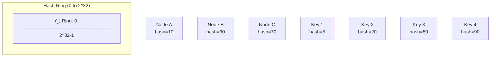
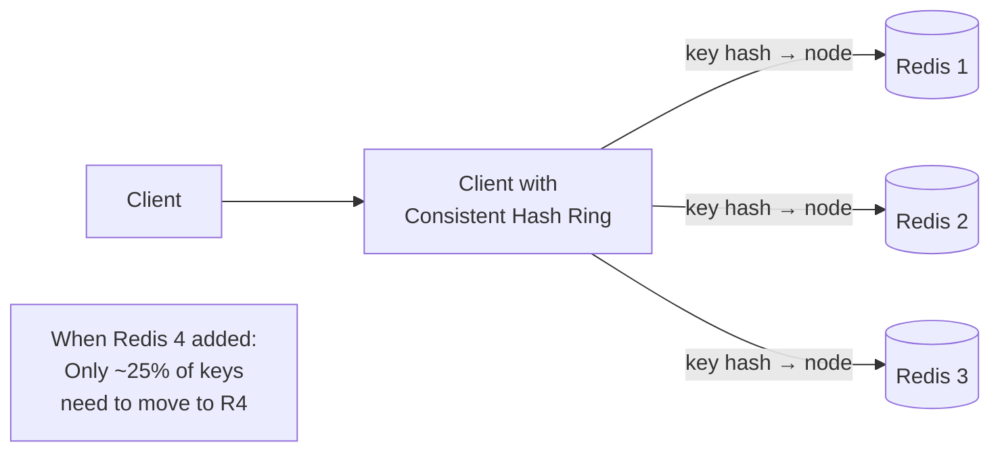

# 14 — Consistent Hashing

> [!important] Core Idea
> Consistent hashing minimizes key redistribution when nodes are added or removed. Instead of remapping ~N/M keys (N=keys, M=nodes) on each change, only ~N/M keys need to move. This makes it ideal for distributed caches, databases, and load balancers.

---

## The Problem: Naive Mod-N Hashing

```
shard = hash(key) % N_nodes

N=3 nodes:
  key → shard 0, 1, or 2

Add 1 node (N=4):
  hash(key) % 3 ≠ hash(key) % 4 for most keys
  → ~75% of keys map to different shards!
  → Massive data migration, cache invalidation storm
```

**Consistent hashing solves this:** Only ~K/N keys move when a node is added/removed (K=keys, N=nodes after change).

---

## The Hash Ring



**Algorithm:**
1. Map both nodes and keys to the same hash space (0 to 2^32)
2. To find which node stores a key: go clockwise around the ring from the key's position to the first node

```
Ring positions: 0 ──────── 10(A) ── 20(K2→A) ─── 30(B) ── 50(K3→B) ─── 70(C) ── 90(K4→A)
                           ↑K1→A                           ↑               ↑
                Key 1 (hash=5) → clockwise → Node A (hash=10)
                Key 2 (hash=20) → clockwise → Node B (hash=30)
                Key 3 (hash=50) → clockwise → Node C (hash=70)
                Key 4 (hash=90) → wraps around → Node A (hash=10)
```

### Adding a Node

```
Add Node D at position 40:

Before: Key 3 (hash=50) → Node C (hash=70)
After:  Key 3 (hash=50) → Node D (hash=40)?? 
        No! Key 3 hash=50 > Node D hash=40, so it still goes to C (hash=70)
        
Actually, keys that WERE going to C but are now BETWEEN B(30) and D(40):
  These move from C to D — only ~K/N keys affected!
```

---

## Virtual Nodes (Vnodes)

**Problem with basic consistent hashing:** If nodes are unevenly distributed on the ring, some nodes get more keys (hot spots).

**Solution:** Each physical node has multiple virtual nodes on the ring.

```
Node A: positions [10, 45, 80, 120, ...]   (many virtual nodes)
Node B: positions [25, 60, 95, 155, ...]
Node C: positions [35, 75, 110, 170, ...]

→ Keys are distributed more evenly across the ring
→ Each physical node "owns" many small segments instead of one large one
```

**Cassandra default:** 256 virtual nodes per physical node

**Benefits of vnodes:**
1. **Even load distribution**: Keys spread evenly across physical nodes
2. **Graceful failure**: When a node fails, its vnodes are distributed among remaining nodes (no single node takes all the load)
3. **Heterogeneous hardware**: Assign more vnodes to more powerful nodes

---

## Adding/Removing Nodes

### Adding a Node
```
New node joins → Claims some vnodes from existing nodes
Only keys in those vnode ranges need to move to new node
~1/N of all keys move (N = new total nodes)
```

### Removing a Node
```
Node leaves → Its vnodes are taken by neighbors
Only keys on removed node need to move
~1/N of all keys move
Data rebalancing happens with minimal disruption
```

---

## Real-World Usage

| System | Usage |
|--------|-------|
| **Cassandra** | Distributes data across nodes using consistent hashing; 256 vnodes/node |
| **Amazon DynamoDB** | Uses consistent hashing for partition routing |
| **Amazon S3** | Key-to-node mapping |
| **Memcached** | Client-side consistent hashing for cache sharding |
| **Redis Cluster** | 16,384 hash slots (not pure consistent hashing but similar) |
| **Nginx upstream** | Consistent hash upstream load balancing |
| **Chord DHT** | Research distributed hash table |

---

## Consistent Hashing for Cache Sharding



Without consistent hashing: Adding Redis 4 would invalidate ~75% of cache keys (catastrophic for traffic spike during deployment).

With consistent hashing: Adding Redis 4 only moves ~25% of keys → much less DB load during scaling.

---

## Implementation Sketch

```python
import hashlib
import bisect

class ConsistentHashRing:
    def __init__(self, nodes=None, vnodes=150):
        self.vnodes = vnodes
        self.ring = {}
        self.sorted_keys = []
        for node in (nodes or []):
            self.add_node(node)
    
    def _hash(self, key):
        return int(hashlib.md5(key.encode()).hexdigest(), 16)
    
    def add_node(self, node):
        for i in range(self.vnodes):
            vnode_key = f"{node}:{i}"
            h = self._hash(vnode_key)
            self.ring[h] = node
            bisect.insort(self.sorted_keys, h)
    
    def remove_node(self, node):
        for i in range(self.vnodes):
            h = self._hash(f"{node}:{i}")
            del self.ring[h]
            self.sorted_keys.remove(h)
    
    def get_node(self, key):
        h = self._hash(key)
        idx = bisect.bisect(self.sorted_keys, h) % len(self.sorted_keys)
        return self.ring[self.sorted_keys[idx]]
```

---

## Replication with Consistent Hashing

For durability, replicate each key to the next N nodes clockwise:

```
N=3 replication factor:
  Key at position 50 → stored on Node C (pos=70), Node A (pos=10), Node B (pos=30)
  (The next 3 nodes clockwise from position 50)
```

This is exactly how Cassandra distributes replicas.

---

## Interview Checklist

- [ ] Explain the problem with naive mod-N hashing
- [ ] Explain the ring and clockwise mapping algorithm
- [ ] Know why virtual nodes (vnodes) are necessary
- [ ] Explain what happens when a node is added/removed (minimal key movement)
- [ ] Know real systems that use consistent hashing (Cassandra, DynamoDB)
- [ ] Explain how consistent hashing enables graceful scaling for cache clusters

---

## Related Notes

- [[13 - Database Sharding]] — consistent hashing solves the resharding problem
- [[07 - Caching]] — consistent hashing for distributed Redis/Memcached
- [[12 - Database Replication]] — replication with N copies on ring
- [[11 - SQL vs NoSQL]] — Cassandra's data distribution mechanism
