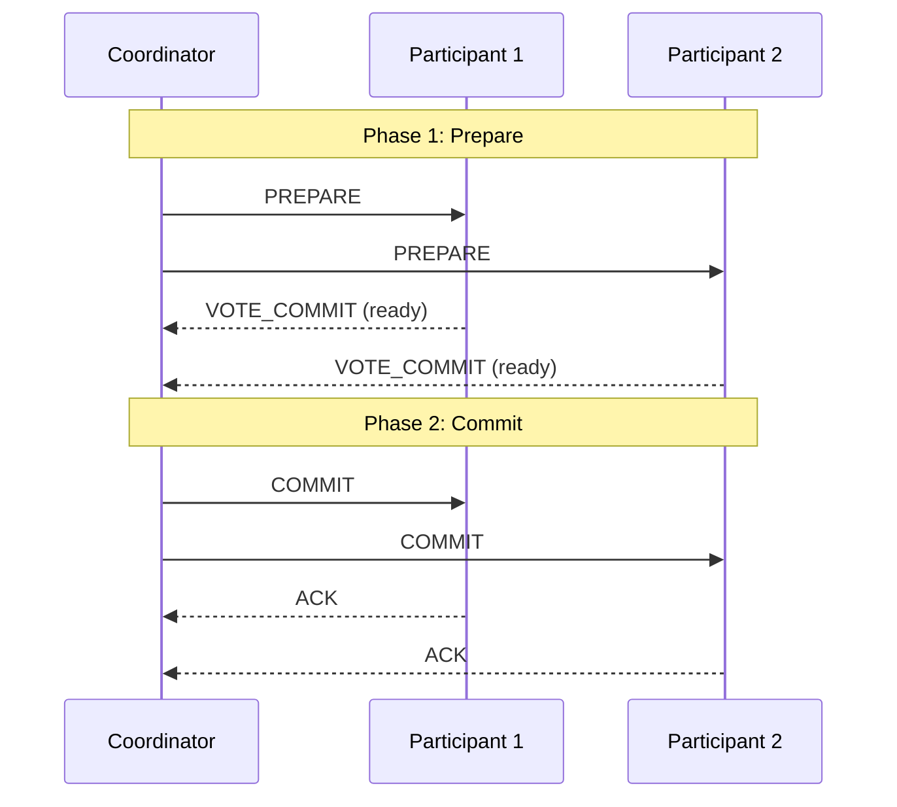
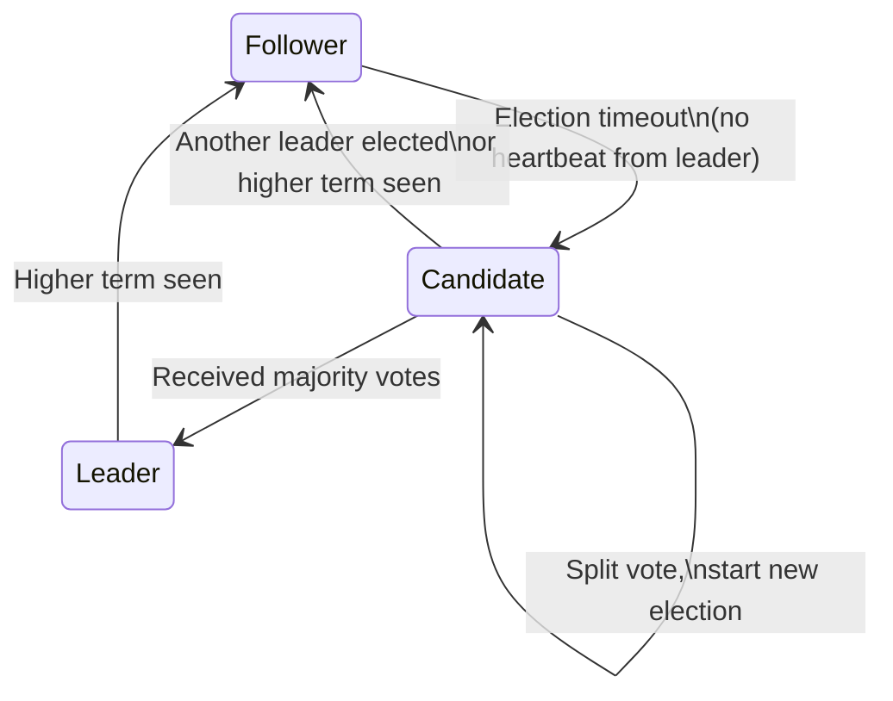
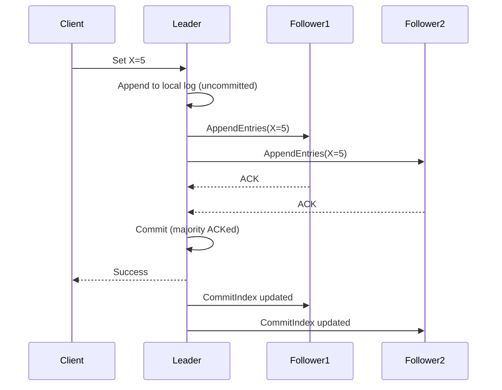

# 16 — Distributed Consensus

> [!important] Core Idea
> Distributed consensus is getting multiple nodes to agree on a single value, even in the presence of failures. It's the foundation of leader election, distributed locks, configuration management, and any system requiring strong consistency.

---

## The Problem

```
3 nodes. All must agree on: "Who is the leader?" or "What is the value of X?"

Challenges:
  → Network partitions (messages lost/delayed)
  → Node crashes (node may be dead or just slow)
  → Byzantine failures (node sending wrong data)

Consensus requirement:
  → Agreement: All correct nodes decide on same value
  → Validity: Decided value was proposed by some node
  → Termination: Every correct node eventually decides
```

---

## Two-Phase Commit (2PC)

Used for distributed transactions. A coordinator ensures all participants commit or all abort.



**Failure cases:**
- Participant fails after PREPARE: Coordinator times out → abort all
- **Coordinator fails after sending some COMMITs**: Participants that got COMMIT have committed; others haven't → **BLOCKING PROBLEM** (participants can't proceed without coordinator)

> [!warning] 2PC is Blocking
> If the coordinator crashes after phase 1, participants are left in an uncertain state — they can't commit or abort without the coordinator. They block until coordinator recovers. This is 2PC's fundamental limitation.

### Three-Phase Commit (3PC)
Adds a pre-commit phase to avoid blocking. But has its own issues under network partitions. Rarely used in practice.

---

## Paxos (Theoretical Foundation)

Paxos is the theoretical algorithm that all practical consensus algorithms are based on. Hard to understand, harder to implement correctly.

**Roles:** Proposers, Acceptors, Learners

**Two phases:**
1. **Prepare**: Proposer sends `Prepare(n)`. Acceptors promise not to accept proposals < n.
2. **Accept**: Proposer sends `Accept(n, value)`. If quorum accepts, value is chosen.

> [!note] Why Paxos?
> You need to understand Paxos exists and why it's hard. In interviews, showing you understand Raft (a more practical algorithm designed to be understandable) is sufficient.

---

## Raft (The Practical Algorithm)

Raft was designed to be understandable. Used by: etcd, CockroachDB, TiKV, Consul.

### Raft Roles
- **Leader**: Handles all client requests. One per term.
- **Follower**: Passive. Responds to leader/candidates.
- **Candidate**: Seeking election when leader not heard from.

### Leader Election



```
Election timeout: Random(150ms, 300ms)
Why random? Prevent split votes — one node always times out first

Candidate requests vote:
  → Sends RequestVote RPC to all nodes
  → Each node votes for at most one candidate per term
  → Candidate needs majority (⌊N/2⌋ + 1 votes)
  → Vote granted only if candidate's log is at least as up-to-date as voter's

Leader sends heartbeats (AppendEntries with empty entries) every 50ms
If follower doesn't hear from leader in election timeout → start election
```

### Log Replication



**Safety guarantee:** A log entry is committed only when stored on a majority of servers. Leader never overwrites committed entries.

**Log matching property:** If two logs have an entry with the same index and term, all entries up to that index are identical. (Guaranteed by the protocol.)

### Raft Safety Properties
1. **Election safety**: At most one leader per term
2. **Leader append-only**: Leader never overwrites/deletes its log
3. **Log matching**: If two logs agree at an index, they agree on all prior entries
4. **Leader completeness**: If entry committed in term T, all leaders in terms > T have that entry
5. **State machine safety**: If a server has applied log entry i, no other server applies a different entry at i

---

## Practical Consensus Systems

| System | Algorithm | Use Case |
|--------|-----------|---------|
| **etcd** | Raft | Kubernetes config store, service discovery |
| **Zookeeper** | ZAB (Zookeeper Atomic Broadcast) | Leader election, distributed config |
| **Consul** | Raft | Service discovery, health checking |
| **CockroachDB** | Raft (per range) | Distributed SQL |
| **Google Chubby** | Paxos | Google's internal lock service |
| **Google Spanner** | Paxos | Globally distributed SQL |

---

## Distributed Locking

Using consensus for mutual exclusion:

```python
# Using etcd for distributed lock
lock = etcd.Lock("my-lock", ttl=30)  # lock expires after 30s (protection against client crash)

with lock:
    # Critical section — only one node runs this at a time
    do_critical_work()
    
# Lock automatically released when:
# - Context exits (normal)
# - Client crashes (TTL expires)
```

> [!warning] Distributed Lock Pitfall: Long GC Pauses
> A client acquires a lock, then has a long GC pause. Lock TTL expires, another client acquires lock. First client resumes with an expired lock and both think they hold the lock.
> 
> Solution: **Fencing tokens** — each lock grant has a monotonically increasing token. Storage system rejects writes with outdated tokens.

---

## Byzantine Fault Tolerance (BFT)

Raft/Paxos assume **crash failures** (nodes stop responding). They don't handle **Byzantine failures** (nodes send incorrect/malicious data).

**Byzantine fault tolerant algorithms** (e.g., PBFT) require 3f+1 nodes to tolerate f Byzantine nodes (vs 2f+1 for crash failures). Very expensive.

Used in: Blockchain consensus (Bitcoin PoW, Tendermint BFT), safety-critical systems

---

## Interview Checklist

- [ ] Explain the distributed consensus problem
- [ ] Know why 2PC is blocking (coordinator failure)
- [ ] Explain Raft leader election (random timeout, majority vote)
- [ ] Explain Raft log replication (majority ACK before commit)
- [ ] Know Raft safety: committed = majority, leader never overwrites
- [ ] Know practical systems: etcd (K8s), Zookeeper (Hadoop)
- [ ] Know the distributed lock fencing token problem

---

## Related Notes

- [[17 - Leader Election]] — uses consensus algorithms
- [[02 - CAP Theorem]] — consensus enables CP systems
- [[12 - Database Replication]] — leader election on primary failure
- [[04 - Availability & Reliability]] — consensus tradeoff with availability
