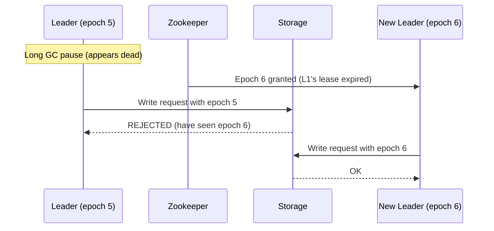

# 17 — Leader Election

> [!important] Core Idea
> Leader election ensures exactly one node in a cluster acts as the "leader" responsible for coordination. Needed for: database primary selection, distributed scheduling, singleton services (cron jobs), and microservice coordinators.

---

## Why Leader Election?

```
Scenarios requiring a single leader:
  → Database primary (single writer for strong consistency)
  → Cron job scheduler (avoid duplicate job execution)
  → Kafka controller (manages partition leadership)
  → Elasticsearch master (manages cluster state)
  → Distributed transaction coordinator
```

---

## Algorithms

### Bully Algorithm
The node with the highest ID wins. When a node suspects leader is down, it initiates election by "bullying" others.

```
Nodes: N1, N2, N3, N4, N5 (N5 = highest ID)
N2 suspects N5 (leader) is down:

1. N2 sends ELECTION to N3, N4, N5
2. N3, N4 send ELECTION to higher nodes (N4→N5, N5)
3. N5 responds ALIVE → N5 becomes leader again
4. (If N5 truly dead) → N4 gets no response from N5 → N4 becomes leader
```

**Problem:** O(N²) messages; high communication overhead; doesn't handle network partitions well

### Ring-Based Algorithm
Nodes form a logical ring. Election token passes around.

```
Ring: N1 → N2 → N3 → N4 → N5 → N1

If N5 fails:
  N1 notices → sends ELECTION(N1) to N2
  N2 adds self: ELECTION(N1, N2) to N3
  ...
  N4: ELECTION(N1, N2, N3, N4) to N1
  N1 sees all nodes, picks highest: N4 wins
  N1 sends COORDINATOR(N4) around ring
```

**Problem:** O(N) messages per election but slow; not used in production

### Raft Leader Election (Production Standard)
→ See [[16 - Distributed Consensus]] for full Raft explanation

Key points:
- Random election timeout prevents simultaneous elections
- Candidate needs majority vote (N/2 + 1)
- Each term has at most one leader
- Log completeness: most up-to-date candidate wins
- **Used by:** etcd, Consul, CockroachDB

### Zookeeper-Based Leader Election (Production Standard)
Zookeeper ephemeral znodes enable leader election:

```python
# Each node creates an ephemeral sequential znode
/election/node-0000000001  (node A)
/election/node-0000000002  (node B)  
/election/node-0000000003  (node C)

# Node with lowest sequence number = leader (node A)
# Each node watches the znode JUST BEFORE it (not the leader directly)

# If node A crashes:
  /election/node-0000000001 disappears (ephemeral)
  node B (watching node 0000000001) gets notified
  node B becomes leader

# This avoids "herd effect" — only one node notified per failure
```

**Key property of ephemeral znodes:** Automatically deleted when the client session disconnects. Guaranteed freshness — if leader crashes, its znode disappears, triggering election.

---

## Split Brain Problem

The most dangerous failure in leader election:

```
Network partition splits 5-node cluster into two groups:
  Group A: [N1, N2] — old leader N1 still thinks it's leader
  Group B: [N3, N4, N5] — elects new leader N3

NOW: Two leaders! Both accept writes!
→ Data divergence → Corruption
```

### Solutions

**1. Quorum-Based (Raft/Paxos standard):**
Leader can only operate if it has a majority of votes.
- Group A has 2/5 nodes → not a majority → leader N1 steps down
- Group B has 3/5 nodes → majority → N3 elected as sole leader

**2. Fencing Tokens (STONITH — Shoot The Other Node In The Head):**
When a new leader is elected, it gets a higher epoch/term number.
All nodes reject requests from leaders with old epoch numbers.

```
Old leader N1 (epoch 5) tries to write
Follower: "I've seen epoch 6 (from N3), refusing epoch 5 writes"
```

**3. Physical Fencing:**
New leader sends STONITH command to old leader: forces it to reboot or shut down.
Used in: Pacemaker (Linux HA), database clusters

---

## Epoch Numbers / Fencing Tokens



---

## Leader Leases

Leader holds a time-limited lease. Must renew before expiry.
- If lease expires, leader must stop processing immediately
- Follower only starts election after lease timeout + network delay

**Property:** Prevents split brain because new leader waits for old leader's lease to expire before taking over.

**Risk:** If leader has wrong system clock, may think lease is still valid when it's expired.

---

## Practical Leader Election in Production

### Kubernetes etcd Leader Election
```go
// Kubernetes uses client-go leader election library
le, err := leaderelection.NewLeaderElector(leaderelection.LeaderElectionConfig{
    Lock:          rl,
    LeaseDuration: 15 * time.Second,
    RenewDeadline: 10 * time.Second,
    RetryPeriod:   2 * time.Second,
    Callbacks: leaderelection.LeaderCallbacks{
        OnStartedLeading: func(ctx context.Context) {
            // This runs only on the leader
            runController(ctx)
        },
        OnStoppedLeading: func() {
            // Lost leadership, stop work
            os.Exit(1)
        },
    },
})
```

### Redis SETNX for Simple Lock (Cautionary Tale)
```bash
SET leader "node-A" NX EX 30  # Set only if not exists, TTL 30 seconds
# Renew: SET leader "node-A" XX EX 30  # Set only if exists (renewal)
```

> [!warning] Redis SETNX is NOT safe for leader election
> Redlock (Redis-based distributed lock) has known issues with clock skew, GC pauses, and network delays that can cause split brain. Use etcd or Zookeeper for production leader election. Martin Kleppmann has a detailed analysis of Redlock's unsafety.

---

## Interview Checklist

- [ ] Know why leader election is needed (use cases)
- [ ] Know Raft leader election at a high level
- [ ] Know Zookeeper ephemeral znode approach (step-down on disconnect)
- [ ] Explain split brain and quorum as the solution
- [ ] Know fencing tokens / epoch numbers to reject stale leader writes
- [ ] Know leader leases and their clock dependency

---

## Related Notes

- [[16 - Distributed Consensus]] — Raft algorithm details
- [[12 - Database Replication]] — leader election for DB primary failover
- [[04 - Availability & Reliability]] — leader election affects availability
- [[02 - CAP Theorem]] — CP systems require leader election
