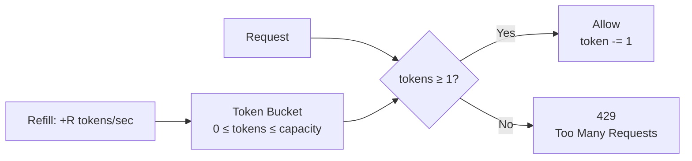
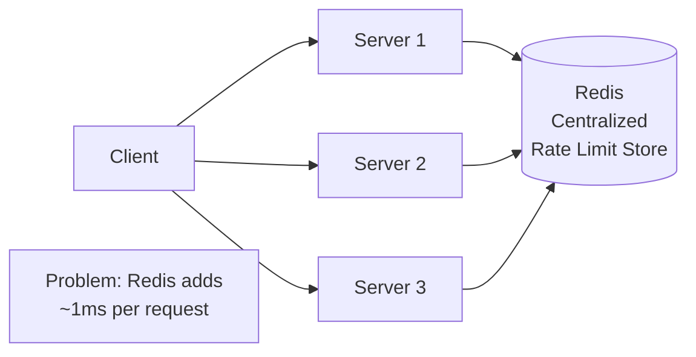

# 18 — Rate Limiting

> [!important] Core Idea
> Rate limiting controls how many requests a client can make in a given time window. Protects services from overload, prevents abuse, enforces fair usage, and monetizes API access (free tier vs paid tier).

---

## Why Rate Limit?

```
Protects against:
  → DDoS attacks (bot flooding)
  → Buggy clients (infinite retry loops)
  → Resource exhaustion (one tenant starving others)
  → API scraping / abuse
  → Cost control (expensive ML inference)
  
Enables:
  → Tiered pricing (100 req/min free, 10K req/min enterprise)
  → Fair resource sharing in multi-tenant systems
```

---

## Algorithms

### 1. Token Bucket (Most Common, Recommended)

```
Bucket capacity: N tokens
Refill rate: R tokens/second

On each request:
  If bucket has ≥ 1 token: consume 1 token, allow request
  Else: reject request (429)

Tokens accumulate up to capacity (supports bursts)
```



**Pros:**
- Allows bursts (up to bucket capacity)
- Simple to implement
- Used by AWS, Stripe, Twitter APIs

**Parameters:**
- `capacity` = max burst size
- `refill_rate` = steady-state requests/second

**Example:** API allows 60 req/min avg, bursts of 10:
```
capacity = 10
refill_rate = 1 token/second (= 60/min)
```

### 2. Leaky Bucket

```
Queue of requests (fixed size)
Requests processed at fixed rate (the "leak")

New request:
  If queue not full: add to queue
  Else: reject (429)

Processor dequeues at fixed rate R
```

**Pros:** Smooth output rate (no bursts); protects downstream from spikes  
**Cons:** If queue fills, recent requests rejected while old ones still being processed; latency for queued requests  
**Used for:** Traffic shaping, network QoS

### 3. Fixed Window Counter

```
Window: 00:00 - 00:59 (1 minute)
Counter: starts at 0, max = 100

Request at 00:30: counter = 15 → allow (counter = 16)
Request at 00:59: counter = 99 → allow (counter = 100)
Request at 00:59: counter = 100 → reject

At 01:00: counter resets to 0
Request at 01:00: counter = 0 → allow
```

**Pros:** Simple, O(1) space  
**Cons:** "Double spend" at window boundary: 100 req at 00:59 + 100 req at 01:00 = 200 req in 2 seconds!

### 4. Sliding Window Log

```
Store timestamp of each request in a sorted set
Window: last 60 seconds

New request at time T:
  Remove entries older than T-60s from log
  If log size < limit: allow, add T to log
  Else: reject
```

**Pros:** Precise; no boundary spike problem  
**Cons:** High memory usage (store all timestamps); O(log N) per request

### 5. Sliding Window Counter (Best Trade-off)

Combines fixed window simplicity with sliding window accuracy:

```
current_window_count × (1 - overlap%) + previous_window_count × overlap%

Example:
  Previous window (00:00-00:59): 80 requests
  Current window (01:00-01:59): 50 requests (so far)
  Request at 01:30 (30 seconds into current window):
  
  Overlap with previous window = 30/60 = 50%
  Estimated count = 80 × 0.5 + 50 = 90
  
  If limit = 100: allow (90 < 100)
```

**Pros:** O(1) space; accurate; no boundary spike; widely used  
**Used by:** Cloudflare

---

## Comparison

| Algorithm | Burst Allowed | Memory | Accuracy | Smoothness |
|-----------|--------------|--------|----------|-----------|
| Token Bucket | ✅ Yes | O(1) | Good | Allows bursts |
| Leaky Bucket | ❌ No (queued) | O(queue size) | Good | Smooth output |
| Fixed Window | ✅ Yes (at boundary) | O(1) | Low (boundary issue) | Not smooth |
| Sliding Window Log | ✅ Yes | O(N) per user | Excellent | Good |
| Sliding Window Counter | ✅ Yes | O(1) | Good | Good |

---

## Distributed Rate Limiting

For a multi-server system, rate limits must be global (not per-server):



### Redis-based Token Bucket
```lua
-- Atomic Lua script (runs atomically in Redis)
local key = KEYS[1]
local capacity = tonumber(ARGV[1])
local refill_rate = tonumber(ARGV[2])
local now = tonumber(ARGV[3])

local bucket = redis.call('HMGET', key, 'tokens', 'last_refill')
local tokens = tonumber(bucket[1]) or capacity
local last_refill = tonumber(bucket[2]) or now

-- Calculate new tokens
local elapsed = now - last_refill
tokens = math.min(capacity, tokens + elapsed * refill_rate)

if tokens >= 1 then
    tokens = tokens - 1
    redis.call('HMSET', key, 'tokens', tokens, 'last_refill', now)
    redis.call('EXPIRE', key, math.ceil(capacity / refill_rate) + 1)
    return 1  -- allowed
else
    return 0  -- rejected
end
```

### Local + Global Rate Limiting (Two-level)
```
Local (per-server): Allow at most global_limit / server_count per server
  → Fast, no network hop
  → Problem: uneven traffic distribution

Global (Redis): Check global counter when local limit exceeded
  → Network hop only when needed
  → More accurate
```

---

## Where to Implement Rate Limiting

| Layer | Pros | Cons |
|-------|------|------|
| **Client-side** | Zero server overhead | Client can bypass it |
| **API Gateway** | Single enforcement point; before hitting backend | Gateway becomes bottleneck |
| **Service level** | Fine-grained per-operation | Duplicated logic |
| **Middleware** | Reusable across services | Still requires cross-service state |

**Best practice:** Enforce at API Gateway (+ optionally at service level for defense in depth)

---

## Rate Limit Headers

```http
HTTP/1.1 429 Too Many Requests
Content-Type: application/json
X-RateLimit-Limit: 1000
X-RateLimit-Remaining: 0
X-RateLimit-Reset: 1640000060
Retry-After: 60

{"error": "Rate limit exceeded. Please retry in 60 seconds."}
```

---

## Rate Limiting Strategies

| Strategy | Description | Use Case |
|---------|-------------|---------|
| **User-based** | Per API key/user ID | Standard API rate limiting |
| **IP-based** | Per IP address | Unauthenticated endpoints, DDoS |
| **Resource-based** | Per endpoint | Different limits for `/search` vs `/profile` |
| **Global** | Total system throughput | Protect backend infrastructure |
| **Tenant-based** | Per customer account | Multi-tenant SaaS |

---

## Interview Checklist

- [ ] Know all 5 algorithms and their trade-offs
- [ ] Recommend token bucket as default (bursts allowed, simple)
- [ ] Explain the fixed window boundary problem
- [ ] Explain distributed rate limiting with Redis
- [ ] Know where to implement (API Gateway + Redis)
- [ ] Know rate limit response headers (429 + Retry-After)
- [ ] Discuss tiered rate limits for different user types

---

## Related Notes

- [[10 - API Design]] — rate limiting is part of API contract
- [[07 - Caching]] — Redis used as rate limit store
- [[06 - Load Balancers]] — rate limiting can be done at LB level
- [[04 - Availability & Reliability]] — rate limiting protects availability
