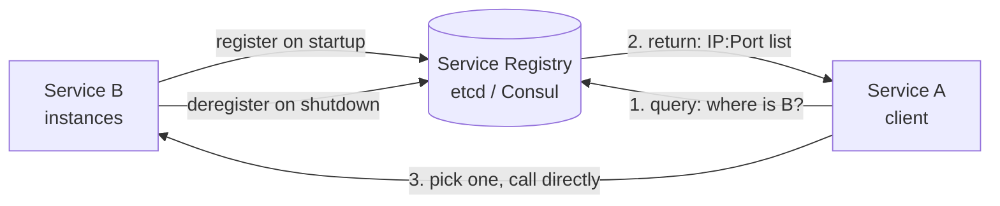
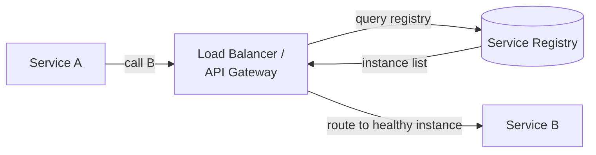
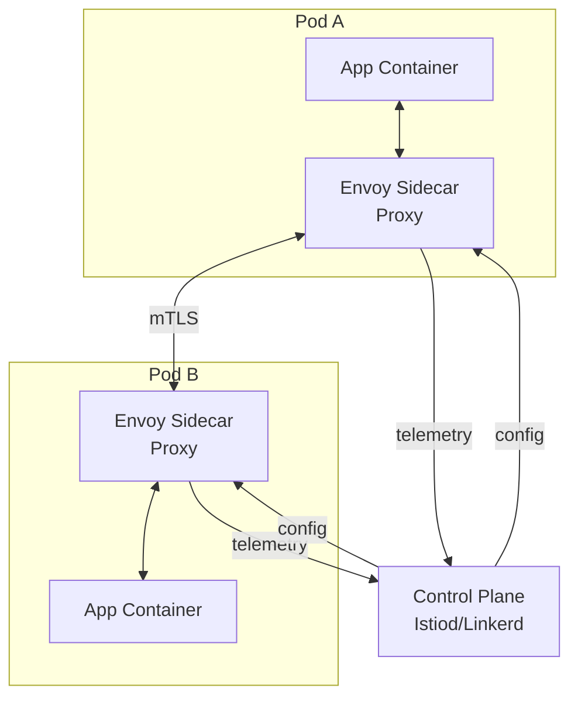

# 20 — Service Discovery & Health Checks

> [!important] Core Idea
> In microservices, services need to find each other dynamically. Service discovery maintains an up-to-date registry of healthy service instances. Health checks ensure traffic only routes to healthy instances.

---

## The Problem

```
Microservices in K8s/cloud:
  → Instances start/stop dynamically (autoscaling, deployments)
  → IP addresses change constantly
  → How does Service A find Service B's current IP?

Old way: Hardcode IP in config
  → Breaks when B restarts with new IP
  → Doesn't work with autoscaling

Solution: Service discovery registry
  → Services register on start, deregister on stop
  → Clients query registry for current instances
```

---

## Client-Side Discovery

Service instances register with the registry. Client queries registry and chooses which instance to call (client does load balancing).



**Pros:** No extra network hop for routing; client can implement custom LB logic  
**Cons:** Every client must implement service discovery logic; language-specific libraries needed

**Examples:** Netflix Eureka + Ribbon, Consul client libraries

---

## Server-Side Discovery

Client makes request to a router (load balancer/gateway). Router queries registry and forwards.



**Pros:** Client doesn't need discovery logic; language-agnostic  
**Cons:** Extra network hop; router is a potential bottleneck  
**Examples:** AWS ALB + ECS, Kubernetes Service (built-in)

---

## Service Registries

### etcd
- Distributed key-value store using Raft
- High consistency (CP)
- Used by Kubernetes as its backing store for all cluster state
- Service registration: `PUT /services/payment/instance1 → "10.0.1.5:8080" TTL=30s`

### Consul (HashiCorp)
- Purpose-built for service discovery
- Health checks built-in (HTTP, TCP, script)
- DNS interface: `payment.service.consul → IPs`
- Multi-datacenter support
- KV store for config

### Zookeeper
- General-purpose distributed coordination
- Uses ephemeral znodes for service registration
- Popular before Consul/etcd; now less common for service discovery
- Still widely used at companies that adopted it early (LinkedIn, etc.)

### Kubernetes DNS (Built-in)
```
Service "payment" in namespace "prod":
  DNS name: payment.prod.svc.cluster.local
  
K8s automatically:
  - Maintains endpoints list (healthy pod IPs)
  - Updates DNS when pods start/stop
  - Round-robin or IPVS load balancing built-in
```

---

## Health Checks Types

| Type | How | Use Case |
|------|-----|---------|
| **HTTP** | GET /health → 200 | REST services |
| **TCP** | Open TCP connection | Any TCP service |
| **Script/Command** | Run shell script | Custom logic |
| **gRPC** | gRPC health protocol | gRPC services |
| **TTL** | Service must call-in within TTL | Self-reporting health |

### Shallow vs Deep Health Check

**Shallow (liveness):**
```
GET /health → {"status": "ok"}
→ Process is running, can accept connections
→ Returns 200 even if DB is down
→ Used for: Kubernetes liveness probe (restart if fails)
```

**Deep (readiness):**
```
GET /health/ready → check DB, Redis, dependencies
→ Returns 503 if any dependency unhealthy
→ Used for: Kubernetes readiness probe (remove from LB if fails)
→ Registry removes instance from pool on non-200
```

---

## Service Mesh (Advanced)

A service mesh handles service-to-service communication at the infrastructure level, not application level.



### What Service Mesh Provides
- **mTLS**: Mutual TLS between services (automatic, no app code changes)
- **Load balancing**: Advanced algorithms (least request, consistent hash)
- **Circuit breaking**: Automatic circuit breaker at proxy level
- **Retries**: Configurable retry policies
- **Observability**: Traces, metrics, logs for every service call
- **Traffic management**: Canary deployments, A/B testing, fault injection
- **Service discovery**: Proxy knows all healthy instances

### Popular Service Meshes
| Product | Proxy | Complexity | Notes |
|---------|-------|-----------|-------|
| **Istio** | Envoy | High | Most feature-rich; complex |
| **Linkerd** | Linkerd2-proxy | Medium | Simpler, Rust proxy |
| **Consul Connect** | Envoy | Medium | Consul integration |
| **AWS App Mesh** | Envoy | Medium | Managed AWS offering |
| **Cilium** | eBPF | Medium | Kernel-level, no sidecar |

---

## K8s Service Discovery in Detail

```yaml
# Service definition
apiVersion: v1
kind: Service
metadata:
  name: payment
spec:
  selector:
    app: payment         # Routes to pods with this label
  ports:
    - port: 80
      targetPort: 8080
  type: ClusterIP        # Internal only

# K8s creates:
# - DNS: payment.default.svc.cluster.local → ClusterIP
# - iptables/IPVS rules for load balancing to healthy pods
# - Endpoints object tracking healthy pod IPs
```

**Kubernetes handles it all:** As pods start/stop/crash, the Endpoints object updates automatically, and iptables/IPVS rules update to route only to healthy pods.

---

## Interview Checklist

- [ ] Explain client-side vs server-side discovery with trade-offs
- [ ] Know Consul, etcd, Zookeeper as registry options
- [ ] Explain shallow (liveness) vs deep (readiness) health checks
- [ ] Know K8s liveness vs readiness probes
- [ ] Explain service mesh concept (sidecar proxy pattern)
- [ ] Know what service mesh provides (mTLS, observability, LB, circuit breaking)

---

## Related Notes

- [[04 - Availability & Reliability]] — health checks drive failover
- [[06 - Load Balancers]] — server-side discovery uses LB
- [[16 - Distributed Consensus]] — etcd and Zookeeper use consensus
- [[17 - Leader Election]] — service registry used for leader election
