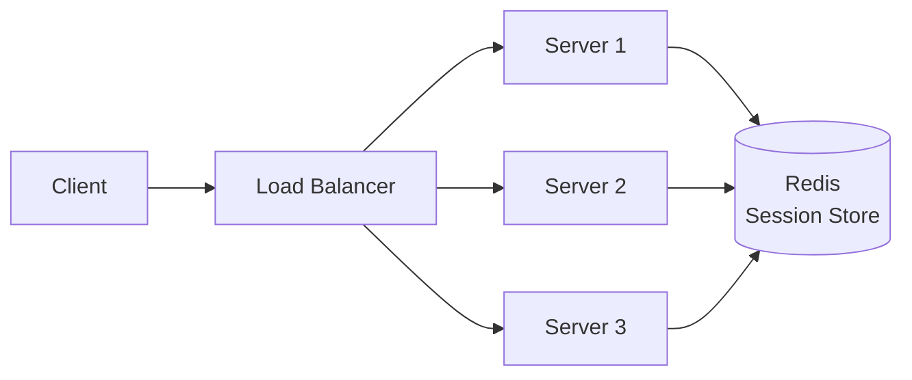
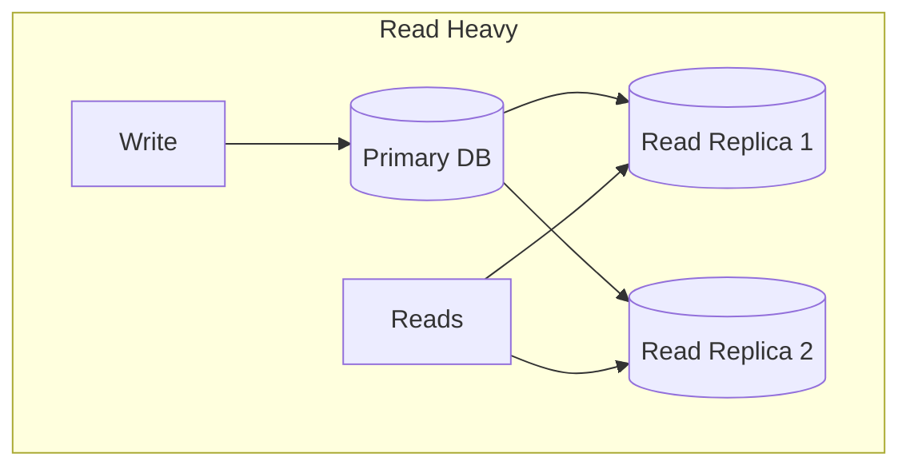
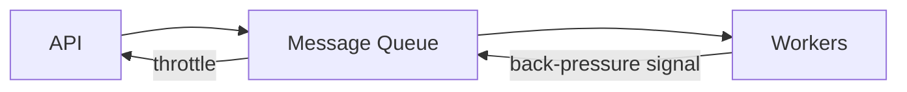

# 01 — Scalability

> [!important] Core Idea
> Scalability is the ability of a system to handle increased load by adding resources. The two primary strategies are **vertical scaling** (bigger machine) and **horizontal scaling** (more machines). At FAANG scale, you almost always need horizontal scaling.

---

## Vertical vs Horizontal Scaling

| Dimension | Vertical (Scale Up) | Horizontal (Scale Out) |
|-----------|--------------------|-----------------------|
| How | Bigger CPU/RAM/SSD | More machines |
| Cost | Exponential growth | Near-linear growth |
| Downtime | Required (usually) | None (rolling deploy) |
| Limit | Hardware ceiling | Effectively unlimited |
| Complexity | Low | High (distributed systems) |
| Failure | Single point | Fault tolerant |

> [!tip] When to Vertical Scale
> Use vertical scaling early when traffic is low and simplicity matters. It buys time before you need the complexity of horizontal scaling.

---

## Stateless vs Stateful Architecture

### Stateless (horizontally scalable)
- Server does not store session state between requests
- Any server can handle any request
- Session data stored in external store (Redis, DB)



### Stateful (harder to scale)
- Server holds state (e.g., WebSocket connections, in-memory game state)
- Load balancer must use sticky sessions (IP hash, cookie)
- Horizontal scaling requires state migration or replication

> [!warning] Sticky Sessions Problem
> If a server goes down, all its sticky sessions are lost. Avoid stateful servers or use external state storage (Redis, Cassandra).

---

## Scaling Different Components

### Web/App Tier
- Stateless → trivial to scale horizontally
- Add more servers + load balancer
- Auto-scaling groups (AWS ASG, K8s HPA)

### Database Tier (the hardest part)



1. **Read replicas** — route reads to replicas, writes to primary
2. **Caching layer** — Redis/Memcached in front of DB
3. **Sharding** — partition data across multiple DB instances → [[13 - Database Sharding]]
4. **NoSQL** — built for horizontal scaling (Cassandra, DynamoDB) → [[11 - SQL vs NoSQL]]

### Cache Tier
- [[07 - Caching]] — Redis cluster, consistent hashing for distribution

### Message Queue / Async Processing
- Decouple producers from consumers
- Kafka partitions = horizontal scale unit → [[08 - Message Queues]]

---

## Auto-Scaling

### Metrics-based triggers
- CPU utilization (> 70% → scale out, < 30% → scale in)
- Request latency (P99 > 500ms → scale out)
- Queue depth (> 1000 messages → scale consumers)
- Custom business metrics

### Scale-out vs Scale-in lag
- **Scale-out lag**: New instances take 2-5 minutes to warm up
- **Pre-warming**: Pre-launch instances before known traffic spikes

> [!question] Interview Q: How would you handle a traffic spike 10x normal?
> 1. **Cache**: Pre-warm cache with expected hot data
> 2. **Auto-scaling**: Ensure ASG max is set high enough
> 3. **Rate limiting**: Protect downstream services
> 4. **Async**: Move non-critical work to queues
> 5. **Graceful degradation**: Return cached stale data if DB is slow

---

## Back-pressure

When a downstream service is slow, upstream services must not blindly keep sending requests — this causes cascading failures.



**Mechanisms:**
- Queue-based: workers consume at their own pace
- Reactive streams: explicit back-pressure signals (gRPC flow control)
- Circuit breaker: stop sending when downstream is failing → [[04 - Availability & Reliability]]

---

## The Knobs of Scaling

```
Read-heavy system:
  → Cache aggressively (Redis)
  → Read replicas
  → CDN for static assets

Write-heavy system:
  → Async writes (message queue)
  → Write-through cache
  → Database sharding

Compute-heavy system:
  → Worker pools
  → Horizontal worker scaling
  → GPU clusters (ML inference)

Memory-heavy system:
  → Vertical scale (RAM is cheap)
  → Distributed cache
  → Data partitioning
```

---

## Numbers to Know

| Scale | Requests/sec | Notes |
|-------|-------------|-------|
| Small startup | < 100 | Single server fine |
| Growing product | 100-10K | Add replicas, cache |
| Mid-size | 10K-100K | Sharding, multi-region |
| FAANG | 100K-10M+ | Full distributed systems |

---

## Interview Checklist

- [ ] Start with single server, scale from there (show evolution)
- [ ] Identify bottlenecks at each scale level
- [ ] Separate stateless (web tier) from stateful (DB tier)
- [ ] Propose read replicas before sharding
- [ ] Mention cache before adding more DB servers
- [ ] Consider async processing for heavy workloads
- [ ] Discuss auto-scaling triggers and warm-up time

---

## Related Notes

- [[02 - CAP Theorem]] — trade-offs at scale
- [[07 - Caching]] — the fastest scale lever
- [[13 - Database Sharding]] — scaling writes
- [[14 - Consistent Hashing]] — distributing load evenly
- [[06 - Load Balancers]] — routing to scaled instances
