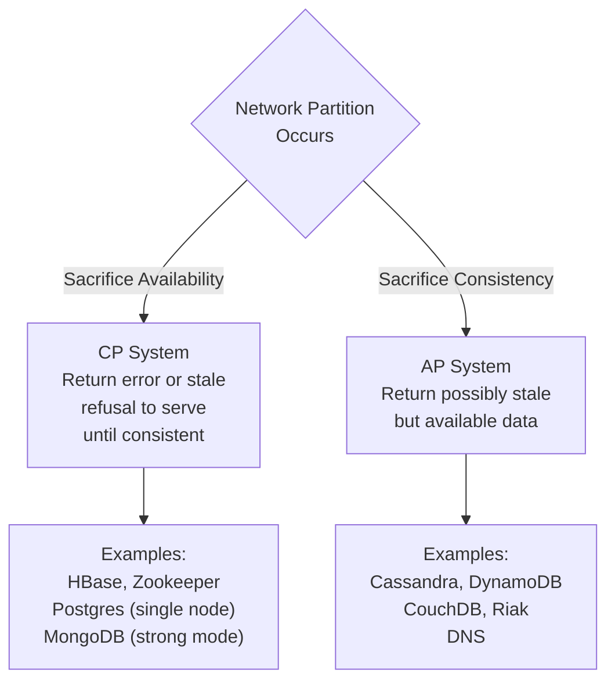

# 02 — CAP Theorem

> [!important] Core Statement
> In a distributed system, you can only **guarantee two** of the three properties simultaneously:
> - **C**onsistency — Every read receives the most recent write
> - **A**vailability — Every request receives a (non-error) response
> - **P**artition Tolerance — System continues operating despite network partitions

> [!warning] The Real Insight
> **P is not optional.** Network partitions WILL happen. So the real choice is: **CP or AP** when a partition occurs.

---

## The Three Properties Explained

### Consistency (C)
Every node returns the same, most up-to-date data. After a write succeeds, any subsequent read from any node sees that write.

*Not the same as ACID consistency — this is about distributed consistency.*

### Availability (A)
Every request (to a non-failing node) gets a response — not necessarily the most recent data, but a response (not an error/timeout).

### Partition Tolerance (P)
The system continues operating even if network messages are delayed or lost between nodes. 

---

## The Real Trade-off: CP vs AP



---

## Real-World Systems Classification

| System | Type | Reason |
|--------|------|--------|
| Zookeeper | CP | Leader must have consensus before responding |
| HBase | CP | Master coordinates all writes |
| MongoDB (default) | CP | Primary must acknowledge writes |
| Cassandra | AP | Tunable consistency; defaults to eventual |
| DynamoDB | AP | Eventually consistent reads by default |
| CouchDB | AP | Multi-master, eventual consistency |
| Redis (cluster) | CP | Hash slots require partition handling |
| DNS | AP | Propagation delay; availability prioritized |
| Riak | AP | Leaderless, eventual consistency |

---

## When to Choose CP vs AP

### Choose CP (Consistency > Availability) when:
- Financial transactions (bank transfers, payments)
- Inventory management (don't oversell)
- Leader election (single authoritative answer needed)
- Configuration systems (all nodes must see same config)
- Distributed locking

### Choose AP (Availability > Consistency) when:
- Social media feeds (seeing a slightly old post is fine)
- Shopping carts (prefer user can add to cart over error)
- Analytics/metrics (approximate is OK)
- DNS (availability critical, stale record acceptable)
- Recommendation engines

> [!example] Amazon's Shopping Cart Insight
> Amazon chose AP for shopping carts. A user can add items even during a partition. The worst case is seeing stale data or duplicate items — tolerable. Returning an error and blocking purchase is not tolerable.

---

## PACELC — The Extended Model

CAP only describes behavior *during a partition*. PACELC extends this to **normal operation**:

```
If (P)artition occurs:
  Choose between (A)vailability and (C)onsistency
Else (normal operation):
  Choose between (L)atency and (C)onsistency
```

| System | Partition behavior | Normal behavior |
|--------|-------------------|-----------------|
| Cassandra | PA | EL (low latency, eventual) |
| DynamoDB | PA | EL |
| MongoDB | PC | EC (consistent but higher latency) |
| HBase | PC | EC |
| MySQL (multi-master) | PA | EL |

> [!tip] PACELC in Interviews
> Mentioning PACELC shows you understand the full picture. CAP is about failure scenarios; PACELC includes the latency vs consistency trade-off in normal operation — which is actually more common in practice.

---

## Consistency Levels (Tunable Consistency)

Systems like Cassandra/DynamoDB allow tuning:

```
N = replication factor (e.g., 3 nodes have a copy)
W = write quorum (writes must succeed on W nodes)
R = read quorum (reads must succeed on R nodes)

For strong consistency: W + R > N
  e.g., N=3, W=2, R=2  (quorum reads/writes)

For max availability: W=1, R=1
  e.g., fast but may read stale data
```

| Mode | W | R | N | Behavior |
|------|---|---|---|----------|
| Strong | 3 | 3 | 3 | Slowest, always consistent |
| Quorum | 2 | 2 | 3 | Balanced |
| One | 1 | 1 | 3 | Fastest, may be stale |
| All | 3 | 3 | 3 | Same as strong but different semantics |

---

## Common Interview Scenarios

> [!question] Q: Design a distributed counter (like view counts on YouTube)
> **AP is fine**: Missing a few views is acceptable. Use Cassandra or Redis cluster with eventual consistency. Aggregate view counts asynchronously.

> [!question] Q: Design a distributed lock
> **CP is required**: Must use a CP system like Zookeeper or etcd. Raft-based consensus ensures only one node holds the lock.

> [!question] Q: Design a banking ledger
> **CP is required**: Double-spend prevention requires strong consistency. Use a relational DB with ACID transactions, or a distributed CP system.

> [!question] Q: When can you have CA (no Partition Tolerance)?
> Only in a single-node system or within a single data center with high-reliability network. Since networks always have some partition risk, CA is theoretical.

---

## Interview Checklist

- [ ] Know the theorem and WHY P is not optional
- [ ] Know real-world examples for CP and AP systems
- [ ] Be able to justify CP vs AP for a given problem
- [ ] Mention PACELC for extra credit
- [ ] Know quorum-based tunable consistency
- [ ] Connect to specific databases (Cassandra=AP, Zookeeper=CP)

---

## Related Notes

- [[03 - Consistency Patterns]] — different types of consistency within AP systems
- [[12 - Database Replication]] — how replication relates to consistency
- [[16 - Distributed Consensus]] — mechanisms to achieve CP
- [[11 - SQL vs NoSQL]] — which databases are CP vs AP
