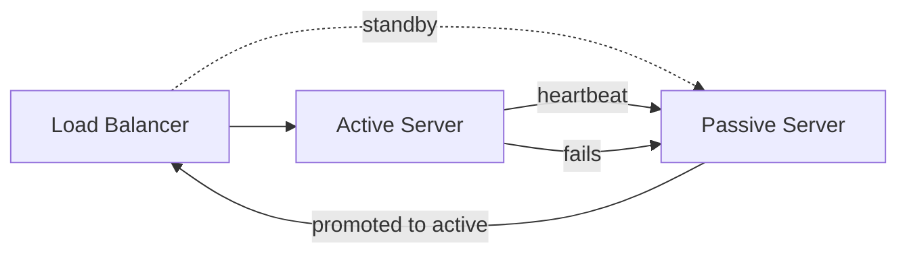
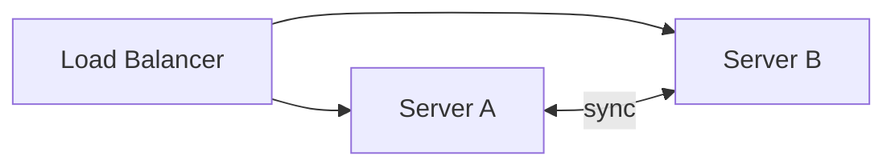
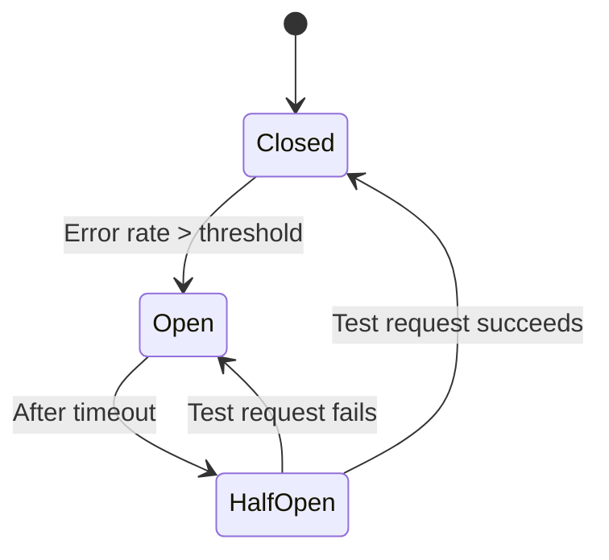
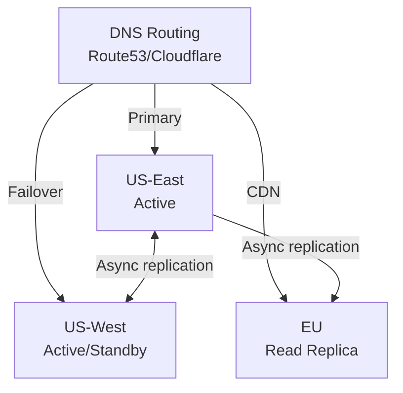

# 04 — Availability & Reliability

> [!important] Core Idea
> Availability is the fraction of time a system is operational. Reliability is the ability to perform correctly over time. At FAANG scale, you design for failure — not against it.

---

## Availability Numbers (The Nines)

| Availability | Downtime/Year | Downtime/Month | Downtime/Day |
|-------------|--------------|----------------|-------------|
| 99% (2 nines) | 3.65 days | 7.2 hours | 14.4 min |
| 99.9% (3 nines) | 8.7 hours | 43.2 min | 1.44 min |
| 99.99% (4 nines) | 52.6 min | 4.32 min | 8.64 sec |
| 99.999% (5 nines) | 5.26 min | 25.9 sec | 864 ms |

> [!tip] What FAANG Targets
> - User-facing services: 99.99%+ (< 1 hour downtime/year)  
> - Core infrastructure (S3, Dynamo): 99.999%
> - Internal services: 99.9% often sufficient

---

## SLA, SLO, SLI

### SLI — Service Level Indicator
Actual measured metric. Examples:
- Request latency (P99 < 200ms)
- Error rate (< 0.1%)
- Availability (% of successful requests)
- Throughput (requests per second)

### SLO — Service Level Objective
Target value for an SLI. Internal goal.
- "P99 latency < 500ms, measured over 30 days"
- "Error rate < 0.1% over 1 week"

### SLA — Service Level Agreement
Contractual commitment to customers. Violation has business consequences (refunds, penalties).
- Typically set **below** SLO to have buffer

```
SLI (measured) ≤ SLO (target) ≤ SLA (contracted)
Actual P99     ≤  500ms       ≤  1000ms
```

### Error Budget
```
Error Budget = 1 - SLO
If SLO = 99.9%: Error Budget = 0.1% = 43.8 min/month of allowed downtime

When error budget is exhausted:
  → Freeze feature releases
  → Focus on reliability work only
```

---

## MTTR and MTBF

| Metric | Full Name | Meaning |
|--------|-----------|---------|
| MTBF | Mean Time Between Failures | How often failures occur |
| MTTR | Mean Time To Recovery | How long to fix failures |
| MTTD | Mean Time To Detect | How long to detect failures |
| MTTF | Mean Time To Failure | Lifespan before first failure |

```
Availability ≈ MTBF / (MTBF + MTTR)

To improve availability:
  → Increase MTBF: better hardware, redundancy
  → Decrease MTTR: better monitoring, runbooks, automation
```

---

## Redundancy Patterns

### Active-Passive (Failover)

- Cold standby: passive is off until needed (slow failover)
- Hot standby: passive is running, synced (fast failover)
- **Problem:** Passive server is wasted resource; failover causes brief downtime

### Active-Active

- Both servers handle traffic
- Better resource utilization
- More complex: both are writable, need conflict resolution
- **Used by:** Multi-region active-active setups at FAANG

---

## Failure Handling Patterns

### Circuit Breaker
Prevents cascading failures by stopping requests to a failing service.



**States:**
- **Closed**: Normal operation, requests flow through
- **Open**: Service is failing; requests immediately return error (fast fail)
- **Half-Open**: Testing if service recovered; allow one request through

> [!example] Circuit Breaker in Practice
> Netflix's Hystrix (now Resilience4j) wraps every service call. If payment service fails 50% of requests in 10 seconds, circuit opens. Orders continue (with degraded experience) instead of timing out waiting for payment service.

### Bulkhead Pattern
Isolate resources (thread pools, connection pools) per service to prevent one failing service from exhausting all resources.

```
Without bulkhead: Service A timeout exhausts all 200 DB connections → Services B, C, D also fail
With bulkhead: 
  Service A: 50 DB connections (isolated pool)
  Service B: 50 DB connections (isolated pool)
  Service C: 100 DB connections (isolated pool)
  Service A failure doesn't affect B and C
```

### Retry with Exponential Backoff + Jitter
```python
retry_delay = min(base_delay * (2 ** attempt) + random_jitter, max_delay)
# Example: 100ms, 200ms, 400ms, 800ms... up to 30s
```

> [!warning] Retry Storms
> Naive retries without jitter cause all clients to retry simultaneously, creating a thundering herd. Always add random jitter.

### Timeout
Set timeouts on all network calls. Never let a request hang indefinitely.

```
Hierarchy:
  API Gateway timeout: 30s
  Service timeout: 10s
  DB connection timeout: 5s
  DB query timeout: 3s
```

### Fallback
When a service fails, return a degraded but functional response:
- Return cached/stale data
- Return a default value
- Return a simplified response (no recommendations)

---

## Graceful Degradation

When systems are under stress, degrade non-critical features first:

```
Priority order (highest to lowest):
1. Core transaction (payment, checkout) — NEVER degrade
2. User authentication — critical
3. User profile — important
4. Recommendations — can return empty
5. Analytics — can drop
6. A/B testing — can disable
```

> [!example] Example: Twitter During Traffic Spikes
> Twitter's "fail whale" was graceful degradation. They'd disable non-essential features (follower suggestions, trending topics analytics) to preserve core tweeting and reading functionality.

---

## Health Checks

### Shallow health check
- Responds "OK" if the process is running
- Does NOT check DB connection, external services
- Good for: restart dead processes (liveness probe in K8s)

### Deep health check
- Checks all dependencies (DB, cache, downstream services)
- Returns degraded status if any dependency is slow
- Good for: load balancer routing (readiness probe in K8s)

```yaml
# K8s example
livenessProbe:
  httpGet:
    path: /health/live     # shallow - just "am I running?"
readinessProbe:
  httpGet:
    path: /health/ready    # deep - "am I ready to serve traffic?"
```

---

## Geographic Redundancy



**Strategies:**
- **Active-Passive multi-region**: One region serves all, other is hot standby (RPO~0, RTO~minutes)
- **Active-Active multi-region**: All regions serve traffic, complex conflict resolution (RPO~0, RTO~seconds)
- **Follow-the-sun**: Route users to nearest region

---

## Interview Checklist

- [ ] Know the 9s of availability and what they mean in downtime
- [ ] Explain SLA/SLO/SLI and error budgets
- [ ] Describe circuit breaker pattern with state machine
- [ ] Know active-active vs active-passive trade-offs
- [ ] Mention retry with exponential backoff and jitter
- [ ] Discuss graceful degradation and feature prioritization
- [ ] Know shallow vs deep health checks

---

## Related Notes

- [[02 - CAP Theorem]] — availability vs consistency
- [[06 - Load Balancers]] — health checks and failover
- [[07 - Caching]] — fallback to cache during failures
- [[18 - Rate Limiting]] — protecting services from overload
