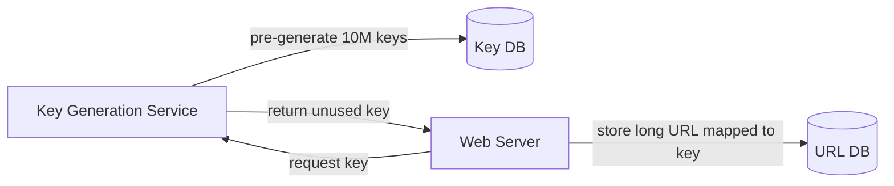
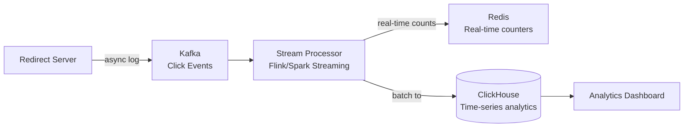

# SD01 — URL Shortener (TinyURL)

> [!tip] Interview Strategy
> This is usually the warm-up question. Show depth by covering: encoding strategy, cache design, analytics, and custom URL support. Don't just draw boxes.

---

## Requirements Clarification

### Functional Requirements
- [ ] Given a long URL, generate a short URL
- [ ] Given a short URL, redirect to the original long URL
- [ ] (Optional) Custom aliases: `tinyurl.com/my-alias`
- [ ] (Optional) URL expiration

### Non-Functional Requirements
- [ ] High availability (shortening + redirect must not go down)
- [ ] Minimal redirect latency (< 10ms ideally — cached)
- [ ] URLs are not guessable (security)
- [ ] Scale: 100M URLs shortened/day, 10:1 read:write ratio

---

## Capacity Estimation

```
Write QPS:
  100M URLs/day ÷ 86,400 sec/day ≈ 1,200 writes/sec
  
Read QPS (10:1 ratio):
  1,200 × 10 = 12,000 reads/sec

Storage:
  Assuming 5 chars/short URL + 200 chars/long URL = ~300 bytes/record
  100M records/day × 365 days × 5 years = ~182 billion records
  182B × 300 bytes = ~54 TB (manageable with DB + CDN)

Cache:
  12,000 reads/sec; cache top 20% of hot URLs
  100M URLs × 0.20 × 300 bytes = ~6 GB cache (fits in Redis)
```

---

## API Design

```
POST /api/v1/data/shorten
Request:  { "longUrl": "https://www.example.com/very/long/path?query=params", "customAlias": "optional", "expiresAt": "optional" }
Response: { "shortUrl": "https://tinyurl.com/Y7keocwj" }

GET /{shortUrl}
Response: 301 (Permanent Redirect) or 302 (Temporary Redirect) to longUrl
```

> [!question] 301 vs 302?
> **301 Permanent**: Browser caches redirect → no future requests to TinyURL. Better for traffic (less server load). Bad if you want analytics (bypassed after first visit).
> **302 Temporary**: Browser always hits TinyURL server. Good for click tracking / analytics.
> **Use 302** if you need analytics. **Use 301** if you want to minimize server load.

---

## High-Level Design

```mermaid
graph TB
    Client -->|POST /shorten| LB[Load Balancer]
    Client -->|GET /abc123| LB
    LB --> WS[Web Servers]
    WS -->|Read shortUrl| Cache[(Redis Cache\n6GB, LRU)]
    Cache -->|Cache HIT| WS
    Cache -->|Cache MISS| DB[(MySQL\nshort_url table)]
    DB --> Cache
    WS -->|Write new URL| DB
    WS -->|Log clicks| Kafka[Kafka\nClick Events]
    Kafka --> Analytics[Analytics Service\n(HBase / ClickHouse)]
```

---

## URL Encoding / Generation

### Approach 1: Base62 Encoding of Auto-Increment ID

```
Characters: [a-zA-Z0-9] = 62 characters
Short URL length: 7 characters = 62^7 = 3.5 trillion unique URLs (enough!)

Algorithm:
  1. DB auto-increment ID (or distributed ID generator): ID = 2009215674938
  2. Convert to Base62: 2009215674938 → "zn9edcu"
  3. Short URL: https://tinyurl.com/zn9edcu
```

**Problem with simple auto-increment:** Predictable IDs → attackers can enumerate all URLs!  
**Solution:** Use a distributed ID generator with non-sequential IDs (Snowflake ID)

### Approach 2: Hash (MD5/SHA256) + Truncation

```
Hash long URL: MD5("https://example.com/path") = "c4ca4238..."
Take first 7 characters: "c4ca423"
Check DB for collision, if collision: take next 7 chars from hash

Problem: High collision probability as URL count grows
```

### Approach 3: Key Generation Service (KGS) — Best for Scale

Pre-generate a pool of unique short URLs. Assign one when a shorten request comes in.



**KGS benefits:**
- No collision at request time (keys pre-verified unique)
- Very fast (just fetch from pre-generated pool)
- No hashing computation at request time

**KGS concerns:**
- Single point of failure → replicate KGS with standby
- Key theft if KGS hands out same key twice → use two key tables: "unused" and "used"

---

## Database Schema

```sql
CREATE TABLE url_mapping (
    id          BIGINT PRIMARY KEY,
    short_url   VARCHAR(10) UNIQUE NOT NULL,  -- "abc123"
    long_url    VARCHAR(2048) NOT NULL,
    user_id     BIGINT,                        -- optional: who created
    expires_at  DATETIME,
    created_at  DATETIME DEFAULT NOW(),
    
    INDEX idx_short_url (short_url)            -- fast lookup
);
```

**DB Choice:** MySQL (relational, ACID) is fine for URL mapping. Read replicas for scale.

---

## Caching Strategy

```
Cache-aside pattern:
  On redirect request for short URL "abc123":
    1. Check Redis: GET url:abc123
    2. Cache HIT → redirect immediately (~1ms total)
    3. Cache MISS → query DB → store in Redis TTL=1day → redirect

Cache sizing: 
  6GB Redis stores ~20M active URLs
  Hit rate for reads: ~80%+ (hot URLs are repeatedly accessed)

LRU eviction: evict least-recently-used URLs
```

---

## Custom Alias

```
POST /api/v1/data/shorten
{ "longUrl": "...", "customAlias": "my-product" }

→ Check if "my-product" already exists in DB
→ If taken: return error 409 Conflict
→ If available: insert with short_url = "my-product"
```

Rate limit custom alias creation per user to prevent squatting.

---

## Analytics (Deep Dive)



**Click event payload:**
```json
{
  "shortUrl": "abc123",
  "timestamp": 1640000000,
  "userAgent": "...",
  "ip": "1.2.3.4",
  "referrer": "twitter.com",
  "country": "US"
}
```

---

## Scale Considerations

### Database Sharding
If > 1TB URL data: shard by `short_url` (hash-based).
Each shard serves a subset of short URLs.

### CDN for Redirects (Advanced)
For extremely popular URLs, cache the redirect at CDN edge:
```
User → CDN edge → (if cached) redirect immediately
                → (if miss) hit origin → 302 response cached at CDN
```
Reduces redirect latency to < 5ms globally.

---

## Interview Checklist

- [ ] Define functional/non-functional requirements
- [ ] Calculate write/read QPS and storage
- [ ] Explain Base62 encoding with example
- [ ] Discuss 301 vs 302 trade-off
- [ ] Draw architecture: LB → Web Servers → Cache → DB
- [ ] Mention KGS for advanced encoding approach
- [ ] Discuss analytics with Kafka
- [ ] Handle custom aliases and collision

---

## Related Notes

- [[07 - Caching]] — Redis for redirect caching
- [[08 - Message Queues]] — Kafka for analytics events
- [[13 - Database Sharding]] — sharding for scale
- [[18 - Rate Limiting]] — prevent abuse of URL shortening
