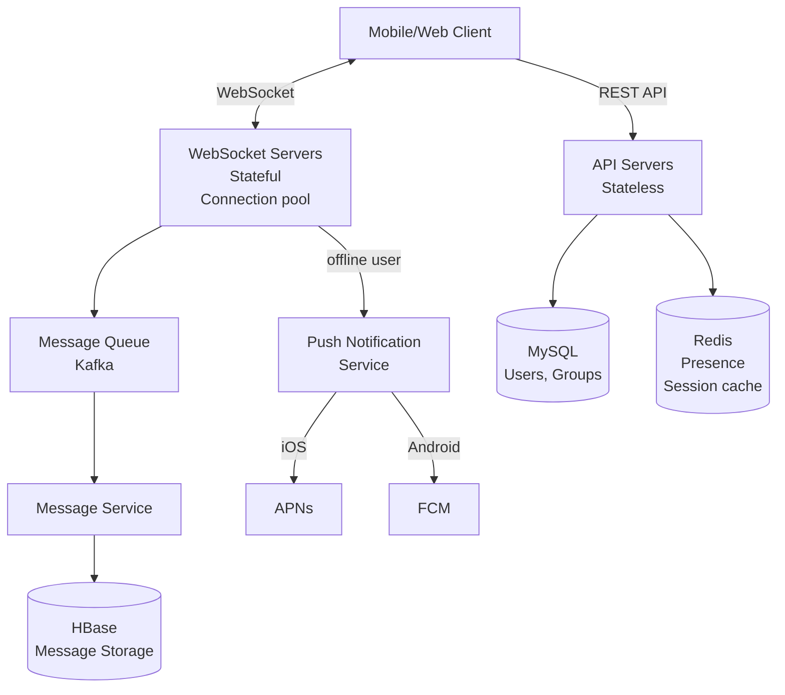
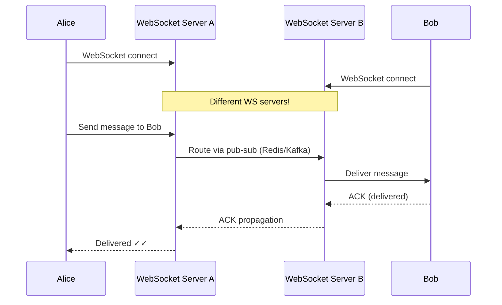
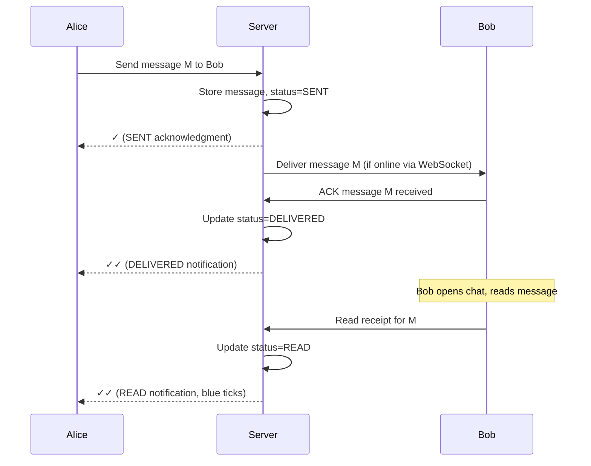

# SD02 — Chat System (WhatsApp / Messenger)

> [!tip] Interview Strategy
> Show depth by covering: WebSocket connections at scale, message storage choice (why HBase), presence system, and push notifications for offline users. The storage design for billions of messages is the hardest and most interesting part.

---

## Requirements Clarification

### Functional Requirements
- [ ] 1:1 messaging
- [ ] Group messaging (up to 500 members)
- [ ] Message delivery status (sent ✓, delivered ✓✓, read ✓✓ blue)
- [ ] Online/offline presence indicator
- [ ] Push notifications when offline
- [ ] Message history (persistent storage)
- [ ] Media sharing (images, videos, documents)

### Non-Functional Requirements
- [ ] Low latency: messages delivered < 100ms
- [ ] High availability: 99.99%
- [ ] Scale: 1 billion users, 60 billion messages/day

---

## Capacity Estimation

```
DAU: 500M users
Messages/day: 60B messages (120 messages/user/day)
Message size: ~100 bytes average text, larger for media

Write QPS: 60B / 86,400 ≈ 700,000 msg/sec
Read QPS: ~same (1:1 ratio — every message sent is read)

Storage:
  60B messages/day × 100 bytes = 6 TB/day
  5 years: 6 TB × 365 × 5 ≈ 10 PB total storage
  → Requires distributed storage (HBase)

WebSocket connections:
  500M DAU × peak concurrent sessions = ~50-100M connections
  Each connection: ~10KB RAM
  → ~1 TB RAM just for WebSocket state → must be distributed
```

---

## High-Level Architecture



---

## Real-time Messaging: WebSocket Architecture

### Why WebSocket?
- HTTP polling: client sends request every N seconds → wasteful, delayed
- Long polling: client waits, server responds when event occurs → complex, not true bidirectional
- **WebSocket**: Persistent bidirectional TCP connection → true real-time, efficient



### WebSocket Server Scaling Challenge
WebSocket servers are **stateful** — client A is connected to Server 1, client B to Server 2.
- Message from A to B must route from Server 1 to Server 2.
- Use Redis pub/sub or Kafka for inter-server routing.

```
Alice on WS Server 1 sends to Bob:
  Server 1 checks: which WS server is Bob connected to?
  → Query Redis: GET user:bob:server → "ws-server-7"
  → Publish to Redis channel "ws-server-7": {to: bob, message: ...}
  → Server 7 delivers to Bob's socket
```

---

## Message Storage: HBase (Why?)

### Requirements for message storage
- High write throughput (700K messages/sec)
- Read by: userId + time range (fetch chat history)
- Immutable records (messages don't change, only status)
- Need to store 10+ PB efficiently

### Why NOT MySQL?
```
MySQL: Great for relational data, complex queries
  → Can't scale to 700K writes/sec on single instance
  → Sharding adds complexity
  → Not optimized for time-series message patterns
```

### Why HBase?
```
HBase (wide-column store on Hadoop):
  → Billions of rows, millions of columns
  → Scales horizontally (HDFS underneath)
  → Optimized for high write throughput (LSM tree)
  → Rows sorted by key → efficient range scans by user+time
```

### HBase Schema Design

```
Table: messages

Row key: [to_user_id][message_id]
         → Groups all messages for a user together
         → message_id is time-ordered (Snowflake ID: sortable by time)
         → Range scan: "Get all messages for user Bob since T" is fast

Column family: msg {
    from_user_id: "alice",
    content: "Hey Bob!",
    type: "text",
    status: 1  (1=sent, 2=delivered, 3=read)
}
```

> [!tip] Row Key Design is Critical
> The row key determines how data is physically laid out in HBase. `[to_user_id][message_id]` means all of Bob's messages are contiguous on disk → single scan to load Bob's chat history.

### Group Message Storage

```
For group messages (group_id = G1 with members A, B, C):

Approach 1: Fan-out on write
  Store separate copy for each member:
    Row key: [user_A_id][msg_id] → message
    Row key: [user_B_id][msg_id] → message (duplicate)
    Row key: [user_C_id][msg_id] → message (duplicate)
  
  Pros: Read is fast (just scan your own messages)
  Cons: Storage × member count; update delivery status complex

Approach 2: Shared storage
  Store once: Row key: [group_id][msg_id] → message
  Track read position per user: Redis or separate table
  
  Pros: No data duplication
  Cons: More complex read logic; slower reads
  
WhatsApp uses fan-out (Approach 1) — optimizes for reads
```

---

## Message Delivery Status System



---

## Presence System

**Challenge:** Determining if 100M users are online, with sub-second accuracy.

```
When user connects: SET user:{id}:online 1 EX 30  (expires in 30s)
Every 10s: user client sends heartbeat → refresh TTL
When client disconnects: DEL user:{id}:online (or let TTL expire)

Check if Bob is online: GET user:bob:online
  → Returns 1: online
  → Returns nil: offline (last heartbeat > 30s ago)
```

**Scale issue:** 100M users × heartbeat every 10s = 10M updates/sec to Redis
**Solution:** 
- Only send presence to contacts (privacy + scale)
- Use a presence service cluster with partitioned users
- Heartbeat via WebSocket (piggyback on existing connection)

---

## Offline Users: Push Notifications

```mermaid
graph LR
    Server[Message Server] -->|user offline?| Presence[Presence Service]
    Presence -->|yes, offline| Push[Push Notification Service]
    Push -->|iOS token| APNs[Apple Push\nNotification Service]
    Push -->|Android token| FCM[Firebase Cloud\nMessaging]
    APNs --> iOS[iOS Device]
    FCM --> Android[Android Device]
    
    Push --> DB[(Device Token DB\n{user_id: device_tokens[]})]
```

**Flow:**
1. Message arrives for offline Bob
2. Server queues message in HBase (already done)
3. Server checks presence: Bob is offline
4. Server publishes to Notification Service (via Kafka)
5. Notification Service fetches Bob's device tokens from DB
6. Sends push via APNS (iOS) or FCM (Android)
7. Bob opens app → fetches missed messages from server

---

## End-to-End Encryption (E2EE)

```
Signal Protocol (used by WhatsApp):
  Each device has: public key (shared), private key (never leaves device)
  
  Alice → Bob:
    Alice encrypts with Bob's public key
    Server stores encrypted ciphertext (cannot decrypt!)
    Bob decrypts with his private key
    
  Server never has decryption key → true E2EE
  
Double Ratchet Algorithm: provides forward secrecy
  Each message uses different encryption key
  Compromise of one key doesn't compromise past or future messages
```

---

## Interview Checklist

- [ ] Explain WebSocket vs long polling and why WebSocket for chat
- [ ] Draw: client → WebSocket server → Kafka/Redis → recipient WebSocket server
- [ ] Explain WebSocket server routing problem and Redis pub/sub solution
- [ ] Justify HBase for message storage (write throughput, time-series)
- [ ] Design HBase row key: [user_id][message_id]
- [ ] Explain fan-out vs shared storage for group messages
- [ ] Describe delivery status system (sent/delivered/read)
- [ ] Describe presence system with Redis TTL + heartbeats
- [ ] Describe push notification flow for offline users

---

## Related Notes

- [[10 - API Design]] — WebSocket deep dive
- [[08 - Message Queues]] — Kafka for message routing
- [[07 - Caching]] — Redis for presence and session routing
- [[11 - SQL vs NoSQL]] — HBase (wide column) for message storage
