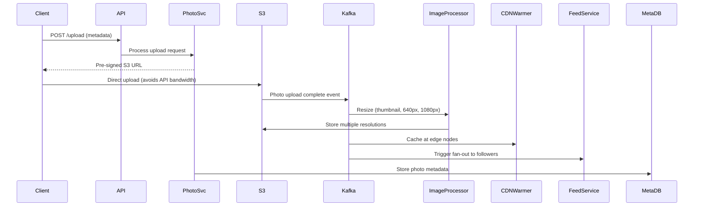
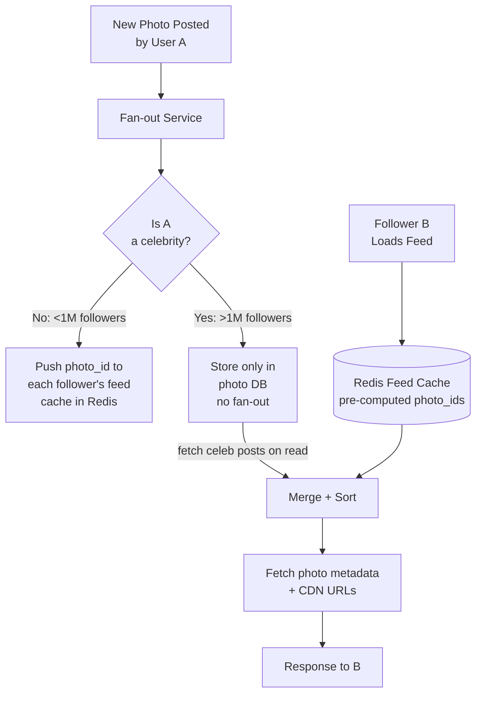
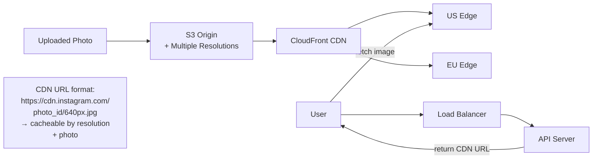

# SD03 — Instagram (Photo Sharing)

---

## Requirements

### Functional
- [ ] Upload photos/videos (images up to 10MB, videos up to 60s)
- [ ] View news feed (photos from followed users)
- [ ] Follow/unfollow users
- [ ] Like and comment on photos
- [ ] Story feature (disappears after 24h)
- [ ] Search by hashtag

### Non-Functional
- [ ] 1B users, 500M DAU
- [ ] 100M photos uploaded/day
- [ ] Feed latency < 200ms
- [ ] 99.99% availability

---

## Capacity Estimation

```
Uploads: 100M photos/day = ~1,200 uploads/sec
  Average photo: 3MB → 3MB × 100M/day = 300 TB/day of raw storage
  After compression + CDN: ~150 TB/day

Feed reads: 500M DAU × 10 feed loads/day = 5B reads/day ≈ 60,000 reads/sec
  (read-heavy: 50:1 ratio)

Storage (5 years): 150 TB/day × 365 × 5 = ~274 PB
  → Object storage (S3 or distributed object store)
```

---

## Photo Upload Flow



### Image Resolutions Generated
```
Original: 10MB (stored for download)
Thumbnail: 150×150 px (~20KB)
Display feed: 640px wide (~150KB)
Full screen: 1080px wide (~500KB)
Story: Cropped for 9:16 aspect ratio
```

**Why resize?** Sending 3MB photo to mobile on cellular when 150KB is sufficient wastes bandwidth and battery.

---

## Database Design

### Users
```sql
CREATE TABLE users (
    user_id     BIGINT PRIMARY KEY,
    username    VARCHAR(30) UNIQUE,
    email       VARCHAR(100) UNIQUE,
    bio         VARCHAR(150),
    profile_pic VARCHAR(512),  -- CDN URL
    follower_count INT DEFAULT 0,  -- denormalized for perf
    following_count INT DEFAULT 0,
    post_count  INT DEFAULT 0
);
```

### Photos
```sql
CREATE TABLE photos (
    photo_id    BIGINT PRIMARY KEY,  -- Snowflake ID
    user_id     BIGINT NOT NULL,
    s3_url      VARCHAR(512),
    caption     VARCHAR(2200),
    location    VARCHAR(100),
    like_count  BIGINT DEFAULT 0,
    comment_count BIGINT DEFAULT 0,
    created_at  DATETIME,
    
    INDEX idx_user_time (user_id, photo_id DESC)
);
```

### Follows (Cassandra for scale)
```
Table: user_follows
  Partition: follower_id (get all users I follow)
  Clustering: followee_id

Table: user_followers
  Partition: followee_id (get all my followers)
  Clustering: follower_id
```

---

## News Feed Generation

Uses **hybrid fan-out** (same as Twitter [[SD05 - Twitter]]):



### Feed Cache Structure (Redis)
```
Key: feed:{user_id}
Value: Sorted Set
  Score: timestamp of post
  Member: {poster_id}:{photo_id}

ZADD feed:bob 1640000001 "alice:photo123"
ZADD feed:bob 1640000002 "carol:photo456"

ZREVRANGE feed:bob 0 19  → last 20 photos in Bob's feed
```

---

## Stories Feature

Stories disappear after 24 hours — interesting design challenge.

```
Storage: S3 (same as photos)
Metadata: Redis with TTL

SETEX story:{user_id}:{story_id} 86400 {metadata_json}
  → Automatically expires after 86400 seconds (24 hours)

Story feed: GEORADIUS equivalent but time-based
  → Active story = exists in Redis AND not expired
  → Query: which of my followees have active stories?
  → SMEMBERS followees_with_stories:{user_id}  
  → Updated when story added/expires

Who viewed my story:
  HyperLogLog: PFADD story_views:{story_id} user_ids...
  PFCOUNT story_views:{story_id}  → approximate unique viewer count
  For ordered list of viewers: Sorted Set with timestamp
```

---

## CDN for Image Delivery



---

## Search by Hashtag

```
Hashtag extraction from caption at upload time:
  "#sunset #travel #photography" → ["sunset", "travel", "photography"]

Elasticsearch:
  POST /photos/_index {photo_id, hashtags, created_at, user_id, like_count}
  
  Search: GET /photos/_search {query: {term: {hashtags: "sunset"}}}
  
Trending hashtags:
  Flink stream: count hashtag frequency in 1-hour sliding window
  Top 30 → cached in Redis → served as "Trending" section
```

---

## Interview Checklist

- [ ] Requirements and capacity (100M uploads/day, 50:1 read:write)
- [ ] Photo upload flow (pre-signed URL → S3 → queue → resize)
- [ ] Explain why multiple resolutions (bandwidth, device capabilities)
- [ ] Hybrid fan-out for feed (celebrities = pull, others = push)
- [ ] Redis sorted set for feed cache
- [ ] CDN for image delivery (URL structure for caching)
- [ ] Stories with Redis TTL for automatic expiration
- [ ] Hashtag search with Elasticsearch

---

## Related Notes

- [[09 - CDN]] — image delivery
- [[07 - Caching]] — Redis feed cache
- [[SD05 - Twitter]] — compare fan-out approaches
- [[SD11 - News Feed (Facebook)]] — similar ranking problem
