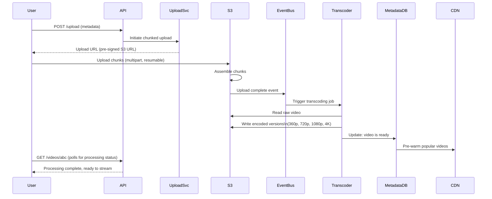
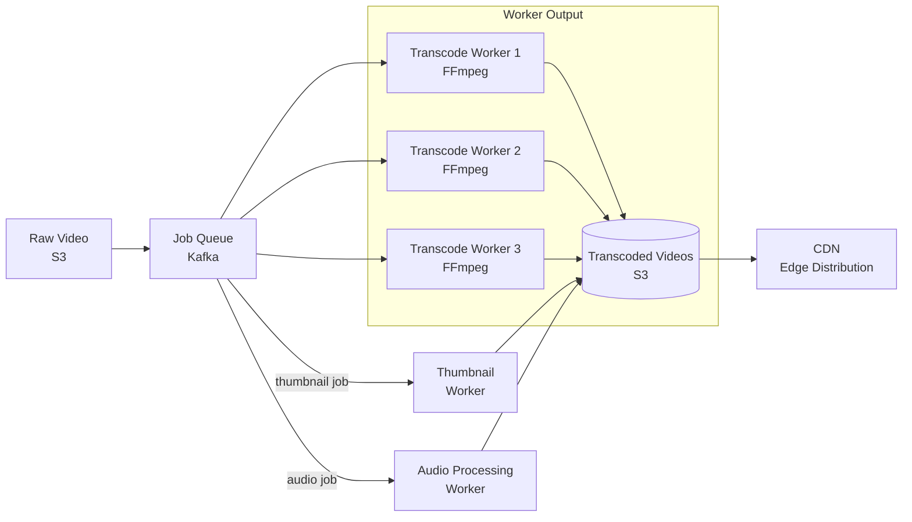
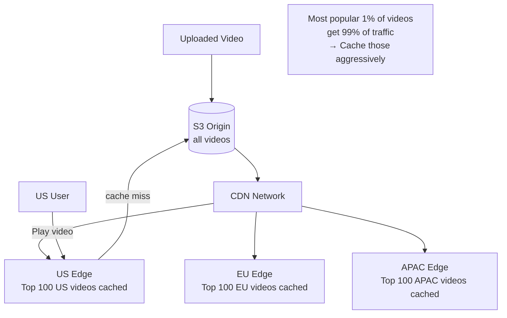

# SD04 — YouTube (Video Streaming)

> [!tip] Interview Strategy
> The unique challenges are: **video upload and transcoding pipeline** (the hardest part), **adaptive bitrate streaming**, and **CDN delivery at global scale**. Most candidates skip the transcoding pipeline — don't.

---

## Requirements Clarification

### Functional Requirements
- [ ] Upload videos (up to 10GB)
- [ ] Stream videos (adaptive quality)
- [ ] Search videos
- [ ] View recommendations
- [ ] Comments, likes, subscriptions
- [ ] View count

### Non-Functional Requirements
- [ ] 500M DAU, 500 hours of video uploaded/minute
- [ ] Streaming latency: < 3 seconds to start playing
- [ ] High availability: 99.99%
- [ ] Global distribution (low latency worldwide)

---

## Capacity Estimation

```
Upload:
  500 hours/minute = 30,000 seconds of video/minute
  Assume 1080p = ~8 Mbps → 30,000s × 8Mb/s ÷ 8 = 30 GB/minute of raw video
  After encoding to multiple resolutions: ~3x storage ≈ 90 GB/minute
  Per year: 90 GB × 60 min × 24 hr × 365 = ~47 PB/year

Stream:
  500M users × ~1 hr/day = 500M hours/day ≈ 5.8M hours/hour
  5.8M streams × ~4 Mbps average = ~23 Tbps bandwidth (!)
  → This is why CDN is essential

Storage: 47+ PB/year → Object storage (S3, GCS) + CDN
```

---

## Video Upload Flow



---

## Transcoding Pipeline (The Core)

### Why Transcoding?
```
Raw upload: 1080p H.264 at 50 Mbps (high quality for upload)
Must produce:
  - 360p (1.5 Mbps)  → mobile on cellular
  - 480p (2.5 Mbps)  → standard
  - 720p (5 Mbps)    → HD
  - 1080p (8 Mbps)   → Full HD
  - 1440p (16 Mbps)  → 2K (if original supports)
  - 2160p (35 Mbps)  → 4K (if original supports)
  - HLS/DASH segment files (2-6 second chunks for adaptive streaming)
```

### Pipeline Architecture



**Key design decisions:**
- **DAG-based workflow**: Transcode workers organized as directed acyclic graph
  - Parallel transcoding of each resolution independently
  - Thumbnail generation in parallel
  - Audio processing in parallel
- **Horizontal scaling**: Add more EC2/K8s pods for transcode workers during upload spikes
- **GPU acceleration**: FFmpeg uses GPU for H.264/H.265 encoding (NVIDIA NVENC)
- **Pre-signed S3 URLs**: Workers read/write directly to S3 (no data through application servers)

---

## Adaptive Bitrate Streaming (HLS / DASH)

```
Video split into 2-second segments at each quality level:
  seg_001_360p.ts, seg_001_720p.ts, seg_001_1080p.ts
  seg_002_360p.ts, seg_002_720p.ts, seg_002_1080p.ts
  ...

Master playlist (m3u8):
  #EXT-X-STREAM-INF:BANDWIDTH=1500000,RESOLUTION=640x360
  360p/playlist.m3u8
  #EXT-X-STREAM-INF:BANDWIDTH=5000000,RESOLUTION=1280x720
  720p/playlist.m3u8
  #EXT-X-STREAM-INF:BANDWIDTH=8000000,RESOLUTION=1920x1080
  1080p/playlist.m3u8

Player logic:
  1. Fetch master playlist
  2. Start at medium quality
  3. Every segment: measure download bandwidth
  4. If bandwidth dropping → switch to lower quality playlist
  5. If bandwidth increasing → switch to higher quality
```

**Why segments?** Each segment is independently cacheable at CDN. Only needed segments are fetched. Seeking = just request the segment at the seek position.

---

## CDN Strategy



**Proactive caching (YouTube technique):**
- When a video starts going viral, proactively push it to edge nodes
- Use view velocity (views/minute) as signal for proactive caching

---

## Metadata Service & Search

### Video Metadata (MySQL)
```sql
CREATE TABLE videos (
    video_id    VARCHAR(11) PRIMARY KEY,  -- YouTube ID: "dQw4w9WgXcQ"
    title       VARCHAR(200) NOT NULL,
    description TEXT,
    user_id     BIGINT NOT NULL,
    duration_ms BIGINT,
    status      ENUM('processing','ready','deleted'),
    view_count  BIGINT DEFAULT 0,         -- approximate counter
    like_count  BIGINT DEFAULT 0,
    created_at  DATETIME,
    
    INDEX idx_user (user_id, created_at DESC)
);
```

### View Count at Scale
```
YouTube serves 1B views/day → ~12K views/sec across all videos

Problem: UPDATE videos SET view_count=view_count+1 WHERE id=X
  → Hot key contention on viral videos (millions of concurrent updates)
  
Solution: 
  1. Redis INCR: atomic increment, ~1M ops/sec
  2. Every 30 seconds: batch flush Redis counters to DB
  3. OR: Use HyperLogLog for approximate unique viewer count (95% accuracy)
```

### Search
```
Videos indexed in Elasticsearch:
  - title (analyzed text)
  - description
  - tags
  - transcript (auto-generated via ML)
  
Ranking factors (ML model):
  - Query relevance (BM25 score)
  - Video quality signals (CTR, watch time, likes/dislikes)
  - User personalization (watch history)
  - Freshness (newer videos for trending topics)
```

---

## Recommendations

```
User watch history → Feature vector (learned embeddings)
Video catalog → Feature vector (learned embeddings)

Candidate generation:
  Matrix factorization: find videos with similar embeddings to user's taste
  Collaborative filtering: "users like you watched..."

Ranking:
  ML model scores candidates by: predicted watch time, CTR, diversity
  
Infrastructure:
  Training: Offline batch on Spark (daily or hourly)
  Serving: Online inference via TensorFlow Serving
  Cache: Precomputed recommendations per user in Redis
```

---

## Interview Checklist

- [ ] Define requirements and estimate scale
- [ ] Draw the video upload flow (chunked upload → S3 → queue → transcoder)
- [ ] Explain why transcoding is needed (multiple resolutions, formats)
- [ ] Explain adaptive bitrate streaming (HLS segments, quality switching)
- [ ] Explain CDN for video delivery (why segments are key to caching)
- [ ] Explain view count at scale (Redis INCR + batch flush)
- [ ] Describe search with Elasticsearch
- [ ] Mention proactive CDN caching for viral videos

---

## Related Notes

- [[09 - CDN]] — CDN is the primary delivery mechanism
- [[08 - Message Queues]] — Kafka for transcoding job queue
- [[07 - Caching]] — Redis for view counts and recommendations
- [[SD12 - Netflix]] — similar streaming design with Open Connect CDN
