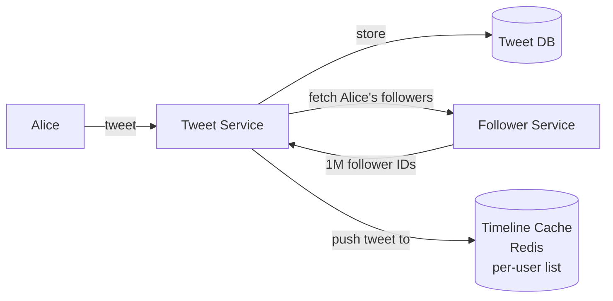
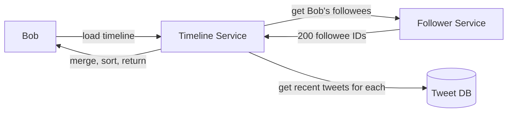
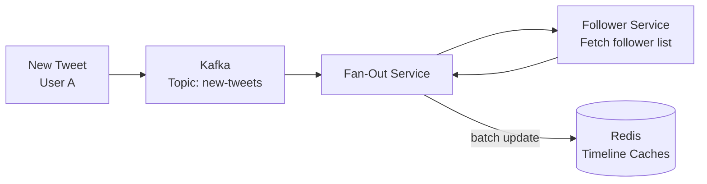

# SD05 — Twitter

> [!tip] Interview Strategy
> The core challenge is **timeline generation**: fan-out on write vs fan-out on read vs hybrid. This is where FAANG interviewers drill deep. Know the hybrid approach and the "celebrity problem" by heart.

---

## Requirements Clarification

### Functional Requirements
- [ ] Post tweets (text 280 chars, images, videos)
- [ ] Follow users
- [ ] View home timeline (tweets from followed users, reverse chronological)
- [ ] View user profile timeline
- [ ] Search tweets
- [ ] Trending hashtags
- [ ] Like, retweet, reply

### Non-Functional Requirements
- [ ] 300M DAU, 500M tweets/day
- [ ] Timelines rendered in < 200ms
- [ ] High availability
- [ ] Eventual consistency for timelines (some staleness OK)

---

## Capacity Estimation

```
Tweets/day: 500M
Tweet size: 280 chars + metadata ≈ ~300 bytes text, larger with media

Write QPS: 500M / 86,400 ≈ 6,000 tweets/sec
Read QPS: 300M DAU × ~5 timeline loads/day ≈ 17M reads/day = ~200,000 reads/sec
  (Read-heavy: 200K vs 6K → 33:1 read:write ratio)

Storage (tweets):
  300 bytes × 500M/day × 365 × 5 years ≈ ~274 TB

Timeline precomputation:
  Average user follows 200 others
  Fan-out on write: 6,000 writes/sec × 200 followers = 1.2M cache writes/sec
```

---

## The Core Challenge: Timeline Generation

### Option 1: Fan-Out on Write (Push Model)

When Alice tweets, immediately push to every follower's timeline cache.



**Pros:**
- Timeline reads are O(1) — just fetch from cache
- Very fast read latency (<10ms)

**Cons:**
- **Celebrity problem**: Lady Gaga (100M followers) tweets → 100M cache writes immediately
- High write amplification
- Storage: each tweet stored N times (one per follower's timeline)

### Option 2: Fan-Out on Read (Pull Model)

When Bob loads his timeline, fetch tweets from all people Bob follows.



**Pros:**
- No precomputation — simple writes
- No celebrity problem (celebrities just have one copy of their tweet)

**Cons:**
- Read is expensive: N DB queries per timeline load (N = number of followees)
- Very slow for users following many people
- DB under heavy load on reads

### Option 3: Hybrid Model (Twitter's Actual Approach ✅)

```mermaid
graph TB
    Tweet[New Tweet] --> Check{Is author\na celebrity\n(>1M followers)?}
    Check -->|No, regular user| FanOut[Fan-out on Write\nPush to follower caches]
    Check -->|Yes, celebrity| Store[Store only in\nTweet DB\nno fan-out]
    
    ReadTimeline[User reads timeline] --> Cache[(Timeline Cache\npre-computed for\nregular followees)]
    Cache --> Merge[Merge engine]
    Store -->|fetch celebrity tweets on read| Merge
    Merge -->|merged timeline| User
```

**Algorithm:**
1. Pre-compute timelines for all users (fan-out on write for normal users)
2. For celebrities: DON'T fan-out. Store tweet once.
3. On timeline read: fetch pre-computed timeline + fetch recent celebrity tweets + merge by timestamp
4. Result: Fast reads AND no celebrity write storm

> [!note] Threshold
> Twitter uses ~10,000 followers as the celebrity threshold for switching to pull model.

---

## Data Storage

### Tweet DB
```sql
-- MySQL / distributed SQL
CREATE TABLE tweets (
    tweet_id    BIGINT PRIMARY KEY,  -- Snowflake ID (time-sortable)
    user_id     BIGINT NOT NULL,
    content     VARCHAR(280),
    media_url   VARCHAR(512),
    like_count  BIGINT DEFAULT 0,    -- denormalized counter
    retweet_count BIGINT DEFAULT 0,
    created_at  DATETIME,
    
    INDEX idx_user_created (user_id, tweet_id DESC)  -- user profile timeline
);
```

### Timeline Cache (Redis)

```
Key: timeline:{user_id}
Value: Sorted set (ZAGG) with score = tweet timestamp
  Members: tweet_ids

ZADD timeline:bob 1640000001 tweet:12345
ZADD timeline:bob 1640000002 tweet:12346

ZREVRANGE timeline:bob 0 49  → last 50 tweets for Bob's timeline
```

**Timeline cache stores tweet IDs, not content** (tweet content fetched separately to avoid duplication and allow editing).

### Follower Graph
```sql
CREATE TABLE follows (
    follower_id BIGINT,
    followee_id BIGINT,
    created_at  DATETIME,
    PRIMARY KEY (follower_id, followee_id),
    INDEX idx_followee (followee_id, follower_id)  -- for fan-out
);
```

For at-scale systems (FAANG), graph stored in a distributed system (Cassandra, or dedicated graph DB) due to scale (billions of follow relationships).

---

## Fan-Out Service



**Fan-out is async (via Kafka):**
- Post request returns immediately after storing tweet
- Fan-out happens in background (seconds later)
- This is why timelines are eventually consistent

**Fan-out optimization:**
- Process in parallel batches (100K followers at a time)
- Skip inactive users (last seen > 30 days ago — don't update their stale cache)

---

## Search: Elasticsearch

```
Tweet content → indexed by Elasticsearch
  Inverted index: word → [tweet_ids]
  
Trending hashtags:
  Stream tweets to Flink/Spark Streaming
  Count hashtag frequency in 1-hour windows
  Top-K → stored in Redis → API serves trending topics
```

---

## Like / Retweet Counters

```
Problem: High contention on popular tweet's like counter
  "Post goes viral → 1M simultaneous likes → UPDATE tweets SET likes=likes+1 WHERE id=X"
  → DB deadlock, contention

Solution: Redis counter + async DB persistence
  INCR tweet:12345:likes  → atomic Redis counter, no lock
  Every minute: flush Redis counter to DB
  
  Read: ALWAYS from Redis (fresh count)
```

---

## Interview Checklist

- [ ] Define requirements (timeline, search, trending)
- [ ] Calculate write/read QPS (300M DAU, 33:1 read:write)
- [ ] Explain fan-out on write: pros (fast reads) cons (celebrity problem)
- [ ] Explain fan-out on read: pros (simple write) cons (slow reads)
- [ ] Explain hybrid approach: normal users push, celebrities pull+merge
- [ ] Design Tweet DB schema and Timeline Cache (Redis sorted set)
- [ ] Explain async fan-out via Kafka
- [ ] Explain search with Elasticsearch and trending with stream processing
- [ ] Explain counter design with Redis to avoid DB contention

---

## Related Notes

- [[07 - Caching]] — Redis for timeline cache
- [[08 - Message Queues]] — Kafka for async fan-out
- [[11 - SQL vs NoSQL]] — which DB for what
- [[SD11 - News Feed (Facebook)]] — similar problem, compare approaches
