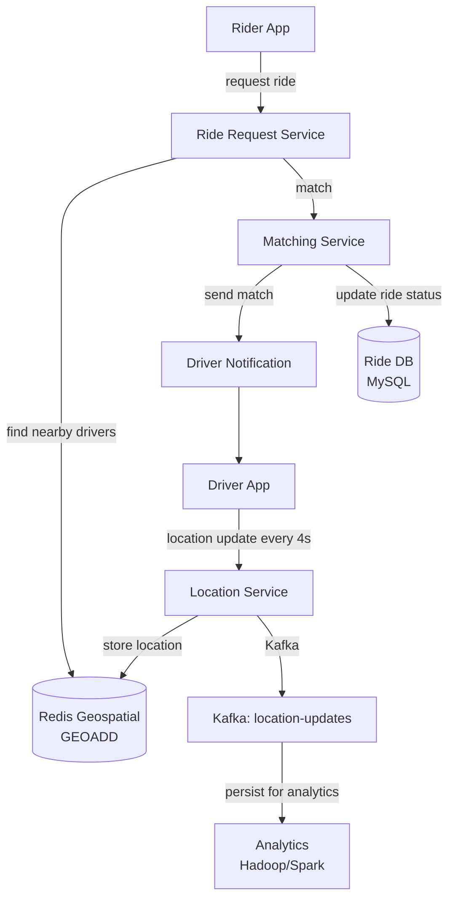
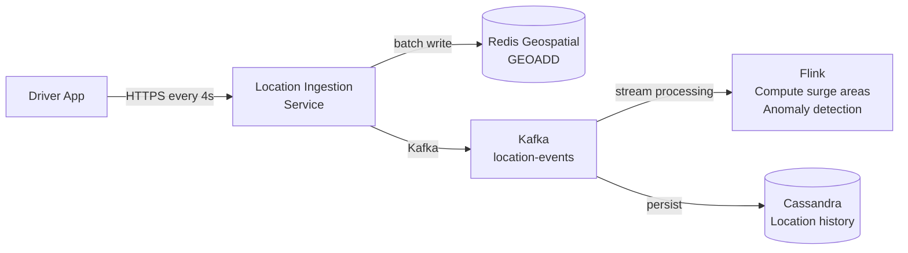

# SD06 — Uber / Ride Sharing

> [!tip] Interview Strategy
> The most unique part of Uber is **geospatial indexing** (how to efficiently find nearby drivers) and the **matching algorithm**. Interviewers at Uber/Lyft focus heavily on location updates at scale and the data structures for proximity search.

---

## Requirements Clarification

### Functional Requirements
- [ ] Rider requests a ride from location A to B
- [ ] System finds nearby available drivers
- [ ] Matches rider with closest/best driver
- [ ] Real-time tracking of driver location
- [ ] ETA calculation
- [ ] Surge pricing based on supply/demand

### Non-Functional Requirements
- [ ] 1M concurrent drivers updating location every 4 seconds
- [ ] Match request latency < 1 second
- [ ] Location accuracy: ~10 meters
- [ ] High availability (rides must not fail mid-trip)

---

## Capacity Estimation

```
Location updates:
  1M active drivers × 1 update/4 seconds = 250,000 location updates/sec
  Each update: {driver_id, lat, lon, timestamp, status} ≈ 50 bytes
  = 12.5 MB/sec of location data

Ride requests:
  Peak: ~100K requests/min ≈ 1,700 requests/sec

ETA queries: much higher (every map interaction)
```

---

## High-Level Architecture



---

## Geospatial Indexing: Finding Nearby Drivers

This is the core technical challenge. How do you find all drivers within 3km of a rider?

### Option 1: Naive — SQL Circle Query
```sql
SELECT driver_id, lat, lon 
FROM driver_locations
WHERE lat BETWEEN rider_lat - 0.03 AND rider_lat + 0.03
  AND lon BETWEEN rider_lon - 0.03 AND rider_lon + 0.03;
```
**Problem:** O(N) scan of all driver locations. With 1M drivers, too slow.

### Option 2: Geohash ✅ (Recommended approach)

Geohash encodes (lat, lon) as a short string. Adjacent cells share common prefix.

```
Precision 6 geohash cell ≈ 1.2km × 0.6km area
Precision 7 geohash cell ≈ 153m × 153m area

San Francisco rider at (37.7749, -122.4194):
  Precision 6: "9q8yy7"
  
Nearby geohash cells (8 neighbors + current = 9 cells):
  "9q8yy7", "9q8yy6", "9q8yy5", ...
  
Find drivers: query drivers whose geohash STARTS WITH one of these 9 cells
```

**Implementation with Redis:**
```
GEOADD drivers_geo lon lat driver_id
GEORADIUS drivers_geo rider_lon rider_lat 3 km ASC COUNT 20
```

**Redis GEORADIUS** uses geohash internally. O(N+log(M)) where N = results, M = index size. Very fast!

### Option 3: Quadtree

Recursively partition 2D space. Each leaf contains a bounded number of drivers.

```
Level 0: Entire world
Level 1: 4 quadrants
Level 2: 16 cells
...
Leaf cell: ≤ K drivers per cell

On find drivers:
  Find leaf cell containing rider
  Expand to neighbors until enough drivers found
```

**Pros:** Dynamic density — densely populated areas have deeper trees  
**Cons:** Complex to distribute and update dynamically

### Geohash vs Quadtree Comparison

| | Geohash | Quadtree |
|--|---------|---------|
| Space partitioning | Fixed grid | Adaptive |
| Dense area handling | Smaller cells | More nodes |
| Implementation | Simple (use Redis) | Complex |
| Update | O(1) per driver | O(log N) |
| Uber uses | Geohash (H3) | Some features use quadtree |

> [!note] Uber's H3
> Uber uses their own open-source library **H3** — a hexagonal hierarchical spatial index. Hexagons have uniform distance to all neighbors (vs squares where diagonal is √2 longer). Important for ETA calculations.

---

## Driver Location Update System



**250,000 updates/sec** — needs high-throughput ingestion:
- Location ingestion service is stateless, horizontally scaled
- Batch GEOADD to Redis (pipeline N updates per TCP round trip)
- Redis Cluster with geospatial data sharded by geohash prefix

---

## Matching Algorithm

```
When rider requests ride at location R:

1. Find available drivers within radius (e.g., 3km)
   → Redis GEORADIUS: returns [driver_A, driver_B, driver_C] with distance

2. Score each driver:
   score = f(distance, driver_rating, car_type, ETA, driver_acceptance_rate)
   
3. Send match request to top-scored driver
   → Driver has 15 seconds to accept
   
4. If driver declines (or timeout):
   → Try next driver
   → If no drivers nearby: surge pricing kicks in to attract drivers
```

**Matching is async (driver must accept):**
- State machine: `REQUESTED → MATCHED → ACCEPTED/DECLINED → CONFIRMED`
- Use Redis for ride state (fast updates); persist to MySQL on state changes

---

## Surge Pricing

```
Supply/Demand imbalance → surge multiplier

Supply: drivers online in area (from geohash + driver status)
Demand: ride requests in area (from incoming request stream)

If demand/supply > threshold:
  surge_multiplier = 1.0 + (demand/supply - 1) × surge_factor
  
Implemented: Flink streaming job
  - Tumbling window: every 1 minute
  - Group by geohash cell
  - Compute supply/demand ratio
  - Output surge multiplier to Redis (keyed by geohash)
  
Rider app: fetch surge multiplier before showing price
  → GET /surge/{geohash_of_rider_location}
  → Redis GET: ~1ms
```

---

## ETA Calculation

```
ETA = time_for_driver_to_reach_rider + estimated_trip_duration

Time for driver to reach rider:
  Google Maps API / internal routing engine
  Uses real-time traffic data
  
Estimated trip duration:
  ML model based on historical trip times (same origin/destination, same time of day)
```

**At Uber scale:** Internal routing engine (not Google Maps) processes road network graph.

---

## Database Design

### Ride Table (MySQL)
```sql
CREATE TABLE rides (
    ride_id     BIGINT PRIMARY KEY,
    rider_id    BIGINT NOT NULL,
    driver_id   BIGINT,
    status      ENUM('requested','matched','in_progress','completed','cancelled'),
    origin_lat  DECIMAL(9,6),
    origin_lon  DECIMAL(9,6),
    dest_lat    DECIMAL(9,6),
    dest_lon    DECIMAL(9,6),
    fare        DECIMAL(10,2),
    surge_mult  DECIMAL(3,2),
    created_at  DATETIME,
    updated_at  DATETIME,
    
    INDEX idx_rider (rider_id, created_at),
    INDEX idx_driver (driver_id, created_at)
);
```

### Driver Location History (Cassandra)
```
Table: driver_locations
Partition key: driver_id
Clustering key: timestamp DESC (most recent first)
Columns: lat, lon, status, speed, heading

→ "Get last 1 hour of location history for driver X" = single partition read
```

---

## Interview Checklist

- [ ] Clarify requirements (scale, latency targets)
- [ ] Explain geohash encoding and why prefix = proximity
- [ ] Explain Redis GEORADIUS for nearby driver search
- [ ] Explain Quadtree as alternative (adaptive density)
- [ ] Draw the location update ingestion pipeline (250K updates/sec)
- [ ] Explain matching algorithm (scoring, async accept/decline)
- [ ] Explain surge pricing with streaming computation (Flink)
- [ ] Mention Uber H3 for extra credit
- [ ] Design Cassandra for location history storage

---

## Related Notes

- [[07 - Caching]] — Redis geospatial for driver locations
- [[08 - Message Queues]] — Kafka for location event streaming
- [[15 - Indexing Strategies]] — geospatial indexing deep dive
- [[11 - SQL vs NoSQL]] — MySQL for rides, Cassandra for location history
