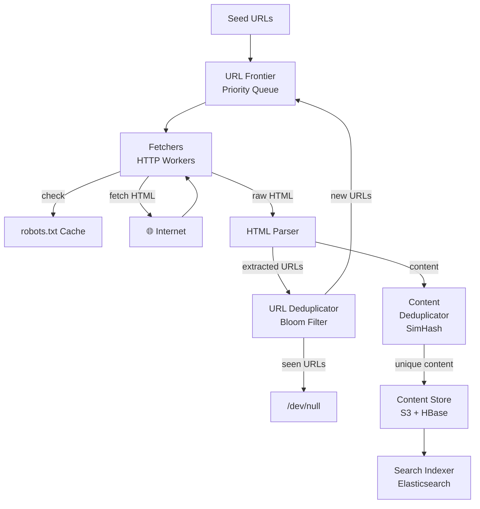
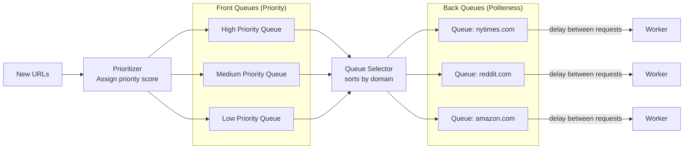
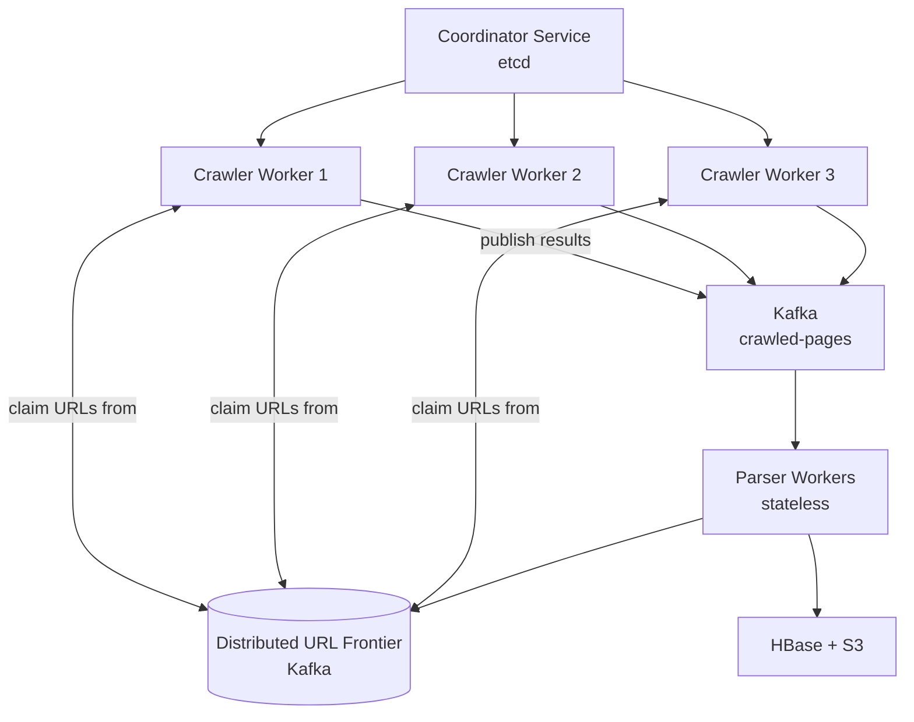

# SD08 — Web Crawler

> [!tip] Interview Strategy
> Focus on: **URL frontier** (politeness + priority), **deduplication** (Bloom filter for URLs), **distributed architecture**, and handling edge cases (robot.txt, redirects, malicious pages). This is more about system design than data structures.

---

## Requirements Clarification

### Functional Requirements
- [ ] Crawl 1 billion web pages in 1 month
- [ ] Store crawled HTML content
- [ ] Extract and follow links
- [ ] Handle robots.txt (politeness)
- [ ] Avoid crawling the same URL twice
- [ ] Handle redirects (301, 302)
- [ ] Prioritize important pages

### Non-Functional Requirements
- [ ] Scale: 1B pages in 4 weeks
- [ ] Distributed: can't do this on one machine
- [ ] Robust: handles malformed HTML, infinite redirect loops, large files

---

## Capacity Estimation

```
1B pages / 4 weeks = 1B / (4 × 7 × 24 × 3600) ≈ 400 pages/sec

Average page size: 100 KB (HTML + some JS/CSS)
Storage: 1B × 100 KB = 100 TB

Links per page: ~10 links → 10B URLs discovered but only 1B unique
URL deduplication: crucial (most links point to already-crawled pages)
```

---

## High-Level Architecture



---

## URL Frontier (Priority Queue)

The URL Frontier manages which URLs to crawl next.

### Two Queues Architecture



**Front queues (Priority):** Determine order of crawling based on:
- Page rank / importance
- Freshness (how often page changes)
- Business priority (news sites > obscure blogs)

**Back queues (Politeness):** One queue per domain. Ensure min 1-5 seconds between requests to the same domain (respects server load and robots.txt crawl-delay).

---

## URL Deduplication

**Problem:** 10B discovered URLs → most already seen or duplicates

### Bloom Filter (Primary)
```
Store all seen URLs in Bloom filter
  10B URLs × 10 bits/URL = 100 Gb = 12.5 GB
  False positive rate ~1% (occasionally skip a valid URL)
  False negatives: NEVER (never recrawl what we've seen)
  
Check: "Have we seen this URL?"
  → Bloom filter: "Definitely NO" → add to frontier
  → Bloom filter: "Probably YES" → skip (may be false positive, acceptable)
```

→ See [[19 - Bloom Filters]] for implementation

### Persistent URL Store
For exact deduplication (no false positives):
```
After Bloom filter says "probably seen":
  → Check URL in HBase (exact match) → definitely seen? skip.
  → Not found? → false positive from Bloom filter → crawl

Trade-off: Bloom filter handles 99% of cases with O(1) and 12.5GB RAM
HBase handles the 1% false positives with DB lookup
```

---

## robots.txt Handling

```
robots.txt is fetched once per domain and cached:
  Cache: robots_txt:{domain} → parsed rules
  TTL: 24 hours (re-fetch daily in case rules change)

Before crawling http://example.com/page:
  1. Check cache for robots_txt:example.com
  2. If not cached: fetch http://example.com/robots.txt first
  3. Parse: check if /page matches any Disallow rules
  4. If disallowed: skip URL
  5. Check Crawl-delay directive: respect minimum interval

User-Agent: Googlebot
Disallow: /private/
Crawl-delay: 10  # Wait 10 seconds between requests
```

---

## HTML Parsing and Link Extraction

```python
# BeautifulSoup or custom SAX parser
from bs4 import BeautifulSoup

def extract_links(html, base_url):
    soup = BeautifulSoup(html, 'lxml')
    links = set()
    for tag in soup.find_all('a', href=True):
        url = urljoin(base_url, tag['href'])  # handle relative URLs
        url = normalize_url(url)               # lowercase, remove fragments, etc.
        if is_valid_url(url):
            links.add(url)
    return links

def normalize_url(url):
    parsed = urlparse(url)
    # Sort query params, remove fragments, lowercase host
    query = urlencode(sorted(parse_qsl(parsed.query)))
    return urlunparse((parsed.scheme, parsed.netloc.lower(), parsed.path, '', query, ''))
```

---

## Content Deduplication (SimHash)

Many pages have same content (mirrors, syndicated content). Avoid storing duplicates.

```
SimHash: A locality-sensitive hash that produces similar hashes for similar documents

Algorithm:
  1. Tokenize document into shingles (3-word windows)
  2. Hash each shingle
  3. Weighted sum of hash bits
  4. If weighted sum > 0: bit = 1, else bit = 0
  5. 64-bit SimHash fingerprint

Two documents with SimHash differing by ≤ 3 bits → likely duplicates (Hamming distance)

Store: SimHash index in HBase
Check new page's SimHash against existing: near-duplicate? don't store
```

---

## Distributed Architecture



**URL partitioning:** Each worker is responsible for specific URL ranges (by domain hash) → ensures politeness (one worker per domain).

---

## Tricky Edge Cases

### Infinite Redirect Loops
```
HTTP 301: A → B → C → A → B → C...
Solution: Track redirect chain per URL fetch; limit to 5 redirects; detect cycle
```

### Large Files / Spider Traps
```
Infinite URL generation:
  https://calendar.example.com/2024/01/01
  https://calendar.example.com/2024/01/02
  ...all dates forever

Solution:
  Max URL length limit (2048 chars)
  Max pages per domain (e.g., 1000 pages)
  URL canonicalization to detect patterns
  Detect and break cycles
```

### Dynamic Content (JavaScript-rendered pages)
```
Problem: React/Vue/Angular pages show empty HTML without JS execution
Solution: Headless Chrome (Puppeteer) for JS-rendered pages
  But expensive: 10x slower than simple HTTP fetch
  Apply selectively: only to important domains or pages without server-side rendering
```

---

## Interview Checklist

- [ ] Explain URL Frontier with priority (front queues) + politeness (back queues)
- [ ] Explain Bloom filter for URL deduplication (size and trade-offs)
- [ ] Explain robots.txt handling and crawl-delay
- [ ] Explain HTML parsing + URL normalization
- [ ] Explain SimHash for content deduplication
- [ ] Draw distributed architecture (workers + Kafka frontier)
- [ ] Handle edge cases: redirect loops, spider traps, JS-rendered pages

---

## Related Notes

- [[19 - Bloom Filters]] — URL deduplication mechanism
- [[08 - Message Queues]] — Kafka for distributed URL frontier
- [[11 - SQL vs NoSQL]] — HBase for content storage
