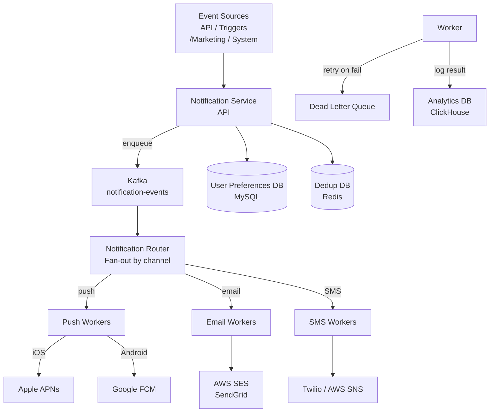

# SD09 — Notification System

---

## Requirements

### Functional
- [ ] Support: push (iOS/Android), email, SMS
- [ ] Send notifications reliably (no lost notifications)
- [ ] No duplicate notifications
- [ ] User notification preferences (opt-out, quiet hours)
- [ ] Analytics (delivery rate, open rate)

### Non-Functional
- [ ] 10M notifications/day (peak: 1M/hour)
- [ ] High availability
- [ ] Eventual delivery (retry on failure)

---

## Architecture



---

## Key Components

### 1. User Preference Management
```sql
CREATE TABLE notification_preferences (
    user_id         BIGINT PRIMARY KEY,
    push_enabled    BOOLEAN DEFAULT TRUE,
    email_enabled   BOOLEAN DEFAULT TRUE,
    sms_enabled     BOOLEAN DEFAULT FALSE,
    quiet_hours_start TIME,      -- e.g., 22:00
    quiet_hours_end   TIME,      -- e.g., 08:00
    timezone        VARCHAR(50)
);

CREATE TABLE notification_subscriptions (
    user_id     BIGINT,
    event_type  VARCHAR(50),     -- e.g., 'new_message', 'promo'
    channel     ENUM('push','email','sms'),
    enabled     BOOLEAN DEFAULT TRUE,
    PRIMARY KEY (user_id, event_type, channel)
);
```

### 2. Deduplication
```
Problem: Retry logic can cause duplicate sends

Solution: Idempotency key per notification
  Key: {user_id}:{event_type}:{event_id}
  
Redis: SET dedup:{user_id}:{event_id} "sent" NX EX 86400
  NX = only set if Not eXists
  EX 86400 = expire after 24h
  
If key already exists → notification already sent → skip
```

### 3. Throttling
```
Rate limit per user: max 10 notifications/hour for same type
  → Prevents spam from buggy event sources
  
Rate limit per channel:
  APNs: limited throughput per certificate
  Twilio: SMS rate limits per number
  
Implementation: Token bucket in Redis per {user_id}:{channel}
```

### 4. Priority Queues
```
Critical (OTP, security alerts): immediate, bypass throttling
High (transaction confirmations): within 30 seconds
Normal (social notifications): within 5 minutes
Low (marketing, promotional): within 1 hour (or batch)
```

### 5. Retry with DLQ
```
Worker pulls notification from Kafka
Tries to send via APNs/FCM/SES/Twilio
On failure:
  → Retry with exponential backoff (3 attempts: 1s, 5s, 30s)
  → After 3 failures: move to Dead Letter Queue
  → DLQ consumer: alert on-call, manual investigation

Transient failures (network): retry
Permanent failures (invalid token, unsubscribed): don't retry, update DB
```

---

## Channel-Specific Handling

### iOS Push (APNs)
```
Device token: unique per device, changes if app reinstalled
Store in DB: CREATE TABLE device_tokens (user_id, token, platform, updated_at)

APNs responses:
  Success: notification delivered to device
  BadDeviceToken: remove from DB (user uninstalled app)
  Throttled: back off and retry
  
APNs limits: up to 4096 bytes payload; rich notifications (images, actions)
```

### Android Push (FCM)
```
Registration token (like APNs device token)
FCM responses:
  Success: delivered
  InvalidRegistration: remove token
  NotRegistered: remove token (app uninstalled)
  
FCM supports: up to 4KB payload, data messages, notification messages
```

### Email (SES/SendGrid)
```
Rate limits: SES default 14/sec per account (soft limit, can increase)
Deliverability:
  → Domain verification (DKIM, SPF, DMARC)
  → Reputation management (bounce rate, spam rate)
  → Unsubscribe link (required by CAN-SPAM)

Track:
  Delivery: SES webhook → our service
  Open: tracking pixel (1px image)
  Click: link rewrite through our redirect service
```

---

## Analytics

```
Every notification send attempt → event to Kafka:
  {notification_id, user_id, channel, status, timestamp}

Flink/Spark aggregation:
  Delivery rate per channel, per notification type
  Open rate, click rate (email/push)
  Unsubscribe rate (trigger to review content)
  
Stored in ClickHouse for fast analytics queries
```

---

## Interview Checklist

- [ ] Three channels: push, email, SMS with provider specifics (APNs, FCM, SES, Twilio)
- [ ] Idempotency/deduplication with Redis NX
- [ ] User preferences: opt-out, quiet hours, per-event-type settings
- [ ] Priority queues for different notification urgency
- [ ] Retry + DLQ for failed deliveries
- [ ] Token management (device token refresh/removal)
- [ ] Analytics pipeline for delivery/open/click rates

---

## Related Notes

- [[08 - Message Queues]] — Kafka for notification queuing
- [[07 - Caching]] — Redis for deduplication and throttling
- [[18 - Rate Limiting]] — throttling notification delivery
- [[SD02 - Chat System (WhatsApp)]] — push notifications for offline users
