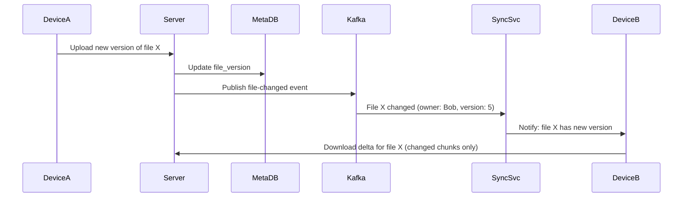

# SD10 — Google Drive (File Storage & Sync)

> [!tip] Interview Strategy
> The hardest parts: **file chunking** for efficient sync (only sync changed chunks), **conflict resolution** for concurrent edits, and **delta sync** for large files. Also cover the separation between metadata service and blob storage.

---

## Requirements

### Functional
- [ ] Upload and download files
- [ ] File sync across multiple devices
- [ ] File sharing (permissions: view/edit)
- [ ] Version history
- [ ] Folder structure

### Non-Functional
- [ ] 1B users, 500M DAU
- [ ] Each user: 15 GB free storage
- [ ] Max file size: 5 TB (Google Drive limit)
- [ ] High availability + durability (data must never be lost)

---

## Capacity Estimation

```
Storage:
  1B users × 15 GB average usage = 15 EB total storage
  (Real usage ≈ 30% of allocated → ~4.5 EB actual)
  
Metadata (file names, paths, versions):
  Per file: ~1 KB metadata
  Per user: ~10,000 files → 10 MB metadata
  1B users: 10 PB metadata

Upload QPS: 
  500M DAU × 2 uploads/day = 1B uploads/day = ~12,000/sec
```

---

## File Chunking

**Key insight:** Instead of uploading the entire file on every change, split files into chunks. Only upload changed chunks.

```
File: large_document.docx (500 MB)
Split into 4 MB chunks:
  Chunk 0: bytes 0-4MB       hash: sha256("abc123...")
  Chunk 1: bytes 4-8MB       hash: sha256("def456...")
  Chunk 2: bytes 8-12MB      hash: sha256("ghi789...")
  ...
  Chunk 124: bytes 496-500MB hash: sha256("xyz000...")

User edits section in chunk 3:
  Only chunk 3 hash changes!
  Upload: just chunk 3 (4 MB instead of 500 MB)
  → 99.2% bandwidth saved!
```

### Chunk Size Trade-offs

| Chunk Size | Pros | Cons |
|-----------|------|------|
| Small (256 KB) | More granular sync; less wasted upload on change | More metadata, more API calls |
| Medium (4 MB) | Good balance | Standard choice |
| Large (16 MB) | Fewer metadata records | Large wasted upload on edit |

**Google uses 256 KB chunks.** Dropbox uses 4 MB chunks.

---

## System Architecture

```mermaid
graph TB
    Client[Client App\nDesktop/Mobile] --> LB[Load Balancer]
    
    LB --> API[API Server\n(metadata operations)]
    LB --> BlockSvc[Block Service\n(chunk upload/download)]
    
    API --> MetaDB[(Metadata DB\nMySQL)]
    API --> Cache[(Redis\nFile tree cache)]
    
    BlockSvc -->|chunked upload| S3[Block Store\nS3 / GCS]
    BlockSvc --> ChunkDB[(Chunk DB\nHBase\nChunk hash → S3 key)]
    
    MetaDB --> Sync[Sync Service\nlong-polling / WebSocket]
    Sync --> Client
    
    API --> Kafka[Kafka\nfile-change-events]
    Kafka --> NotifSvc[Notification Service\nsync other devices]
```

---

## Metadata Service

```sql
-- Files and folders
CREATE TABLE files (
    file_id     BIGINT PRIMARY KEY,
    parent_id   BIGINT,                -- folder (NULL for root)
    owner_id    BIGINT NOT NULL,
    name        VARCHAR(255),
    size        BIGINT,
    mime_type   VARCHAR(100),
    is_dir      BOOLEAN DEFAULT FALSE,
    current_version BIGINT,            -- FK to file_versions
    created_at  DATETIME,
    updated_at  DATETIME,
    
    INDEX idx_parent (parent_id, name),  -- list folder contents
    INDEX idx_owner (owner_id)           -- list my files
);

-- Version history
CREATE TABLE file_versions (
    version_id  BIGINT PRIMARY KEY,
    file_id     BIGINT NOT NULL,
    version_num INT,
    chunk_ids   JSON,           -- ordered list of chunk IDs
    size        BIGINT,
    checksum    VARCHAR(64),    -- sha256 of whole file
    created_at  DATETIME,
    created_by  BIGINT,        -- user who made this version
    
    INDEX idx_file_versions (file_id, version_num DESC)
);

-- Chunk registry
CREATE TABLE chunks (
    chunk_id    VARCHAR(64) PRIMARY KEY,  -- sha256 of chunk content
    s3_key      VARCHAR(512),              -- location in S3
    size        BIGINT,
    ref_count   INT DEFAULT 0             -- deduplication: how many files use this chunk
);
```

### Deduplication at Chunk Level
```
Two users upload identical files (e.g., same PDF):
  Chunk hash of chunk 0: sha256(...) = "abc123"
  
  User A: stores chunk with hash "abc123" → stored once
  User B: uploads chunk with same content → hash "abc123"
         → Already in chunk DB! → ref_count++, no second copy stored
         → User B's file_version points to same chunk

This is how Google Drive stores petabytes less data than you'd expect.
```

---

## Delta Sync Algorithm

When a file changes, compute and upload only the diff:

```
Client-side algorithm:
1. Compute chunk hashes for NEW version of file
2. Fetch current chunk list from server
3. Compare: which chunks changed?
4. Upload only changed chunks
5. Update file_version with new chunk list

Example:
  Old: [chunk0_hash, chunk1_hash, chunk2_hash]
  New: [chunk0_hash, NEW_chunk1_hash, chunk2_hash]
  
  Upload: only NEW_chunk1 (rest are already on server)
  Update metadata: version 2 = [chunk0_hash, NEW_chunk1_hash, chunk2_hash]
```

---

## Conflict Resolution

When two users (or two devices) edit the same file simultaneously:

```
Device A: Starts with version V1, makes changes → creates V2
Device B: Starts with version V1, makes changes → creates V2' (conflict!)

Server receives V2 and V2' both claiming to succeed V1

Strategy 1: Last-Write-Wins
  Whoever's V2 arrives last wins; other loses changes
  Simple but loses work

Strategy 2: Fork-on-Conflict (Google Docs approach for binary files)
  Create two separate files:
    "document.docx" (winner)
    "document (Device B's copy).docx" (loser)
  User manually merges
  
Strategy 3: Operational Transformation (OT) / CRDT (for text/docs)
  Google Docs uses OT to merge concurrent edits without conflict
  Works for structured text; not applicable to binary files
```

---

## File Sharing

```sql
CREATE TABLE file_permissions (
    file_id         BIGINT,
    user_id         BIGINT,       -- NULL for public link
    permission      ENUM('view', 'comment', 'edit'),
    link_token      VARCHAR(64),  -- for shareable link
    expires_at      DATETIME,
    
    PRIMARY KEY (file_id, user_id)
);

-- Shareable link:
-- https://drive.google.com/file/d/{file_id}?token={link_token}
-- Check: is link_token valid and not expired?
```

---

## Sync Across Devices



**Notification mechanism:**
- Desktop client: WebSocket connection or long-polling to sync service
- Mobile client: Push notification (FCM/APNs) → wake app → sync

---

## Interview Checklist

- [ ] Explain file chunking and why (delta sync, partial upload)
- [ ] Chunk-level deduplication (sha256 as chunk ID)
- [ ] Database schema: files, file_versions, chunks tables
- [ ] Delta sync: upload only changed chunks
- [ ] Conflict resolution strategies (fork on conflict for binary files)
- [ ] File sharing with permissions table and shareable links
- [ ] Sync across devices: Kafka → sync service → WebSocket to device

---

## Related Notes

- [[11 - SQL vs NoSQL]] — MySQL for metadata, S3 for blobs
- [[08 - Message Queues]] — Kafka for sync events
- [[07 - Caching]] — Redis for file tree caching
