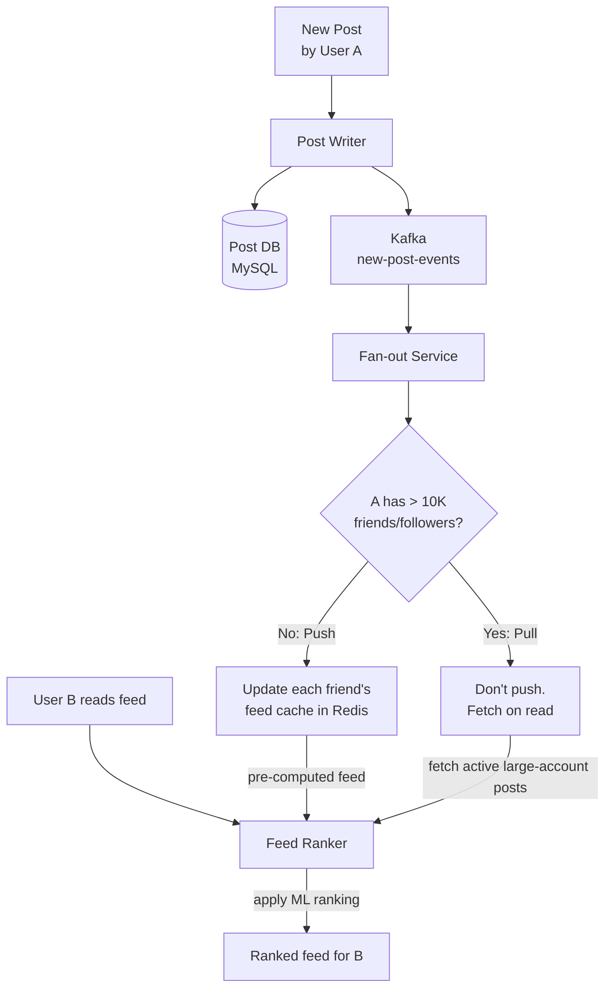
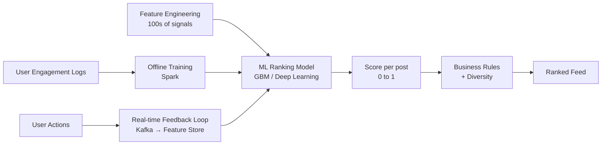
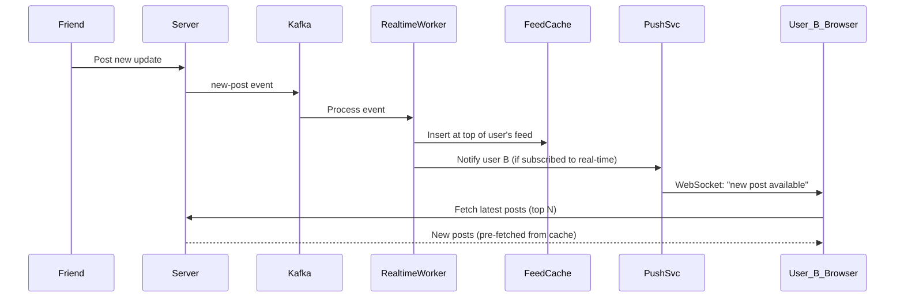

# SD11 — News Feed (Facebook)

> [!tip] Interview Strategy
> Facebook's News Feed is the canonical fan-out problem. Go beyond just "fan-out on write vs read" — discuss **feed ranking** (ML model), **real-time updates**, and the **hybrid celebrity approach** in depth. Most candidates skip ranking.

---

## Requirements

### Functional
- [ ] User sees a personalized ranked feed of posts from friends + pages they follow
- [ ] Feed updates in real-time (new posts appear without refresh)
- [ ] Supports: text, photos, videos, links, reactions
- [ ] Feed is ranked (not just reverse chronological)

### Non-Functional
- [ ] 3B users, 1B DAU
- [ ] Feed loads in < 300ms
- [ ] Highly available
- [ ] Personalized ranking (different for each user)

---

## Feed Generation: The Fan-Out Problem

See [[SD05 - Twitter]] for detailed comparison. Facebook uses hybrid approach:



---

## Feed Ranking (The Differentiator)

Raw feed (chronological) is replaced by ML-ranked feed. This is what separates Facebook from older social networks.

### Ranking Signals
```
Engagement signals:
  - Historical CTR on this content type
  - Predicted like/comment/share probability
  - Reactions velocity (how fast engagement accumulating)
  - Watch time (for videos)
  - Reshare likelihood

Content signals:
  - Post freshness (recency)
  - Content type (video > photo > link > text typically)
  - Post completeness
  - Author reputation

User signals:
  - Relationship strength with author (close friend vs acquaintance)
  - Interaction history with this author
  - User's current context (time of day, device type)
  - User's current "mood" (implicit from recent activity)

Negative signals:
  - User hides/unfollows similar content
  - Low engagement despite high reach (indicates low quality)
```

### ML Pipeline



**Two-stage ranking:**
1. **Candidate generation** (~1000 posts): fast retrieval from feed cache + friends' posts
2. **Ranking** (~1000 posts → top 20): full ML model with all signals (slower but higher quality)
3. **Re-ranking**: diversity, policy enforcement (no spam, NSFW)

---

## Real-time Feed Updates



**Infinite scroll with pagination:**
```
First load: ZREVRANGE feed:userB 0 19  (top 20 posts)
Scroll more: ZREVRANGE feed:userB 20 39 (next 20)
Pull to refresh: new posts prepended to top of cache
```

---

## Post Storage

### Multi-table by content type
```sql
-- Base post table
CREATE TABLE posts (
    post_id     BIGINT PRIMARY KEY,  -- Snowflake ID
    user_id     BIGINT NOT NULL,
    post_type   ENUM('text', 'photo', 'video', 'link', 'event'),
    visibility  ENUM('public', 'friends', 'close_friends', 'private'),
    content     TEXT,
    created_at  DATETIME,
    
    -- Denormalized counters (fast reads)
    like_count      INT DEFAULT 0,
    comment_count   INT DEFAULT 0,
    share_count     INT DEFAULT 0,
    
    INDEX idx_user_time (user_id, post_id DESC)
);

-- Photo attachment
CREATE TABLE post_photos (
    post_id     BIGINT,
    photo_order INT,
    cdn_url     VARCHAR(512),
    width, height INT,
    PRIMARY KEY (post_id, photo_order)
);
```

### Counters at Scale
```
100M likes on a viral post → 100M writes to like_count
→ Same hot-row contention as Twitter

Solution:
  → Redis INCR post:{id}:likes  (atomic, no locking)
  → Background job: flush Redis counters to MySQL every 30 seconds
  → Read: always from Redis (fresh) with MySQL as backup/truth
  
For display: "1.2M likes" (exact count not needed, approximate OK)
```

---

## Privacy and Visibility

```
Before adding a post to someone's feed:
  Check: Is the post visible to this user?
  
  - Public: everyone sees it
  - Friends: is the viewer a friend?
  - Close friends: is the viewer in close_friends list?
  - Custom: check audience_list for this post
  - Excluded: check excluded_users for this post

This check runs at fan-out time (not at read time — too slow at 1B users)
Fan-out service skips users who don't have permission
```

---

## Graph Storage

Facebook's friend graph at 3B users:

```
Friends table: (user_id, friend_id) → 200B+ rows at Facebook scale
Can't use MySQL alone → use a combination:
  - MySQL for persistence
  - Tao (Facebook's TAO): in-memory graph cache
  - Custom graph DB optimized for social graph traversal

TAO: Association list stores (user_id → [friend_ids])
  Each user ID hashed to a shard
  All friend data for a user on same shard = fast fan-out lookup
```

---

## Interview Checklist

- [ ] Explain hybrid fan-out (push for normal users, pull for popular users)
- [ ] Explain ranked feed vs chronological — mention ML signals
- [ ] Describe two-stage ranking: candidate generation → ML scoring
- [ ] Real-time updates via WebSocket + Kafka
- [ ] Post counter design with Redis INCR + async flush
- [ ] Privacy/visibility check during fan-out
- [ ] Graph storage at scale (TAO concept)

---

## Related Notes

- [[SD05 - Twitter]] — comparison: Twitter uses similar hybrid approach
- [[SD03 - Instagram]] — Instagram feed design
- [[07 - Caching]] — Redis for feed cache and counters
- [[08 - Message Queues]] — Kafka for fan-out and real-time events
