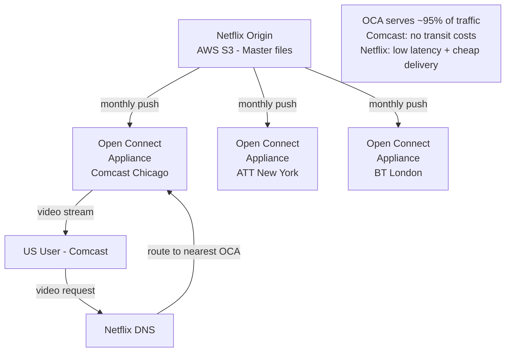
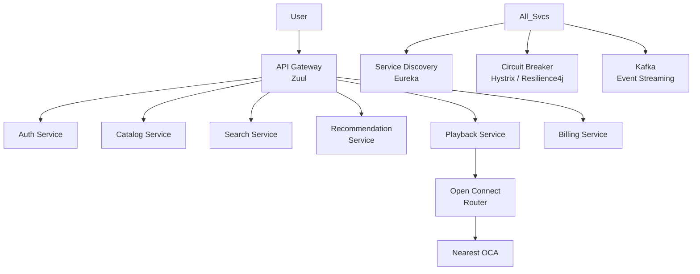

# SD12 — Netflix (Video Streaming)

> [!tip] Interview Strategy
> What makes Netflix unique: **Open Connect** (custom CDN inside ISPs), **massive transcoding pipeline**, and **recommendation system**. If you're interviewing at Netflix, knowing Open Connect is a must.

---

## Requirements

### Functional
- [ ] Browse and search catalog (10K+ titles)
- [ ] Stream video with adaptive quality
- [ ] Personalized recommendations
- [ ] Continue watching from where you left off
- [ ] Multiple profiles per account

### Non-Functional
- [ ] 300M subscribers, 100M concurrent streams at peak
- [ ] < 3 seconds to start playback
- [ ] Global availability, low latency worldwide
- [ ] 4K streaming, HDR

---

## What Makes Netflix Different From YouTube

| Aspect | YouTube | Netflix |
|--------|---------|---------|
| Content | User-generated (millions of creators) | Licensed/original (thousands of titles) |
| File size | Small-medium | Very large (4K: 50-100 GB per movie) |
| CDN | Google CDN | Custom CDN (Open Connect) inside ISPs |
| Pre-caching | Based on view velocity | Nightly push of entire catalog to ISPs |
| Personalization | Recommendations within search | Primary discovery mechanism |

---

## Open Connect CDN (Netflix's Secret Weapon)

Netflix built their own CDN to solve bandwidth costs and latency:



### How Open Connect Works

1. **Placement**: Netflix places custom server appliances (OCAs) inside ISP data centers globally (1000+ locations)
2. **Nightly push**: Netflix pushes that day's expected popular content to nearby OCAs before peak hours (machine learning predicts regional demand)
3. **ISP benefits**: ISPs get free hardware + significant reduction in transit bandwidth costs (Netflix traffic stays inside ISP network)
4. **Netflix benefits**: Ultra-low latency (user is in same ISP network as OCA), massive bandwidth savings, no transit fees

> [!tip] Key Interview Point
> This is different from a normal CDN! Netflix employees call this **proactive caching** vs reactive caching. They pre-push content rather than caching on first request. ~95% of Netflix traffic is served from OCAs.

---

## Content Ingest & Encoding Pipeline

Netflix receives studio master files (uncompressed, terabytes per title):

```mermaid
graph LR
    Studio[Studio\nMaster File\n50-100 TB uncompressed] --> S3[AWS S3\nRaw storage]
    S3 --> Kafka[Kafka\nencoding-jobs]
    Kafka --> Workers[EC2 Encoding Workers\n100s of instances]
    
    Workers -->|Video encode| VP9[VP9 / H.265 / AV1\n2160p, 1080p, 720p...] 
    Workers -->|Audio encode| Audio[AAC, Dolby Atmos\nmultiple languages]
    Workers -->|Subtitle| Sub[WebVTT subtitles\n30+ languages]
    
    VP9 --> S3_Out[S3 Encoded\n+ Chunked\n(HLS/DASH)]
    S3_Out --> OCAs[Push to OCAs]
    
    QA[Quality Assurance\nVMAF score] --> Workers
```

**Per-title encoding variants:**
```
4K HDR:    ~50 Mbps
1080p HDR: ~20 Mbps
1080p:     ~8 Mbps
720p:      ~4 Mbps
480p:      ~2 Mbps
360p:      ~0.8 Mbps
Audio:     128 Kbps to Atmos
```

**Netflix's innovation: Per-title encoding**
Traditional: same bitrate ladder for all content
Netflix: ML analyzes each title's complexity → action movies need more bitrate, static cartoons need less → saves ~20% storage/bandwidth

---

## Adaptive Bitrate Streaming

```
Client downloads manifest file (MPD or m3u8):
  Available tracks at different qualities + audio languages
  
Every 2 seconds:
  Client measures: downloaded segment size / time = current bandwidth
  Computes: buffer health (how many seconds of video buffered)
  Decision algorithm:
    if buffer < 5s: switch to lower quality
    if buffer > 20s + bandwidth high: switch to higher quality
    Target: maintain ~30 second buffer
```

**Netflix's player (custom built):**
- Uses DASH (Dynamic Adaptive Streaming over HTTP) for most devices
- HLS for Apple devices (Safari, iOS)
- Custom ML-based ABR algorithm (BOLA, Pensieve) for better quality decisions

---

## Microservices Architecture



**Netflix OSS (Open Source):**
- **Eureka**: Service discovery
- **Ribbon**: Client-side load balancing
- **Hystrix**: Circuit breaker (now Resilience4j)
- **Zuul**: API Gateway
- **Chaos Monkey**: Randomly kills production instances (tests resilience)

---

## Recommendation System

Netflix's recommendation drives 80% of content watched:

```mermaid
graph LR
    Events[User Events\nwatch, like, search\nKafka] --> FS[Feature Store\nCassandra]
    FS --> Models[ML Models]
    
    Models --> CF[Collaborative Filtering\n"Users like you watched..."]
    Models --> CB[Content-Based\n"You liked Stranger Things,\ntry Dark (similar)"]
    Models --> DL[Deep Learning\nEmbeddings for users + titles]
    
    CF --> Ensemble[Ensemble + Personalization]
    CB --> Ensemble
    DL --> Ensemble
    
    Ensemble --> Cache[(Redis\nPersonalized ranks\nper user per row)]
    
    User --> API[API] --> Cache --> Response[Ranked catalog\nfor this user]
```

**Netflix personalizes everything:**
- Not just which titles shown, but ORDER of titles per row
- Even **thumbnail art** is personalized: action fans see action thumbnails, romance fans see character thumbnails of the same movie

---

## Catalog Service

```
Content metadata:
  {movie_id, title, description, cast, director, genres, runtime, maturity_rating, 
   languages, subtitles, release_year, available_regions}

PostgreSQL + Cassandra:
  Postgres for metadata (structured, relational queries)
  Cassandra for availability per region (high write/read of region access rules)

Elasticsearch for search:
  Full-text search on title, description, cast
  Autocomplete with Trie approach → [[SD07 - Search Autocomplete]]
```

---

## Interview Checklist

- [ ] Explain Open Connect (custom CDN inside ISPs, proactive caching)
- [ ] Explain per-title encoding optimization (not fixed bitrate ladder)
- [ ] Explain adaptive bitrate streaming (DASH/HLS, 2-second segments)
- [ ] Describe microservices architecture with Eureka, Hystrix
- [ ] Describe recommendation system (collaborative + content-based + DL)
- [ ] Mention Chaos Monkey (Netflix's resilience testing philosophy)
- [ ] Mention playback location determination (nearest OCA routing)

---

## Related Notes

- [[09 - CDN]] — CDN concepts; Open Connect is a custom CDN
- [[SD04 - YouTube]] — similar transcoding pipeline
- [[04 - Availability & Reliability]] — Circuit breaker, Chaos Monkey
- [[07 - Caching]] — Redis for personalized recommendation caching
